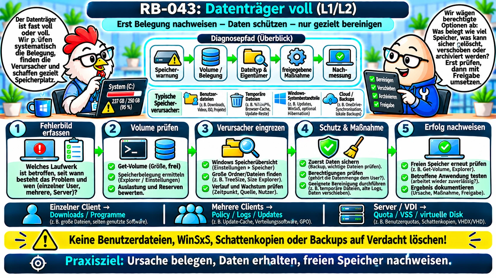

# RB-043 – Datenträger voll (L1/L2)

**Projekt:** 50 Tickets – 50 typische IT-Supportfälle  
**Stand:** 22.11.2026 · **Version:** 1.0 · **Plattform:** Windows 11, ergänzend Windows Server und VDI  
**Status:** Recherchierte und theoretisch nachvollzogene Fallanalyse; **keine praktische Validierung**. Alle Beispiele, Speicherwerte, Geräte und Namen sind **fiktiv**.



## 1. Störungsbild, Lernziel und Abgrenzung

**Muster-Ticket:** „Auf meinem Windows-PC ist Laufwerk C: rot. Outlook kann Dateien nicht mehr speichern und Windows Update meldet zu wenig Speicherplatz.“  
**Ziel:** Speicherengpass reproduzierbar messen, dessen **tatsächliche Ursache** eingrenzen, die **kleinste zulässige Maßnahme** auswählen und Erfolg sowohl technisch als auch aus Anwendersicht bestätigen.

Dieses Ticket ist kein pauschaler „Aufräumauftrag“. Große Dateien können legitime Arbeitsunterlagen, Wiederherstellungsdaten oder Bestandteile des Betriebssystems sein. Änderungen, die vermeintlich Gigabytes freigeben, können Datenverlust, Ausfall einer Sicherung oder fehlende Rollbackfähigkeit bewirken.

**Abgrenzung:** RB-007 (PC langsam), RB-016 (OneDrive), RB-027 (Windows Update), RB-042 (Benutzerprofil), RB-044 (BitLocker) können Folgeprobleme mitbringen. Hier liegt der Fokus auf **Kapazität, Belegungsquelle und datenschonender Entscheidung**.

## 2. Technikgrundlagen: Datenträger, Volume, freier Platz und Quota

- **Physischer Datenträger:** SSD/HDD mit bestimmter nutzbarer Kapazität, möglicherweise mit mehreren Partitionen.
- **Partition und Volume:** Logische Speicherbereiche; Windows-Laufwerksbuchstaben sind Zuordnungen zu Volumes, nicht zwangsläufig zu einer ganzen SSD.
- **Freie Kapazität:** Für das jeweilige Volume verfügbarer Platz. Prozentwerte müssen stets mit **absoluten GiB** und dem benötigten freien Platz verglichen werden.
- **Quota:** Eine benutzer- oder containerspezifische Grenze kann bereits erreicht sein, obwohl das übergeordnete Volume noch freien Platz hat.
- **Reservierte Nutzung:** Systemdateien, Auslagerungsdatei, Ruhezustandsdatei, Wiederherstellung, Schattenkopien, Update-Komponentenspeicher sowie Anwendungen können legitimen Platz belegen.
- **Logische Dateigröße vs. physisch belegter Platz:** Kompression, Sparse-Dateien, Hardlinks und Clusterbelegung können dafür sorgen, dass Verzeichnisgrößen und belegte Bytes voneinander abweichen.

**Fachlicher Merksatz:** „Volume voll“ beschreibt die beobachtete **Kapazitätssituation**; „Benutzerdaten zu groß“ ist nur eine von mehreren möglichen Ursachen.

## 3. Fehlerbilder unterscheiden – nicht jedes „Speicher voll“ ist gleich

| Befund | Mögliche Ursache | Nächster Prüfpunkt |
|---|---|---|
| `C:` nahezu voll | Downloads, Anwendungscaches, Windows-Daten, Wiederherstellungsdaten | Volumes und Windows-Speicherübersicht |
| Datei lässt sich auf Netzlaufwerk nicht speichern | Freigabe-/Serverquota, NAS/Server-Volume voll, Berechtigungen | Zielsystem und Quota, nicht nur lokales `C:` |
| VDI-Profil meldet „nicht genügend Speicher“ | FSLogix/VHDX-Container, Quota, Host-/Share-Kapazität | Container- und Hoststorage; nicht blind lokalen Cache löschen |
| Windows Update scheitert | Temporär fehlende Kapazität für Download/Installation/Rollback | Konkretes Update und benötigte Reserve ermitteln |
| Volumebelegung steigt stetig | Logwachstum, Backup-/Sync-Schleife, Anwendungen, ungewöhnliche Prozesse | Trend, Besitzer und Erzeuger dokumentieren |
| Anzeige widersprüchlich | Shadowstorage, Reservierungen, Dateisystemfehler, Hardlinks | VSS-/Komponentenspeicher-Analyse, Systemereignisse |

**Schweregrad:** Datenverlustgefahr, ausgefallene Geschäftsanwendung oder produktives Servervolume priorisieren; nicht allein aufgrund einer roten Leiste einen kritischen Incident behaupten.

## 4. Ticketaufnahme und Baseline

Erfasse **bevor irgendetwas verändert wird**:

1. Betroffener Rechner, Volume/Buchstabe/UNC-Pfad und exakte Meldung, Zeitpunkt und seit wann der Platz knapp wird.
2. Einzelbenutzer oder mehrere? Windows-PC, Server, VDI/FSLogix, Hyper-V-Host oder Netzfreigabe?
3. Gesamtvolumen, freier Platz (GiB und %), jüngste Veränderungen und beobachtete Probleme mit Anwendungen/Updates.
4. Speicherort der betroffenen Dokumente, Datenbesitzer, Backup-/Retentionstatus und bestehende Richtlinien.
5. Remotezugriff und Rückfallplan: Auch Diagnoseprogramme können ein fast volles Volume mit Logs oder Reports weiter belasten.

**Schreibziel:** Ausgangszustand wie „C: 238 GiB gesamt, 3,1 GiB frei um 14:00 Uhr“ plus Quelle der Messung, statt „Festplatte ziemlich voll“.

## 5. Sicherheitsgate: Erst Eigentümer, Backup und Betriebsfolgen

**Nicht auf Verdacht löschen:** Benutzerprofile und Downloads, `C:\Windows`, `C:\Windows\WinSxS`, `C:\Windows\Installer`, ProgramData, Backup-Repositories, Wiederherstellungspunkte/Schattenkopien, `pagefile.sys`, `hiberfil.sys`, VHD/VHDX, Datenbankdateien oder produktive Logs.

- Kläre **Aufbewahrungsfristen, Legal Hold, Datenschutz, Backup und Datenbesitz**; Administratorrechte sind **keine** pauschale Löschfreigabe.
- Automatische Speicheroptimierung kann je nach Einstellungen **Papierkorb, Downloads und lokale Cloud-Dateien** einbeziehen. Einstellungen vor dem Start prüfen.
- Eine OneDrive-Datei „Speicherplatz freigeben“ nur nach Sync-Status, Offlinebedarf und Richtlinien prüfen; **nicht** mit dem **Löschen** des Cloudobjekts verwechseln.
- Vor Änderungen an produktiven Servern/VMs: Auswirkungen auf laufende Dienste, Quotas, Sicherungen und Wartungsfenster klären.
- **Nie** ein Volume nur deshalb bis auf 0 freie Bytes füllen, um ein Problem zu simulieren.

## 6. Diagnose A – Volumes und freien Platz lesend messen

Die folgenden PowerShell-Befehle **ändern keine Konfiguration und löschen keine Dateien**. Sie laufen lokal am betroffenen System; Leseberechtigungen können nötig sein.

```powershell
# Volumes, Dateisystem und freien Speicherplatz lesend erfassen:
Get-Volume |
  Select-Object DriveLetter, FileSystemLabel, FileSystemType,
                Size, SizeRemaining, HealthStatus |
  Sort-Object DriveLetter

# Ein ausgewähltes Volume gezielt prüfen:
Get-Volume -DriveLetter C |
  Select-Object DriveLetter, Size, SizeRemaining, HealthStatus

# Alternative aus Win32_LogicalDisk (lokale feste Datenträger):
Get-CimInstance Win32_LogicalDisk -Filter 'DriveType=3' |
  Select-Object DeviceID, Size, FreeSpace, VolumeName
```

**Einordnung:** `Get-Volume` misst den freien Speicher des Volumes, erklärt aber **nicht**, welcher Ordner ihn belegt. `HealthStatus` ist nur ein Indikator; er ersetzt weder Datenträgerdiagnose noch Datensicherung. Für Netzfreigaben ist eine reine lokale Volumenprüfung unzureichend.

## 7. Diagnose B – Belegungsquelle eingrenzen, ohne zu löschen

**Windows 11:** *Einstellungen → System → Speicher* für das richtige Volume öffnen. Kategorien wie installierte Apps, temporäre Dateien, Dokumente, „Andere“ und System/Reserviert vergleichen. Mit *Bereinigungsempfehlungen* nur Kandidaten identifizieren; Häkchen und Konsequenzen vor „Bereinigen“ prüfen.

**Lesende Stichprobe nur im ausdrücklich freigegebenen Verzeichnis:**

```powershell
# Nur Dateien DIREKT im Downloads-Ordner des aktuellen Kontos,
# kein vollständiger Systemscan, kein Zugriff auf andere Benutzerprofile:
$pfad = Join-Path $env:USERPROFILE 'Downloads'
Get-ChildItem -LiteralPath $pfad -File -ErrorAction Stop |
  Sort-Object Length -Descending |
  Select-Object -First 15 Name, FullName, Length, LastWriteTime

# Bei genehmigtem, kleinen Testordner kann man eine Summe bilden:
# Nicht unkritisch auf C:\ oder produktive Freigaben erweitern.
$testOrdner = Join-Path $env:TEMP 'RB043-Lab'
if (Test-Path -LiteralPath $testOrdner) {
  Get-ChildItem -LiteralPath $testOrdner -File -Recurse -ErrorAction Stop |
    Measure-Object -Property Length -Sum
}
```

**Grenzen dieser Messung:** Die Summe der Dateilängen ist keine verlässliche Anzeige der **physisch** belegten Bytes (Kompression, Sparse-Dateien, Hardlinks, Cluster, Zugriffsausnahmen). Große rekursive Scans erzeugen I/O-Last und können in Dateiservern Ressourcen binden. Inventarisierung nur mit Berechtigung, angemessener Tiefe und Datenminimierung.

## 8. Diagnose C – Windows-Komponentenspeicher korrekt beurteilen

Der Ordner `WinSxS` gehört zur Windows-Komponentenwartung und verwendet Hardlinks; seine im Explorer scheinbare Größe ist **nicht** gleichbedeutend mit exklusiv belegtem Platz.

```cmd
REM Diagnose des Komponentenspeichers; löst selbst keine Bereinigung aus:
DISM.exe /Online /Cleanup-Image /AnalyzeComponentStore
```

Die Ausgabe nennt unter anderem die Einschätzung, ob eine Bereinigung empfohlen wird. **Keine manuellen Löschungen im WinSxS-Ordner!** Falls eine Komponentenbereinigung fachlich geeignet und freigegeben ist, erfolgt sie mit unterstützten Windows-Werkzeugen. **`/ResetBase` ist kein harmloser Schalter:** Microsoft dokumentiert, dass nach dieser Ausführung vorhandene Updatepakete nicht mehr deinstalliert werden können. Daher **nicht als Standardmaßnahme** im L1-/L2-Runbook.

## 9. Diagnose D – Speicheroptimierung, Cloud-Dateien und temporäre Kategorien

**Windows-Speicheroptimierung (Storage Sense):** unterstützte Funktion für das Systemlaufwerk; die Konfiguration bestimmt, wann Papierkorbdateien, Downloads oder lokal vorgehaltene Cloudinhalte verwaltet werden. Erst die tatsächlichen Einstellungen lesen und die Vorschläge kategorieweise bewerten. Auf anderen Laufwerken gesonderte Belegungsanalyse durchführen.

**OneDrive-Dateien bei Bedarf:** Nur-online-Dateien verwenden lokale Platzhalter, lokal stets verfügbare Dateien brauchen Speicherplatz. Vor dem optionalen „Speicherplatz freigeben“ den **Synchronisierungsstatus**, die Cloudverfügbarkeit, Offline-Anforderungen und Unternehmensrichtlinien prüfen. Ein solcher Schritt ersetzt **keine versionierte Datensicherung**.

**Temporäre Dateien:** Nicht alles in `%TEMP%` oder `AppData` ist wertlos. Laufende Installationen, Browser- und Appdaten sowie Diagnoselogs können erforderlich sein; keine universellen `Remove-Item -Recurse -Force`-Rezepte.

## 10. Diagnose E – VSS, Quotas, virtuelle Datenträger und Dateisystem

```cmd
REM Lesende Abfrage: Schattenkopie-Speicherzuordnungen und Belegung
vssadmin list shadowstorage
```

**Interpretation:** Ein hoher VSS-Bedarf kann erklärbar sein, wenn Wiederherstellungspunkte, vorherige Versionen oder Backups betrieben werden. **Schattenkopien nicht löschen oder Shadowstorage verkleinern**, ohne den jeweiligen Backup-/Wiederherstellungsdienst zu verstehen und freigegebene Schutzanforderungen zu prüfen.

**Server/VDI/Hyper-V:** Host-Volume, virtuelle VHDX, dynamisch wachsende Datenträger, Snapshots/Checkpoints, Containerquoten und Freigabequoten sind verschiedene Kapazitätsgrenzen. Vor „Datenträger erweitern“ die gesamte Kette (Host/Datastore → VHDX → Partition → Dateisystem → Benutzerquota) prüfen; die Erweiterung benötigt eine Änderungsfreigabe.

**Verdacht auf Disk-/Dateisystemfehler:** Nicht nur „frei machen“: relevante Systemereignisse, I/O-Fehler und Datenträgerzustand dokumentieren. Vor jeder Reparatur Backup und Eskalation (siehe Kapitel 11).

## 11. Entscheidungsmatrix: Befund → risikoärmster nächster Schritt

| Gesicherter Befund | Hypothese | Maßnahme nach Freigabe | Nachweis |
|---|---|---|---|
| Bestätigte unbenötigte temporäre Windows-Dateien | OS-/App-Caches belegen Platz | Microsoft-Bereinigungsempfehlungen **einzeln** prüfen und genehmigte Kategorien bereinigen | Freier Platz vorher/nachher; App-Test |
| Große, vom Eigentümer freigegebene Downloads | Legitime, aber nicht mehr benötigte Dateien | Archivierung/Übertragung oder selektive Löschung mit dokumentierter Einwilligung | Zielkopie geöffnet/Hash falls nötig, freier Platz |
| Synchronisierte Cloudinhalte lokal in großem Umfang | Offline-Kopien verbrauchen Platz | Synchronisation/Offlinebedarf prüfen; danach selektiv „Speicherplatz freigeben“ | Cloud-Datei erreichbar; lokaler Verbrauch kleiner |
| Wachsende Logs/Backups | Anwendung, Agent oder Policy erzeugt Daten | Herstellerkonformes Rotieren/Retention durch zuständige Administration | Wachstum gestoppt; Funktion/Backup geprüft |
| VSS groß | Schattenkopiespeicher gebunden | Backup-/VSS-Verantwortliche einbeziehen; keine pauschale Löschung | Backup-/Restorepunkte weiter verfügbar |
| „Volume hat Platz“, Nutzer erreicht Quota | Quota-/Profilgrenze | Eigene Quota prüfen; Anpassung nur nach Freigabe | Speichern mit Zielkonto erfolgreich |
| Diskfehler/SMART-Warnung/I/O-Ereignisse | Integritätsproblem statt Kapazitätsproblem | L2/L3-Storage-Pfad, unverzügliche Sicherung, Hardwareprüfung | Gesundheitsbefund und Wiederherstellung dokumentiert |

## 12. Durchführung und Retest: Was gilt als gelöst?

1. Ein dokumentierter Befund muss zu **genau benanntem** Speicherverbrauch und einer genehmigten Aktion führen.
2. Vorher/Nachher-Werte **auf demselben Volume** mit gleicher Messmethode festhalten; Erfolg ist ein ausreichender, betrieblich vereinbarter Puffer, nicht eine universelle Prozentzahl.
3. Auslösende Tätigkeit wiederholen: Dokument speichern, Outlook starten, Windows Update oder Backup erfolgreich laufen lassen – je nach Ticket.
4. Datenerhalt prüfen: exemplarische Benutzerdateien, OneDrive-Status, relevante App-Funktionen sowie ggf. Backup-/Restorefähigkeit.
5. Wachstum/Trend beobachten: Falls der Speicher umgehend wieder vollläuft, nicht mehrfach reinigen, sondern den Verursacher weiter analysieren.
6. Ticket schließen erst nach reproduzierbarem Funktionstest oder transparent an zuständige Stelle übergeben.

## 13. Fiktiver Praxisfall A – Einzelner Windows-11-Client

**Ausgangslage (erfunden):** Ein Client meldet „C: voll“, freier Speicher 2,8 GiB auf 238 GiB, ein ca. 5 GiB großer Export kann nicht erstellt werden; ein anderer Client ist nicht betroffen.

**Diagnosepfad:** Volume-Lesetest → Windows-Speicherübersicht → genehmigte Stichprobe in `Downloads` → Abgleich mit Nutzer. Dort liegen drei alte, ausdrücklich entbehrliche ISO-Abbilder (zusammen etwa 24 GiB); Backups und OneDrive bleiben unberührt. **Entscheidung:** Benutzer bestätigt, dass die ISOs in einer überprüften Ablage bereits vorhanden sind und lokal nicht benötigt werden.

**Fiktive Korrektur:** Nach Freigabe selektives Entfernen/Archivieren genau dieser Dateien mit vorhandener Rückfallkopie. **Retest:** C: hat danach mehr freien Speicher; der zuvor blockierte Export gelingt; nach Neustart bestehen Dateien und Anwendung fort.

**Sparringsfrage:** Wieso ist das Löschen des kompletten Downloads-Ordners ohne Eigentümerprüfung fachlich falsch, auch wenn er groß ist?

## 14. Fiktiver Praxisfall B – VDI-Profil-Quota statt vollem Clientlaufwerk

**Ausgangslage (erfunden):** Ein User meldet „Datenträger voll“ während Anmeldung in einer VDI-Umgebung. Der lokale VDI-Systemdatenträger zeigt noch ausreichend Platz; mehrere User sind nicht betroffen.

**Diagnosepfad:** Fehlermeldung und Speicherort unterscheiden → FSLogix-/Profilcontainer und Share-Kapazität prüfen → getrennt **Containergröße/Quota, Netzfreigabe, Host-Storage** und Anmeldeereignisse bewerten. Die Benutzerquota des Containers ist erreicht, obwohl die Share noch freien Platz hat.

**Fiktive Korrektur:** Zuständige VDI-Administration prüft Datenretention und eine freigegebene Container-/Quota-Maßnahme; **kein** Löschen von VHDX-Dateien. **Retest:** Anmeldung, Profilbestand, Anwendungsfunktion und Containerwachstum stimmen überein.

**Transferfrage:** Welche drei Messorte benötigen wir, um „Host voll“, „VHDX voll“ und „Benutzerquota voll“ auseinanderzuhalten?

## 15. Active Recall, Diagnosekarten und Transfertraining

**Erst ohne Spickzettel beantworten.**

### Wissenskarten

1. Was misst `Get-Volume` – und was nicht? → **Volumegröße und freien Platz; keinen Verursacher.**
2. Wofür dient `DISM /Online /Cleanup-Image /AnalyzeComponentStore`? → **Lesende Analyse des Windows-Komponentenspeichers.**
3. Welche Gefahr birgt `/ResetBase`? → **Vorhandene Updatepakete lassen sich danach nicht mehr deinstallieren.**
4. Was zeigt `vssadmin list shadowstorage`? → **Schattenkopie-Speicherzuordnungen und deren Verbrauch.**

### Verständniskarten

5. Warum stimmen Explorer-Ordnergrößen und tatsächliche Volume-Belegung nicht immer überein? → **Hardlinks, Kompression, Sparse-Dateien, Zuordnung und Reservierungen.**
6. Warum ist OneDrive-Synchronisierung kein Ersatz für ein versioniertes Backup? → **Änderungen und Löschungen können synchronisiert werden; Wiederherstellbarkeit gesondert sichern.**
7. Warum reicht eine einmalige Freiplatz-Messung nicht? → **Wachstum, Arbeitslast und App-Validierung fehlen.**

### Diagnosekarten

8. C: frei, aber in einer App „Quota überschritten“ – was prüfen? → **Zielvolume, Benutzer-/Containerquota und Share.**
9. `WinSxS` scheinbar sehr groß – nächster sicherer Schritt? → **DISM-Analyse, keine manuelle Löschung.**
10. Speicher steigt direkt nach Bereinigung wieder – Hypothese? → **Aktiver Verursacher, Log-/Cache-/Sync-/Backupwachstum.**
11. Welche Nachweise beenden das Ticket? → **Vorher/Nachher, genehmigte Maßnahme, funktionierender Arbeitsschritt, Datenerhalt.**

### Transfer und zeitversetzter Abruf

- **Sofort:** Aus einer Störungsmeldung allein drei konkurrierende Ursachen formulieren; den ersten **lesenden** Test für jede Hypothese wählen.
- **Nach etwa 7 Tagen:** Einen neuen Fall ohne Runbook diagnostizieren und begründen, warum **nicht** gelöscht wird.
- **Nach etwa 21 Tagen:** Eine Variante mit Netzfreigabe, OneDrive und virtueller Disk bearbeiten; korrekte Messorte, Eskalation und Re-Test aus dem Gedächtnis rekonstruieren.

---

## Herstellerquellen und Quellenabgleich

**Microsoft (Zugriff/Recherche: 22.11.2026):**

1. Speicherplatz freigeben unter Windows: https://support.microsoft.com/de-de/windows/experience/storage-filemanagement/free-up-drive-space-in-windows
2. Speicheroptimierung: https://support.microsoft.com/de-de/windows/experience/storage-filemanagement/manage-drive-space-with-storage-sense
3. Windows-Speichereinstellungen: https://support.microsoft.com/de-de/windows/experience/storage-filemanagement/storage-settings-in-windows
4. OneDrive-Dateien bei Bedarf: https://support.microsoft.com/de-de/onedrive/save-disk-space-with-onedrive-files-on-demand-for-windows
5. WinSxS-Bereinigung/`/ResetBase`-Warnung: https://learn.microsoft.com/de-de/windows-hardware/manufacture/desktop/clean-up-the-winsxs-folder?view=windows-11
6. `Get-Volume`: https://learn.microsoft.com/en-us/powershell/module/storage/get-volume?view=windowsserver2025-ps
7. `vssadmin list shadowstorage`: https://learn.microsoft.com/en-us/windows-server/administration/windows-commands/vssadmin-list-shadowstorage
8. Storage-/Dateisystemfehler (Windows Server): https://learn.microsoft.com/en-us/troubleshoot/windows-server/backup-and-storage/troubleshoot-data-corruption-and-disk-errors
9. Storage Sense/Quota-Kontexte (Windows Server): https://learn.microsoft.com/en-us/troubleshoot/windows-server/backup-and-storage/troubleshoot-windows-server-storage-sense

**Transparenz:** Diese Darstellung ist eine didaktische Synthese aus Herstellerdokumentation und fachlichem Diagnosekonzept. Die fiktiven Fallverläufe sind **keine** Messdaten einer echten Umgebung. Befehle, Schritte und Randbedingungen müssen in einer isolierten Laborumgebung beziehungsweise am konkreten System geprüft werden.
