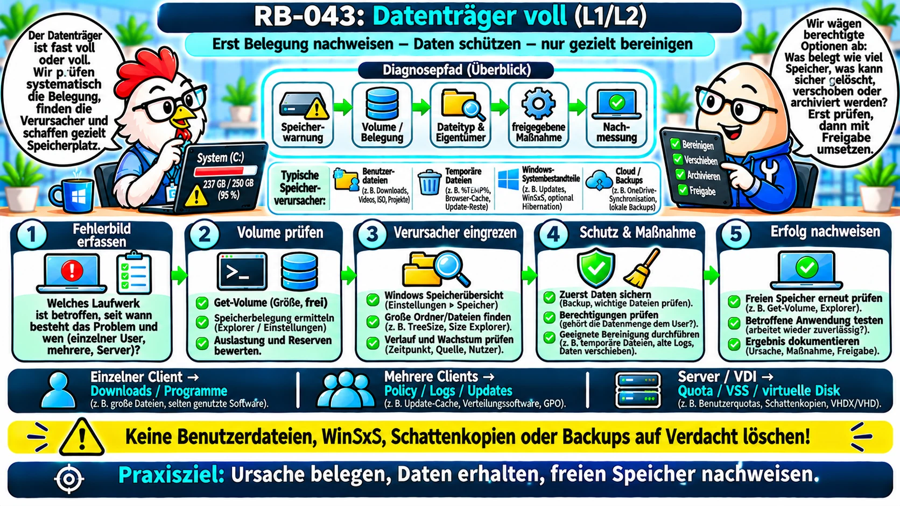

# RB-043 – Praxis-Runbook (L1/L2): Datenträger voll

**Projekt:** 50 typische IT-Supportfälle · **Stand:** 22.11.2026 · **Version:** 1.0  
**Status:** Recherchiert; **noch nicht praktisch validiert**. Lesende Befehle sind entsprechend gekennzeichnet. Keine automatisierte Bereinigung.



**Ziel:** Engpass und Datenbesitzer nachweisen, nur genehmigte und reversible Maßnahmen wählen, freien Speicher sowie die tatsächliche Anwendung nachtesten.

## 1. Ticketannahme: Exakten Fehler und betroffenen Speicherort erfassen

- [ ] Fehlermeldung/Warnung, Zeitpunkt, Gerät, Benutzer/Abteilung und Anwendung dokumentiert?
- [ ] Ist es lokales `C:`/`D:`, Netzwerkpfad, Profilcontainer, Server-/Hostvolume oder Quota?
- [ ] Einzelgerät oder viele, seit wann, jüngste Updates/Backups/Installationen?
- [ ] Produktionsrisiko (Datenbank, Anmeldung, Update, Backup, Geschäftsanwendung) bewertet?

## 2. Sicherheits- und Freigabecheck **vor jeder Löschung**

- [ ] Datenbesitzer, Aufbewahrung, Datenschutz, Backupstatus und Rückfallkopie geklärt?
- [ ] Freigabe für **konkrete** Datei-/Kategorie-/Quota-Maßnahme dokumentiert?
- [ ] Keine unkontrollierte Bereinigung von Windows-, Benutzer-, Backup-, VSS-, VHDX- oder Produktivlogs?
- [ ] Bei Remotezugriff: Rückweg und ausreichend Arbeitsreserve geklärt?

**STOP:** Fehlt die Freigabe, gibt es Datenintegritätsfehler oder ist der Speicherort unklar → keine Bereinigung, L2/L3 beziehungsweise Datenbesitzer einbeziehen.

## 3. Betroffenes Volume und freien Platz **lesend** messen

```powershell
# Keine Änderung; lokales Windows-Gerät:
Get-Volume |
  Select-Object DriveLetter, FileSystemLabel, FileSystemType,
                Size, SizeRemaining, HealthStatus
Get-CimInstance Win32_LogicalDisk -Filter 'DriveType=3' |
  Select-Object DeviceID, Size, FreeSpace, VolumeName
```

- [ ] Ausgangswerte **absolut (GiB)** und relativ (%) mit Zeitpunkt gesichert?
- [ ] Gegenprobe mit *Windows → Einstellungen → System → Speicher* oder Explorer?
- [ ] Quota-/Netzfreigabefehler nicht mit lokalem Freiplatz verwechselt?

## 4. Kategorien und konkrete Belegung ohne Schreibzugriff eingrenzen

- [ ] Speicherübersicht: Apps, temporär, Benutzerdateien, System/Reserviert, Cloud betrachtet?
- [ ] Zeitlicher Trend: Neue Dateiablagen, große Logfiles, Update-/Backup-/Syncwachstum?
- [ ] Nur mit Einverständnis im konkret genannten Benutzerverzeichnis nach Dateigrößen gesehen?

```powershell
# Ausschließlich direkte Dateien in den Downloads des aktuellen Kontos:
$ordner = Join-Path $env:USERPROFILE 'Downloads'
Get-ChildItem -LiteralPath $ordner -File -ErrorAction Stop |
  Sort-Object Length -Descending |
  Select-Object -First 15 Name, Length, LastWriteTime
```

**Hinweis:** Dateilängen summieren sich nicht zwingend zur realen Belegung; keine ungebremste Rekursion über `C:\` oder produktive Freigaben.

## 5. Systembestandteile und Sonderfälle **lesend** prüfen

**Wenn begründet relevant, mit passender Berechtigung:**

```cmd
REM Komponentenspeicher untersuchen, NICHT bereinigen:
DISM.exe /Online /Cleanup-Image /AnalyzeComponentStore
REM VSS-Nutzung prüfen, NICHT löschen:
vssadmin list shadowstorage
```

- [ ] WinSxS-Größe als Hardlink-/Komponentenspeicherthema interpretiert?
- [ ] OneDrive-Synchronisation und benötigte Offlinekopien berücksichtigt?
- [ ] VSS/Wiederherstellung/Backup-Vorgaben bekannt?
- [ ] Bei VDI/Server: Host, Share, virtuelle Disk und Benutzerquota getrennt geprüft?

## 6. Hypothese anhand zweier unabhängiger Befunde absichern

| Gesicherter Befund | Plausibler Pfad | Nicht daraus folgern |
|---|---|---|
| Große Downloads im **genehmigten** Benutzerordner | Dateien mit Besitzer abgleichen | Dass alle Downloads entbehrlich sind |
| VSS-Speicher stark belegt | Backup-/Restorekonzept prüfen | Dass Schattenkopien gelöscht werden dürfen |
| WinSxS im Explorer „groß“ | DISM-Analyse | Dass gemeldete Ordnergröße exklusiv belegt ist |
| Cloud-Dateien lokal groß | Synchronisations-/Offlinebedarf prüfen | Dass Cloudobjekte gelöscht werden dürfen |
| Volume frei, App-Quota erreicht | Ziel-/Profilquota untersuchen | Dass lokale Datenträger voll sind |
| Speicherplatz sofort wieder weg | Aktiven Verursacher verfolgen | Dass wiederholtes pauschales Löschen hilft |

## 7. Genehmigte, kleinste wirksame Maßnahme wählen

**L1-geeignet nach Richtlinie:** Microsoft-Bereinigungsempfehlungen **einzeln** überprüfen, unkritische temporäre Kategorien erst mit Freigabe bereinigen; Eigentümer legt freigegebene, gesicherte Benutzerdateien zur Archivierung fest; bei OneDrive ggf. nur lokale Kopie nach Sync-/Offlineprüfung freigeben.

**L2/Storage-/Application-Team:** Gezielte Logrotation, Retention, Quota-/Volumenerweiterung, VSS- und Backupverwaltung, VDI-/FSLogix-Container, Datenträger-/Dateisystemdefekt. Änderungen mit Wartungs-/Rollbackplan.

**Verbotene Schnellschüsse:** Manuelles Löschen von `WinSxS`, `Installer`, `AppData`-Inhalten, `pagefile.sys`, Backups, Datenbanken, Schattenkopien, Produktivlogs; `DISM ... /ResetBase` als Routine; pauschale PowerShell-`Remove-Item`-Skripte.

## 8. Vorher/Nachher-Messung und nachhaltige Wirkung

- [ ] Gleiches Volume und gleiche Messmethode vor/nach Aktion; absolute GiB dokumentieren.
- [ ] Relevante Anwendung kann wieder speichern/synchronisieren/updaten?
- [ ] Daten und notwendige Wiederherstellungsfunktionen nach Maßnahme verfügbar?
- [ ] Bei wiederkehrender Belegung Logwachstum oder weitere Ursachen mit Folgeticket überwachen?

```powershell
# Erneuter lesender Nachweis:
Get-Volume -DriveLetter C |
  Select-Object DriveLetter, Size, SizeRemaining, HealthStatus
```

**Erfolgsmaßstab:** Nicht willkürlich „10 % frei“, sondern ausreichend Reserve für den vorgesehenen Workload; Störungsmeldung und Auslöser zuverlässig behoben.

## 9. Eskalation / Stoppkriterien

Sofort an L2/L3/Storage/Backup eskalieren bei:

- fehlendem Backup/unklarem Datenbesitz oder unklarer Aufbewahrungsfrist;
- Dateisystem-/I/O-Fehlern, Storage-Health-Warnungen oder unerwartetem Datenträgerverlust;
- produktiver Server-/Datenbank-/Hyper-V-/VDI-Kapazität und unklaren Quotas;
- unkontrolliertem Wiederanwachsen, Backup-/Sicherungsproblemen oder zweifelhafter Cloud-Synchronisierung;
- nicht reproduzierbarer Wirkung trotz ausreichendem freien Platz.

## 10. Abschluss und Muster-Ticketkommentar

**Vor Abschluss:** Ursache, Belegungsquelle, Eigentümerfreigabe, Änderung, Vorher/Nachher und Testablauf im Ticket dokumentieren; sensible Dateinamen nur soweit wirklich notwendig nennen.

> **Muster – ausdrücklich fiktiv:** „Auf Gerät LAB-CLIENT07 war das Volume C: mit 238 GiB Gesamtkapazität bis auf 2,8 GiB belegt. Im freigegebenen Downloads-Ordner wurden ältere, bereits extern gesicherte ISO-Dateien als Hauptverbraucher identifiziert. Nach bestätigter Freigabe archiviert/entfernt; freier Platz anschließend 26,1 GiB. Geplanter Datei-Export und erneute Anmeldung erfolgreich getestet. Kein Eingriff in Windows-Komponentenspeicher, VSS oder Benutzerprofile. Wiedervorlage zur Prüfung des Speichertrends vereinbart.“

---

### Recherchierte Herstellerquellen (22.11.2026)

- https://support.microsoft.com/de-de/windows/experience/storage-filemanagement/free-up-drive-space-in-windows
- https://support.microsoft.com/de-de/windows/experience/storage-filemanagement/manage-drive-space-with-storage-sense
- https://support.microsoft.com/de-de/onedrive/save-disk-space-with-onedrive-files-on-demand-for-windows
- https://learn.microsoft.com/de-de/windows-hardware/manufacture/desktop/clean-up-the-winsxs-folder?view=windows-11
- https://learn.microsoft.com/en-us/powershell/module/storage/get-volume?view=windowsserver2025-ps
- https://learn.microsoft.com/en-us/windows-server/administration/windows-commands/vssadmin-list-shadowstorage

**Transparenz:** Das Runbook ist ein recherchierter Prüfplan und ersetzt keine praktische Freigabe oder Laborvalidierung.
