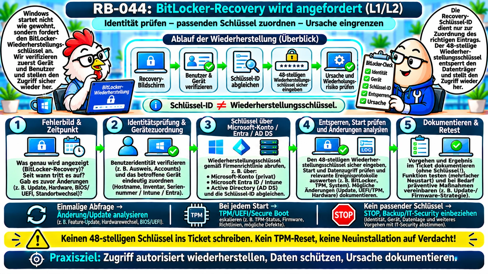

# RB-044 – BitLocker-Recovery wird angefordert (L1/L2)

**Projekt:** 50 Tickets – 50 typische IT-Supportfälle  
**Stand:** 22.11.2026 · **Version:** 1.0 · **Systeme:** Windows 11, BitLocker / Geräteverschlüsselung, Microsoft Entra ID, Intune, AD DS  
**Status:** Nach offiziellen Microsoft-Quellen recherchierte, theoretisch nachvollzogene Diagnose; **noch nicht praktisch validiert**. Alle Geräte, Personen, Zeitpunkte und Beispiele sind **fiktiv**.



> **Merksatz:** **Recovery-Bildschirm ≠ Datenverlust. Schlüssel-ID ≠ 48-stelliges Wiederherstellungskennwort. Erfolgreiche Entsperrung ≠ behobene Ursache.** Identität, Gerät, richtigen Schlüssel und Auslöser getrennt nachweisen.

---

## 1. Störungsbild, Ziel und Abgrenzung

**Fiktives Muster-Ticket:** „Nach dem Neustart fragt mein Firmennotebook nach einem BitLocker-Wiederherstellungsschlüssel. Ich kann Windows nicht starten.“

**Lernziel:** Das Gerät dem berechtigten Benutzer zuordnen, den angezeigten Schlüsselbezeichner mit dem sicher hinterlegten Wiederherstellungskennwort abgleichen, den Schutz ohne Umgehung wiederherstellen, die Ursache für den Recovery-Modus eingrenzen und den stabilen Neustart belegen.

**Abgrenzung:** RB-025 behandelt „PC startet nicht“, RB-026 Bootprobleme und WinRE, RB-045 die Intune-Verwaltung. **RB-044** befasst sich ausdrücklich mit der **BitLocker-Wiederherstellungsanforderung** und sicherem Schlüsselhandling. Eine Windows-PIN, ein Microsoft-Konto-Passwort und das BitLocker-Wiederherstellungskennwort sind unterschiedliche Dinge.

**Mögliche Folgen:** Arbeitsplatz ausgefallen, gesperrte Betriebssystempartition, gescheiterte Anmeldung und im Extremfall fehlender Zugriff auf Daten. **Eine Recovery-Abfrage beweist weder, dass die Daten beschädigt sind, noch, dass ein Angriff vorlag.** [Q1, Q2]

## 2. Technikgrundlagen: Verschlüsselung, TPM, Startintegrität

BitLocker schützt Volumes durch Laufwerksverschlüsselung. Bei vielen Windows-Geräten wird ein Entsperrmechanismus an das **Trusted Platform Module (TPM)** und gemessene Startbedingungen gebunden. Sind erwartete Bedingungen nicht erfüllt, kann das TPM den Schutzschlüssel nicht wie üblich freigeben; Windows verlangt einen unterstützten Wiederherstellungsnachweis.

```text
Regulärer Start:
Gerät → UEFI/Secure Boot/Bootkomponenten → TPM-Prüfung → Laufwerk entsperrt → Windows

Abweichung bei Startbedingungen oder Entsperrmechanismus:
Gerät → BitLocker-Recovery → autorisierter Wiederherstellungsnachweis → Windows
                                         ↓
                           nach erfolgreichem Start Auslöser untersuchen
```

- **Schlüsselprotektor:** Ein Mechanismus zum Schützen des Volume-Schlüssels (z. B. TPM, TPM+PIN, RecoveryPassword). Die genaue Konfiguration ist geräteabhängig.
- **TPM/PCR-Messung:** Der Vertrauenszustand bestimmter Bootkomponenten wird mit den vorherigen erwarteten Messwerten abgeglichen. Geänderte Messwerte können Recovery auslösen.
- **RecoveryPassword:** Das übliche **48-stellige numerische Wiederherstellungskennwort**, das bei entsprechendem Schutzmechanismus zum Entsperren eingegeben wird.
- **Key ID / Schlüssel-ID:** Ein Bezeichner zur **Auswahl des passenden RecoveryPassword-Datensatzes**. Er ist nicht selbst der Entsperrcode.
- **Geräteverschlüsselung:** Windows kann Verschlüsselung auf geeigneten Geräten auch automatisch aktivieren, auf manchen Windows-Home-Geräten ebenfalls. Der Benutzer hat sie nicht zwingend bewusst manuell eingerichtet. [Q1, Q3, Q4]

**Henne-Ei-Abhängigkeit in fachlichen Worten:** Ohne ausreichenden Recovery-Nachweis kein regulärer Zugriff auf das geschützte Volume; der passende Nachweis liegt deshalb **außerhalb des gesperrten Volumes** in einer autorisierten Sicherung.

## 3. Fehlerbilder unterscheiden: Einmalig, dauerhaft oder anderer Kontext

| Symptom | Mögliche Erklärung | Diagnostischer nächster Schritt |
|---|---|---|
| Recovery nach BIOS-/UEFI-Update oder Hardwaretausch | Geänderte TPM-/Bootmessung; **noch keine bestätigte Ursache** | Änderung und Versionsstand dokumentieren; Recovery regulär durchführen |
| Recovery nach Secure-Boot-/Bootreihenfolge-Änderung | Startintegritätsmessung weicht ab | Änderungsverlauf, Freigabe und Sicherheitskontext prüfen |
| Bei **jedem** Neustart erneute Recovery | Fortbestehende Abweichung, TPM-/Firmware-/Policyproblem | Nach erfolgreichem Start gezielt Ereignisse und TPM-Konfiguration prüfen, L2/L3 |
| Schlüssel aus Portal wird abgelehnt | Falscher Datensatz/Key-ID, Eingabefehler oder anderer Wiederherstellungsmechanismus | **Key-ID und Gerät erneut abgleichen**, nicht raten |
| Passender Schlüssel in Portal nicht auffindbar | Anderes Gerät/Tenant, fehlende Hinterlegung, alter oder anderer Schlüsselsatz | Andere **autorisierte** Sicherungsstellen abfragen; Security/Identity eskalieren |
| Recovery in WinRE oder nach Startreparatur | Gesperrtes Volume für Recovery-Werkzeuge | Recovery-Kontext unterscheiden, keine automatischen Boot-/Formatierbefehle |
| Recovery-Bildschirm mit Code/Kategorie | Hinweis auf Boot-/Secure-Boot-/PCR-Probleme | Bei unterstützten Versionen zusätzliche Fehlerinfo protokollieren |

**Grenze:** Ein einmaliger Recovery-Fall und ein wiederkehrender Bootkonfigurationskonflikt benötigen unterschiedlich tiefe Ursachenanalysen. [Q1, Q5, Q6]

## 4. Ticketaufnahme: Nichts verändern, bevor Gerät und Vorfall klar sind

1. **Wortlaut:** Steht dort *BitLocker-Wiederherstellung*, *Recovery Key*, PIN, Windows Hello oder eine andere Entsperraufforderung?
2. **Gerätezuordnung:** Firmen-/Privatgerät, Inventarnummer, Hostname, Seriennummer (datensparsam), Benutzer, Organisationszugehörigkeit.
3. **Bildschirmdaten:** Angezeigte **Wiederherstellungsschlüssel-ID** oder zulässiger Teil davon, Zeitpunkt, zusätzliche Fehlerkategorie/-code, falls verfügbar. **Kein RecoveryPassword ins Ticket kopieren.**
4. **Anlass:** Letztes funktionierendes Boot, Windows-/Firmware-/BIOS-Update, Dock-/Hardwareänderung, Wartung, Startmedium, TPM-/Secure-Boot-Änderung.
5. **Umfang:** Ein Gerät oder viele nach demselben Rollout? Bei mehreren Geräten/Standorten auf Change oder Incident prüfen.
6. **Berechtigung und Kanal:** Wer ist anfragende Person, welches Gerät darf sie nutzen und wie darf der Schlüssel angezeigt/übermittelt werden?

**Ausgangsbefund (fiktiv):** „Notebook NB-044, Recovery beim Systemstart seit 09:05 Uhr nach gemeldetem Firmware-Update; Key-ID im autorisierten Ticket erfasst; kein RecoveryPassword protokolliert.“

## 5. Sicherheitsgate: Vertraulichkeit und unveränderter Gerätezustand

**Vor dem Abruf eines Wiederherstellungskennworts:**

- Identität **nach dem betrieblichen Verfahren** prüfen; eine E-Mail-Absenderadresse allein reicht nicht. Gerät und berechtigte Nutzung plausibilisieren. [Q2]
- Schlüssel **nur** über zugelassene Portale/Verwaltungswege abrufen und auf dem zugelassenen Kanal ausschließlich für den konkreten, autorisierten Wiederherstellungsvorgang verwenden.
- **Kein** Klartextschlüssel in Ticketkommentaren, Screenshots, Chatprotokollen, E-Mails, Zwischenablageprotokollen, offenen Shell-Logs oder öffentlichen Dokumentationen.
- **Keine** TPM-Löschung, keine Änderung von Secure Boot, BIOS/UEFI, BCD oder BitLocker-Protektoren auf Verdacht. Keine Formatierung, Neuinstallation, unbeaufsichtigte Reparatur oder Geräteobjektlöschung.
- Vor tieferen Eingriffen: Daten- und Backupstatus, Recovery-Rückweg, Unternehmensfreigabe und Security-Owner klären.
- Wenn Schlüssel möglicherweise offengelegt wurde: Key-Exposure nach Policy melden; **Rotation nur nach Freigabe** und mit bestätigter neuer Hinterlegung. [Q1, Q7]

**STOP:** Identität/Zuordnung unklar, kein autorisierter Abruf, Sicherheitshinweis auf Kompromittierung oder nicht eindeutige Key-ID → **keinen Schlüssel herausgeben**; an Identity/Security/Endpoint-Team eskalieren.

## 6. Schlüssel-ID verstehen und richtig zuordnen

Der Recovery-Bildschirm zeigt eine **Key ID**, mit der der passende hinterlegte Wiederherstellungsdatensatz ausgewählt wird. Das dazugehörige **RecoveryPassword** besteht typischerweise aus 48 Ziffern in acht Gruppen.

- Die **Key-ID ist ein Such- und Zuordnungsmerkmal**, nicht der Code zur Entsperrung.
- **Mehrere** RecoveryPasswords können für ein Gerät/Volume im Verlauf existieren (z. B. nach Rotation). **Nicht** einfach den ersten Eintrag verwenden.
- Den Identifier vom **gesperrten Gerät** mit dem Eintrag im **richtigen Tenant/Account/Geräteobjekt** vergleichen.
- Bei Abweichung oder unklarer Gerätezuordnung die Suche fortsetzen, **keinen anderen Key ausprobieren und keine Schutzmaßnahmen umgehen**.
- Die sichtbare Kontoinformation in Windows 11 24H2 kann ein Hinweis auf den Speicherort sein, ist aber **keine Berechtigungsfreigabe** für einen beliebigen Anfragenden. [Q2, Q5]

## 7. Autorisierte Recovery-Quellen – je nach Eigentum und Bereitstellung

| Gerätetyp / Verwaltung | Mögliche autorisierte Quelle | Voraussetzung / Grenze |
|---|---|---|
| Privates Gerät mit Microsoft-Konto | `https://aka.ms/myrecoverykey` | **Tatsächliches** bei der Sicherung verwendetes Microsoft-Konto; Gerät und ID abgleichen |
| Arbeits- oder Schulgerät, Self-Service | `https://aka.ms/aadrecoverykey`, Mein-Konto-Geräteseite oder Unternehmensportal | Gerät im passenden Tenant; Self-Service kann durch Policy eingeschränkt sein |
| Intune-verwaltetes Gerät | Intune Admin Center → Geräte → Gerät → Wiederherstellungsschlüssel | Berechtigte Adminrolle, prüfbare Geräteidentität; Keyabruf wird protokolliert |
| Domänengebundenes Gerät mit AD-DS-Sicherung | Autorisierte AD-DS-BitLocker-Recovery-Informationen über freigegebenes Adminverfahren | Schlüssel muss tatsächlich hinterlegt worden sein; delegierte Leserechte nötig |
| Sonstige genehmigte Sicherung | Ausdruck, separat gespeicherte Datei, zugelassenes USB-Medium / Enterprise-Escrow | Sicherer Besitznachweis; Schlüssel nicht auf dem gesperrten Volume suchen |

**Wichtig:** Ein RecoveryPassword wird **nicht bei jeder Einrichtung automatisch in jedem** dieser Systeme hinterlegt. Fehlt eine Sicherung, ist das zunächst ein Befund, nicht automatisch ein Zugriffsrechtsproblem. [Q2, Q4, Q8]

## 8. Unternehmen: Entra / Intune / AD DS nur mit den richtigen Rollen

**Microsoft Entra ID / Intune:**

1. Autorisiert im richtigen Tenant anmelden, das **passende Geräteobjekt** anhand verifizierter Merkmale auswählen.
2. In Intune: *Geräte → Alle Geräte → konkretes Gerät → Wiederherstellungsschlüssel* (Menübezeichnung kann sich ändern); alternativ über zulässige Entra-Geräteansicht.
3. **Recovery Key ID vergleichen**; RecoveryPassword nur nach positiver Identitäts- und Geräteprüfung anzeigen.
4. Anzeige oder Abruf hinterlässt einen **Audit-Eintrag**. Das Ticket dokumentiert **dass** ein autorisierter Abruf erfolgt ist, aber **nicht** die 48 Ziffern.
5. Benötigte Rolle/Berechtigung: in Entra beispielsweise `microsoft.directory/bitlockerKeys/key/read`; Intune-/Mandantenregeln beachten.

**AD DS:** Schlüssel hinterlegbar, sofern die entsprechende Sicherung konfiguriert und erfolgt ist. Der berechtigte Admin nutzt das organisationsseitig vorgesehene AD-DS-Recovery-Verfahren oder Viewer; bitte **keine** ungeschützten LDAP-/PowerShell-Exporte aller RecoveryPasswords ins Ticket.

**Kein Schlüssel gefunden:** Richtiges Gerät, Tenant, Backupzeitpunkt, mögliche Altgeräte-/Neuregistrierung und zugelassene Alternative prüfen; danach eskalieren. Ein gewöhnliches Passwort-Reset erzeugt **keinen** BitLocker-Wiederherstellungsschlüssel. [Q2, Q8]

## 9. Autorisiertes Entsperren am Recovery-Bildschirm

**Nur bei verifiziertem Gerät, berechtigter Person und passendem Key-ID-Datensatz:**

1. RecoveryPassword über freigegebene Quelle und freigegebenen Kanal bereitstellen.
2. Den 48-stelligen Code **direkt am Recovery-Bildschirm** eingeben; keine Zwischenspeicherung in Diagnosedokumenten oder ungeschützten Dateien.
3. Bei Fehlermeldung **Gerätezuordnung, Key ID und Eingabe** prüfen, statt beliebige Daten zu löschen oder Bootoptionen zu verändern.
4. Startet Windows, dokumentieren: Zeitpunkt, einmalig/mehrfach, Benutzeranmeldung und Funktion der betroffenen Kernanwendungen.
5. Nach dem Start **nicht** mit „entsperrt = erledigt“ schließen; die Ursache und Schutzkonfiguration prüfen, insbesondere bei erneutem Recovery beim nächsten Start.

**Weder Recovery-Kennwort noch Enterprise-Rechte erlauben, Benutzer-/Unternehmensrichtlinien zu umgehen.** Bei nicht wiederherstellbarem Schlüssel keine versprochene Datenrettung durch Neuinstallation. [Q2]

## 10. Nach erfolgreichem Start: Status und Ereignisse **lesend** prüfen

**Nur auf dem wieder zugänglichen, genehmigten Gerät:**

```powershell
# LESEND: Nur nichtgeheime Statusfelder anzeigen;
# bewusst KEINE KeyProtector-Details/RecoveryPasswords ausgeben.
Get-BitLockerVolume -MountPoint $env:SystemDrive |
  Select-Object MountPoint, VolumeStatus, ProtectionStatus,
                LockStatus, EncryptionPercentage

# LESEND: Alternative Statusabfrage; keine Schlüssel anzeigen.
manage-bde.exe -status

# LESEND: Verfügbare BitLocker-Ereignisprotokolle auflisten.
Get-WinEvent -ListLog '*BitLocker*' |
  Select-Object LogName, RecordCount

# LESEND: TPM-Grundstatus; ohne Reset oder Provisioning.
Get-Tpm | Select-Object TpmPresent, TpmReady, TpmEnabled
```

**Einordnung:** `ProtectionStatus : On` bedeutet, dass der Schutz aktuell aktiv ist, erklärt aber **noch nicht**, welcher Bootvorgang die Recovery auslöste. `LockStatus : Unlocked` auf einem laufenden Windows ist erwartbar. Ereignisprotokolle können ältere Meldungen, aber auch **keinen** eindeutigen Auslöser enthalten. Befehl-/Modulverfügbarkeit sowie Leserechte sind von Windows-Edition und Umgebung abhängig. [Q9]

**Gezielter Folgeschritt:** Relevante BitLocker-/TPM-/System-Ereignisse im Zeitraum der Abfrage prüfen; nur erforderliche, nichtgeheime Details dokumentieren. `manage-bde -protectors -get` und breite Exporte von `KeyProtector` sind **absichtlich nicht** enthalten, weil sie sensible Schlüsselinformationen offenlegen können.

## 11. Warum wurde die Recovery ausgelöst? Hypothesen systematisch prüfen

1. **Einmalig nach Update:** Geplante Firmware-/BIOS-/UEFI-Änderung anhand Change-Log, Herstellerversion und Rollout nachweisen; bedeutet nicht automatisch Fehlkonfiguration.
2. **Mehrfach nach jedem Neustart:** TPM/PCR- oder Secure-Boot-Status, Bootkonfiguration, UEFI-Firmware und organisationsweit ausgerollte Änderungen in einem freigegebenen L2-/L3-Verfahren prüfen.
3. **Nur ein bestimmtes Gerät:** Hardware-/TPM-/Firmwarezustand und Gerätereparaturen mit Vergleichsgerät gegenüberstellen.
4. **Mehrere Geräte nach Change:** Koordinierten Incident bzw. Change-Rollback-Plan mit Endpoint-/Security-Team prüfen, nicht jeden Client blind umbauen.
5. **WinRE/anderer Bootkontext:** Prüfen, ob tatsächlich ein normaler OS-Start oder eine Wiederherstellungsumgebung betroffen ist.
6. **Zusatzinformationen ab Windows 11 24H2:** Sofern angezeigt, Kategorien/Codes wie PCR-Abweichung oder Secure-Boot-Konfigurationsproblem als **Hinweise** dokumentieren; Diagnose durch unabhängige Befunde bestätigen. [Q1, Q5, Q6]

**Wichtig:** Ein TPM-Reset oder Änderungen am Secure-Boot-Zustand sind **keine** Standard-Fehlerbehebung und können den Zugang zu verschlüsselten Daten zusätzlich gefährden.

## 12. Befund → gezielte Maßnahme → Erfolgskriterium

| Gesicherter Befund | Fachlich angemessene nächste Aktion | Retest / Nachweis |
|---|---|---|
| Einmalige Recovery nach freigegebenem Firmwareupdate | Mit passendem Schlüssel autorisiert entsperren, Change prüfen | Kontrollierter Neustart ohne erneute Recovery; Schutzstatus dokumentiert |
| Wiederholte Abfrage + passende UEFI-/TPM-Befunde | L2/L3-/Security-Analyse der Bootintegrität; nur freigegebene Herstellermaßnahme | Wiederholte kontrollierte Starts; keine Schutzabsenkung |
| Mehrere Recovery-Einträge, falsche ID | Korrekte Key ID und Datensatz beim **richtigen** Objekt ermitteln | Richtiger Schlüssel angenommen; Audit-Eintrag vorhanden |
| Entra-Eintrag existiert, aber Schlüssel fehlt | Schlüsselsicherungsprozess/Altgerät/AD DS prüfen, Administrator eskalieren | Authentifizierte Quelle für **passenden** Key gefunden oder dokumentierter STOP |
| Schlüssel könnte offengelegt worden sein | Security-Prozess und berechtigte Rotation **nach** Recovery/Freigabe | Neuer Schlüssel sicher hinterlegt und geschützt; Audit/Policy erfüllt |
| Gerät lässt sich auch nach erfolgreichem Entsperren nicht starten | RB-026 und Hardware-/Boot-Diagnose, Backup vorher klären | Windows-Start und Datenzugriff nach getrennter Reparatur bestätigt |

**Keine Universal-Lösung:** TPM löschen, BIOS-Werte blind umstellen, BitLocker deaktivieren, Recoveryprotektor entfernen oder Windows neu installieren. **Kein Schlüssel vorhanden** ist ein möglicher **harter Stop**, kein Anlass für Entschlüsselungsversprechen. [Q1–Q9]

## 13. Zwei realitätsnahe, ausdrücklich **fiktive** Praxisfälle

### Fall A – Einmalige Recovery nach genehmigtem Firmwareupdate

**Meldung:** „Windows verlangt seit dem heutigen Neustart den BitLocker-Schlüssel.“  
**Befund 1:** Zuordnung des Benutzergeräts und der angezeigten Key ID mit betrieblichem Recovery-Datensatz stimmt überein.  
**Befund 2:** Der Endpoint-Change-Report weist ein genehmigtes UEFI-Firmwareupdate am gleichen Morgen aus.  
**Hypothese:** Das Update hat die erwarteten TPM-/Startmessungen beeinflusst; bisher **kein Beweis** für eine dauerhaft fehlerhafte Konfiguration.  
**Vorgehen:** Berechtigtes Recovery, schlüsselgeheime Verarbeitung, anschließende lesende Status- und Ereignisprüfung.  
**Fiktiver Ausgang:** Start gelingt, zweiter kontrollierter Neustart ohne Recovery; Schutz aktiv. Change- und Retest-Ergebnis ohne Key im Ticket dokumentiert.

### Fall B – Recovery bei jedem Neustart; Gerät in zwei Portalen

**Meldung:** „Ich habe den Code bereits eingegeben, aber am nächsten Tag erscheint die Abfrage wieder.“  
**Befund 1:** Recovery-Key-ID des gesperrten Geräts stimmt **nicht** mit dem zuerst ausgewählten alten Entra-Geräteobjekt überein.  
**Befund 2:** Nach korrekter Objektzuordnung und autorisiertem Entsperren zeigen freigegebene Gerätereports einen noch offenen Secure-Boot-/Firmwareabweichungsbefund.  
**Hypothesen:** Falsches Portalgerät als anfänglicher Zuordnungsfehler **und** persistente Bootintegritätsabweichung als möglicher Grund für die wiederholte Recovery.  
**Vorgehen:** Keine TPM-/UEFI-Änderung im First-Level; Endpoint/Security vergleicht Konfiguration und Change-Historie.  
**Fiktiver Ausgang:** Freigegebene Herstellerkorrektur behebt die Abweichung; mehrere Neustarts ohne Recovery, BitLocker-Schutz bleibt aktiv.

**Lernsignal:** Eine zufällige „einmalige Reparatur“ ist weniger wertvoll als eine Diagnose, die zwischen dem **Abruf des richtigen Kennworts** und der **Fehlerursache** unterscheidet.

## 14. Labortraining, Retest, Eskalation und Ticketdokumentation

**Sichere Laboridee:** Auf einer **separaten, gesicherten Windows-Test-VM** zunächst ausschließlich Recovery-Quellen und die Schlüsselsicherungswege dokumentieren. Die absichtliche Auslösung einer Recovery nur im eigens autorisierten Labor mit gesicherten Daten/Schlüsseln, vollständigem Rückfallplan und nachvollziehbarem Change durchführen. **Keinen** TPM-Reset, BIOS-/Secure-Boot-Wechsel oder Schlüsselentzug am echten Arbeitsgerät zur Demonstration vornehmen.

**Erfolgskriterien:**

- Richtige Identität und Gerät nachvollziehbar geprüft; Abruf über autorisiertes System, nie geheim im Ticket.
- Verschlüsselter Datenträger sicher zugänglich; Betriebssystem und kritische Funktionen arbeiten.
- BitLocker-Schutz aktiv und organisatorisch geforderte Recovery-Informationen weiterhin sicher hinterlegt.
- Nach einem **kontrollierten Neustart** bleibt die unerwartete Abfrage aus; bei weiterem Recovery ist der Fall **nicht geschlossen**.
- Auslöser, Zeitlinie und Eskalationsgrund mit unabhängigem Befund dokumentiert.

**Muster-Ticketkommentar (fiktiv, ohne Geheimnisse):**

> „Notebook NB-044 nach freigegebenem UEFI-Update im BitLocker-Recovery-Modus. Berechtigter Benutzer und Gerät geprüft, Schlüssel-ID mit autorisiert hinterlegtem Datensatz abgeglichen; Recovery über freigegebenen Kanal durchgeführt. Windows startete, BitLocker-Schutzstatus aktiv, Testanmeldung und zwei kontrollierte Neustarts erfolgreich. Ursache nach Firmware-Change plausibel, keine weitere Recovery. 48-stelliges Kennwort wurde nicht im Ticket gespeichert.“

**STOP/Eskalation:** Falsche/fehlende Key-ID, kein genehmigter Zugriff, Security-Verdacht, fehlender Escrow, dauerhaft wiederholte Recovery, System-/Storagefehler oder kein Windows-Start trotz erfolgreicher Entsperrung → L2/L3, Security, Endpoint, Hardware-/Backup-Owner einschalten.

## 15. Active Recall, Transfertraining und verifizierte Quellen

**Wissensfragen (ohne Artikel beantworten):**

1. Wozu dient die **Key ID**, und welche Datenmenge hat das typische RecoveryPassword?
2. Welche Unterschiede bestehen zwischen **TPM-gebundenem Start**, Recovery und regulärer Windows-Anmeldung?
3. Nenne drei mögliche **autorisierte Ablageorte** für Recovery-Informationen.
4. Warum kann ein Windows-Home-Gerät trotzdem Geräteverschlüsselung verwenden?

**Verständnisfragen:**

5. Wieso beweist ein Recovery-Bildschirm **keinen** TPM-Defekt und keinen Datenverlust?
6. Warum ist „Windows startet wieder“ nach Eingabe des Codes noch **kein** vollständiger Abschluss?
7. Warum kann ein altes, gleichnamiges Entra-Geräteobjekt zu einem falschen Schlüssel führen?
8. Welche Sicherheitsprobleme verursacht ein Klartextschlüssel im Ticketsystem?

**Diagnose-/Transferfragen:**

9. Benutzer zeigt die Recovery-ID, aber im Unternehmensportal ist kein Key sichtbar: Welche **drei nicht destruktiven** Prüfungen nimmst du vor?
10. Nach Firmwareupdate erscheint Recovery bei jedem Boot: Welche Befunde sammelst du **nach** autorisiertem Entsperren?
11. Ein Kollege empfiehlt `Clear-Tpm` oder das Abschalten von Secure Boot. Wie begründest du fachlich, warum das kein Standardtest ist?
12. Welche vier Nachweise benötigst du, um das Ticket zuverlässig schließen zu können?

**Nach 7 und 21 Tagen:** Mit einem veränderten Störungsszenario aus dem Gedächtnis den sicheren Diagnosepfad formulieren. Erst anschließend mit dem Praxis-Runbook vergleichen. Passende Anki-Wissens-, Verständnis- und Diagnosekarten erst aus tatsächlich geübten Inhalten ableiten.

### Quellen – Microsoft, geprüft am 22.11.2026

- **[Q1]** Microsoft Learn: BitLocker-Wiederherstellungsübersicht — https://learn.microsoft.com/de-de/windows/security/operating-system-security/data-protection/bitlocker/recovery-overview
- **[Q2]** Microsoft Learn: BitLocker-Wiederherstellungsprozess (Helpdesk, Identität, Schlüssel-ID, Recovery) — https://learn.microsoft.com/de-de/windows/security/operating-system-security/data-protection/bitlocker/recovery-process
- **[Q3]** Microsoft Learn: BitLocker-Betriebshandbuch und Statusprüfungen — https://learn.microsoft.com/de-de/windows/security/operating-system-security/data-protection/bitlocker/operations-guide
- **[Q4]** Microsoft Support: Recovery-Schlüssel suchen — https://support.microsoft.com/de-de/windows/security/encryption/find-your-bitlocker-recovery-key
- **[Q5]** Microsoft Learn: BitLocker-Preboot-Recovery-Bildschirm — https://learn.microsoft.com/de-de/windows/security/operating-system-security/data-protection/bitlocker/preboot-recovery-screen
- **[Q6]** Microsoft Learn: BitLocker FAQ — https://learn.microsoft.com/en-us/windows/security/operating-system-security/data-protection/bitlocker/faq
- **[Q7]** Microsoft Learn: BitLocker-Key-Rotation in Intune — https://learn.microsoft.com/en-us/intune/device-management/actions/rotate-bitlocker-keys
- **[Q8]** Microsoft Learn: BitLocker-Verschlüsselung in Intune (Schlüsselanzeige/Rollen/Audit) — https://learn.microsoft.com/de-de/intune/device-configuration/endpoint-security/encrypt-bitlocker-windows
- **[Q9]** Microsoft Learn: `manage-bde -status` — https://learn.microsoft.com/de-de/windows-server/administration/windows-commands/manage-bde-status
- **[Q10]** Microsoft Support: Geräteverschlüsselung unter Windows — https://support.microsoft.com/en-us/windows/security/encryption/device-encryption-in-windows

**Transparenz:** Offizielle Herstellerquellen werden als Grundlage wiedergegeben; die Diagnosebeispiele sind fiktiv. Praktische Verifikation, tatsächliche Recovery-Tests und reale Benutzerdaten wurden **nicht** durchgeführt.
