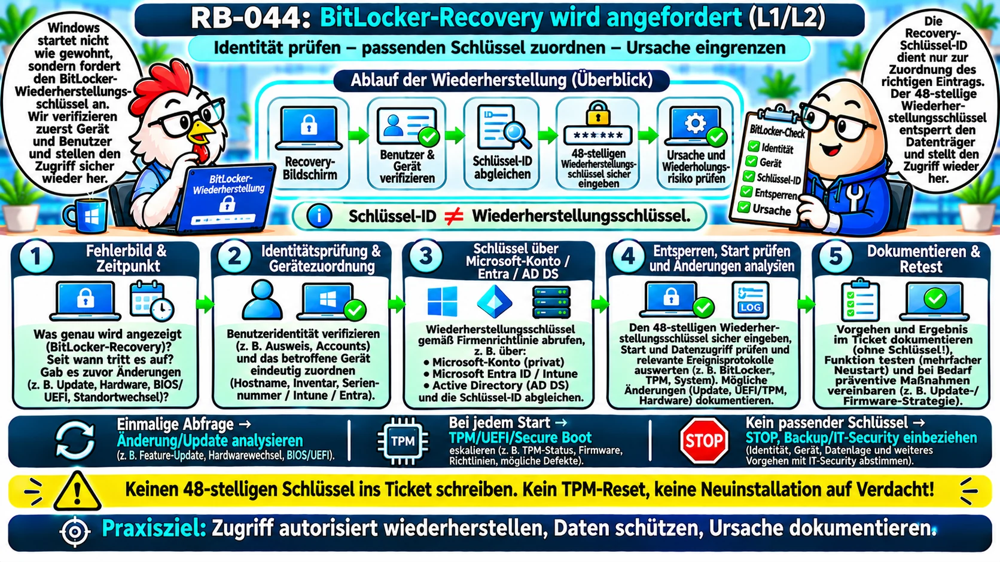

# RB-044 – Praxis-Runbook (L1/L2): BitLocker-Recovery wird angefordert

**Projekt:** 50 typische IT-Supportfälle · **Stand:** 22.11.2026 · **Version:** 1.0  
**Status:** Offizielle Herstellerquellen recherchiert; **noch nicht praktisch validiert**. Beispiele fiktiv. **Keine Schlüssel im Ticket speichern.**



**Ziel:** Berechtigte Recovery sicher ermöglichen, schlüsselgeheime Verarbeitung gewährleisten und eine wiederholte Recovery-Anforderung ursächlich eingrenzen. Nicht mit einem gewöhnlichen Passwort-Reset oder einem pauschalen Windows-Reparaturticket verwechseln.

## 1. Ticketannahme: Bildschirm und Auswirkungen bestätigen

- [ ] Ist es tatsächlich eine **BitLocker-Recovery-Abfrage** vor Windows/bei WinRE statt Windows-Hello-, Login- oder Benutzer-PIN-Problem?
- [ ] Genauer Zeitpunkt, Gerät und Benutzer, Einzel-/Mehrfachfall, kürzliches Firmware-/Windows-Update, Hardware-/Bootänderung aufgenommen?
- [ ] Gerätebezeichnung/Inventarnummer erfasst, Service-Ausfall priorisiert, ggf. mehrere Geräte nach Rollout abgeglichen?
- [ ] Angezeigte **Key ID** für spätere Zuordnung nur im zulässigen Umfang festgehalten, **nicht** das 48-stellige Kennwort?

## 2. STOP- und Sicherheitscheck **vor** Schlüsselabruf

- [ ] Anfragende Person **nach Unternehmensverfahren authentifiziert**, Gerätezuordnung und Autorisierung plausibel?
- [ ] Zugelassener Administrations-/Self-Service-Pfad und **sicherer Übermittlungskanal** vorhanden?
- [ ] Sicherheitsverdacht, nicht gemeldeter Gerätewechsel oder falsches Gerät ausgeschlossen bzw. Security eingebunden?
- [ ] Kein Plan für unautorisiertes Entfernen von BitLocker-Schutz, Zurücksetzen des TPM, BIOS-Manipulation oder Neuinstallation?

**STOP:** Ohne Identitäts-/Gerätefreigabe und passenden Schlüsselnachweis **keine** Ausgabe eines Wiederherstellungskennworts. Nicht in Ticket/Chat/Log/Screenshot eintragen.

## 3. Recovery-ID und Geräteidentität eindeutig vergleichen

- [ ] Key ID wird **vom gesperrten Gerät** aufgenommen; richtiges Mandanten-/Geräteobjekt ausgewählt?
- [ ] Gerätename zusätzlich durch Inventardaten/Seriennummer/Benutzer-/Eigentümerzuordnung plausibilisiert?
- [ ] Bei mehreren Datensätzen: passt die **Key ID** genau zum vorgesehenen RecoveryPassword?
- [ ] Kein bloßes Kopieren eines Schlüsselwerts aus einem ähnlich benannten Altgerät?

**Merksatz:** Schlüssel-ID dient der **Zuordnung**; sie entsperrt nicht selbst.

## 4. Zugelassenen Speicherort für das RecoveryPassword finden

| Umfeld | Autorisierter Abrufweg (nach Policy) |
|---|---|
| Privates Gerät | Microsoft-Konto: `https://aka.ms/myrecoverykey` |
| Geschäfts-/Schulkonto | `https://aka.ms/aadrecoverykey` / Mein Konto / Unternehmensportal (wenn zugelassen) |
| Intune/Entra administriert | Intune-/Entra-Geräteobjekt → BitLocker-Wiederherstellungsschlüssel, mit berechtigtem RBAC und Audit |
| Klassisches AD DS | Von Organisation freigegebenes BitLocker-Recovery-Informationsverfahren, wenn zuvor hinterlegt |
| Gesondert gesichert | Genehmigter Ausdruck/Datei/USB-Key; sicherer Besitznachweis |

- [ ] Einträge und **Key ID** abgeglichen, nur passende autorisierte Quelle verwendet?
- [ ] Falls kein Eintrag: andere zulässige Ablagen, Tenant, Altgerät, Escrow-Status prüfen und an Identity/Security eskalieren.

## 5. Entsperren ohne Änderung der Verschlüsselung

- [ ] Den **passenden 48-stelligen Zahlencode** am Recovery-Bildschirm über den zugelassenen Weg eingeben lassen.
- [ ] Bei Eingabefehler zuerst Key-ID und Zuordnung prüfen, keine brutalen Recovery-/Reset-Experimente.
- [ ] Windows-Start und Benutzeranmeldung bestätigt? Wenn nicht: nach gesicherter Schlüssel-/Datenlage an RB-026-/Hardware-Zweig eskalieren.
- [ ] Schlüssel nicht in Ticket, Zwischenablageprotokoll, Screenshots, Kennwortmanager ohne Freigabe oder Exportdateien hinterlassen.

## 6. Nach dem Start: **lesender** Status- und Logcheck

```powershell
# NUR nach erfolgreichem Boot auf dem autorisierten Gerät;
# NICHT den KeyProtector mit potentiell geheimen Werten ausgeben.
Get-BitLockerVolume -MountPoint $env:SystemDrive |
  Select-Object MountPoint, VolumeStatus, ProtectionStatus,
                LockStatus, EncryptionPercentage

manage-bde.exe -status

Get-WinEvent -ListLog '*BitLocker*' |
  Select-Object LogName, RecordCount
```

- [ ] Schutzstatus und Laufwerkzustand dokumentiert, **ohne Geheimnisse**?
- [ ] Zeitgleiche BitLocker-/TPM-/Systemereignisse geprüft? Eventuell kein eindeutiger Eintrag – Befund nicht erfinden.
- [ ] Erneut angeforderte Recovery in neuen Bootvorgängen gesondert beachten.

## 7. Auslöser eingrenzen: einmalig oder wiederkehrend

| Beobachtung | Lesender Vergleich |
|---|---|
| Nach einmaligem genehmigten Firmware-/BIOS-Update | Change-Zeitpunkt, Firmwarestand, Recoverydatum, Bootstatus |
| Recovery bei jedem Start | TPM/Secure-Boot-/PCR-Hinweise, UEFI-/Bootänderung, BitLocker-Ereignisse; Endpoint/Security-Team |
| Nur ein Notebook betroffen | Gerätetyp, Hardwarewechsel, TPM-Status, Vergleichsgerät |
| Viele Clients nach Rollout betroffen | Gemeinsamer Change/Richtlinie/Updatepaket, Incident-/Rollout-Eigentümer |
| „Schlüssel nicht gefunden“ | Gerät/Tenant/Key-ID/Escrow und alternative freigegebene Sicherung |

**Nicht** TPM löschen, Secure Boot abschalten, Bootreihenfolge oder BitLocker-Protektoren ändern, um „kurz zu testen“.

## 8. Gezielte, freigegebene Folgemaßnahme wählen

**L1:** Sichere Identitätsprüfung, Gerätezuordnung, dokumentierter Abruf über zugelassenen Weg, Autorisierung, Recovery-Begleitung und Eskalation.

**L2/Endpoint/Identity/Security:** Bootintegritäts- und Firmwareänderung anhand von Logs/Change bewerten, Herstellerverfahren und Konfigurationspolicy prüfen, ggf. gezielte Korrektur mit Rollback. **Keyrotation** nach offen gelegtem RecoveryPassword bzw. Security-Policy durch berechtigte Rollen nur bei **gesicherter neuer Hinterlegung**.

**Nicht im Standard-Runbook:** `Clear-Tpm`, `manage-bde -off`, `manage-bde -protectors -disable`, `bcdedit`-Änderungen, Schlüsseldateien in Logfiles exportieren, Reset/Wipe/Reinstall oder Entfernen von Entra-/Intune-Geräten.

## 9. Retest: Zwei getrennte Nachweise

- [ ] **Zugang:** Windows erfolgreich gestartet und Benutzer kann die benötigten Daten/Anwendungen verwenden.
- [ ] **Schutz:** BitLocker-Status korrekt und geforderte Schlüsselsicherung/Key-ID nach Policy kontrolliert.
- [ ] **Stabilität:** Ein **kontrollierter weiterer Neustart** ohne erneute Recovery, bei Bedarf mehrfache Tests durch L2; wenn Recovery erneut → nicht abgeschlossen.
- [ ] **Ursache:** Change-/Firmware-/TPM-/Startpfad mit unabhängigen Befunden plausibilisiert; nicht nur Codeeingabe notiert.

## 10. Abschluss, Eskalation, Muster-Ticketkommentar

**Eskalieren:** Keine sichere Geräte-/Benutzerzuordnung, fehlender passender Recovery-Eintrag, offengelegter Schlüssel, Sicherheitsverdacht, wiederholte Abfrage, Datenträger-/TPM-Fehler, kein Start trotz Entsperren, fehlende Backups bei beabsichtigter Systemreparatur.

> **Muster – fiktiv, bewusst ohne Geheimdaten:** „Auf Firmennotebook NB-044 erschien nach einem freigegebenen UEFI-Firmwareupdate die BitLocker-Recovery-Abfrage. Identität und Gerät verifiziert; Schlüssel-ID dem autorisiert hinterlegten Eintrag zugeordnet. Entsperrung im zugelassenen Verfahren durchgeführt, kein RecoveryPassword protokolliert. Windows-Start und Geschäftsapplikation geprüft, Schutzstatus aktiv, kontrollierter Neustart erfolgreich. Ergebnis und Change-Referenz dokumentiert; kein TPM-Reset, keine Schutzdeaktivierung.“

**Transparenz:** Dieses Runbook ist ein recherchierter Diagnosepfad, **noch nicht praktisch validiert**. Die endgültige Entscheidung richtet sich nach Richtlinien, Sicherheitsrollen und konkreter Gerätekonfiguration.

### Microsoft-Quellen (22.11.2026)

- [Q1] https://learn.microsoft.com/de-de/windows/security/operating-system-security/data-protection/bitlocker/recovery-overview
- [Q2] https://learn.microsoft.com/de-de/windows/security/operating-system-security/data-protection/bitlocker/recovery-process
- [Q3] https://learn.microsoft.com/de-de/windows/security/operating-system-security/data-protection/bitlocker/operations-guide
- [Q4] https://support.microsoft.com/de-de/windows/security/encryption/find-your-bitlocker-recovery-key
- [Q5] https://learn.microsoft.com/de-de/windows/security/operating-system-security/data-protection/bitlocker/preboot-recovery-screen
- [Q8] https://learn.microsoft.com/de-de/intune/device-configuration/endpoint-security/encrypt-bitlocker-windows
- [Q7] https://learn.microsoft.com/en-us/intune/device-management/actions/rotate-bitlocker-keys
