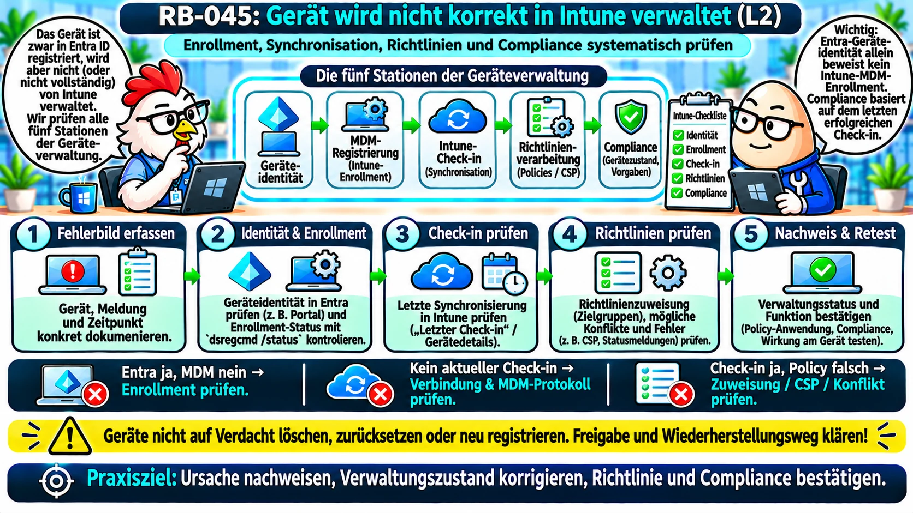

# RB-045 – Gerät wird nicht korrekt in Intune verwaltet (L2)

**Projekt:** 50 Tickets – 50 typische IT-Supportfälle  
**Stand:** 22.11.2026 · **Version:** 1.0 · **Systeme:** Windows 11, Microsoft Entra ID, Microsoft Intune  
**Status:** Offizielle Microsoft-Quellen recherchiert, theoretisch nachvollzogen; **noch nicht praktisch validiert**. Alle Namen, IDs, Fehlerzustände und Störungsfälle sind **fiktiv**. Keine produktiven Geräte wurden verändert.



> **Merksatz:** **Entra-Geräteidentität ≠ Intune-MDM-Enrollment ≠ erfolgreicher Check-in ≠ wirksame Richtlinie ≠ bestätigte Compliance.** Erst feststellen, auf welcher Ebene die Kette scheitert.

---

## 1. Störungsbild, Abgrenzung und Lernziel

**Muster-Ticket:** „Mein Windows-11-Arbeitsgerät taucht in Entra ID auf, aber im Intune Admin Center fehlen die Einstellungen; die Geräte-Compliance ist unbekannt und die neue Unternehmensrichtlinie kommt nicht an.“

**Ziel:** Eindeutig die Geräteidentität und das betroffene Verwaltungssymptom bestimmen; Enrollment, letzte Meldung, Zuweisung, Konfigurationsstatus und tatsächliche Clientwirkung mit unabhängigen Befunden abgleichen. Erst danach eine freigegebene Korrektur wählen und verifizieren.

**Weitere Fehlermeldungen:** „Gerät wird bereits verwaltet“, „Ihr Unternehmen kann das Gerät nicht verwalten“, „Richtlinie ausstehend“, „Nicht konform“, „Synchronisierung fehlgeschlagen“, „Konfiguration in Intune erfolgreich, lokal nicht sichtbar“.

**Abgrenzung:** RB-029 behandelt Lizenzfehler, RB-040 klassische AD-GPO-Verarbeitung und RB-046 das eigentliche Softwaredeployment. RB-045 behandelt **den MDM-Verwaltungszustand als Ganzes**. Ein Gerät kann korrekt eingeschrieben sein und dennoch bei einzelnen Apps/Policies Probleme haben.

**L2-Arbeitsziel:** Zwei getrennte Belege anfertigen: **Intune-Cloudstatus** und **Client-Befund**; anschließend Ursache, konkrete Maßnahme und erfolgreichen Retest dokumentieren. [Q1–Q6]

## 2. Architektur: Fünf voneinander zu trennende Stationen

```text
Microsoft Entra: eindeutige Geräteidentität (Join/Registrierung)
            ↓
MDM-Enrollment: Gerät wird tatsächlich in Intune verwaltet
            ↓
Check-in: Gerät verbindet sich, verarbeitet Aufgaben und meldet Status
            ↓
Zuweisung + Verarbeitung: Policies, CSP, Gruppen, Filter, Konflikte
            ↓
Compliance: Gerät bewertet und Status an Intune zurückgemeldet
            ↓
Geschäftsprüfung: erwartete Einstellung vorhanden, Zugriff funktioniert
```

- **Microsoft Entra Join/Registrierung:** Identität und Vertrauenszustand im Verzeichnis; nicht automatisch der Nachweis, dass Intune MDM-Richtlinien verwaltet.
- **MDM-Enrollment:** Eigenständige Registrierung beim MDM-Dienst; berechtigter MDM-Provider, Geräte-/Benutzerkontext und unterstützte Betriebssystemedition erforderlich.
- **Check-in:** Austausch mit Intune. Fehlender aktueller Check-in kann neue Zuweisungen und Statusmeldungen verhindern; **ein vergangener erfolgreicher Check-in beweist nicht die aktuelle Verarbeitung jeder Policy**.
- **Policy-Verarbeitung:** Eine bestimmte Policy kann *Pending*, *Error*, *Conflict*, *Not applicable* oder erfolgreich sein; Scope, Gruppen und CSP-Eignung getrennt prüfen.
- **Compliance:** Bewerteter und gemeldeter Gerätezustand, oft mit Einfluss auf Conditional Access. **„Nicht konform“ ist nicht dasselbe wie „nicht registriert“**. [Q1, Q2, Q4]

## 3. Typische Fehlerbilder und die jeweils erste Hypothese

| Befund | Denkbare Ursachen | Erste gezielte Prüfung |
|---|---|---|
| Entra-Eintrag existiert, aber kein aktuelles Intune-Gerät | Kein MDM-Enrollment, falscher Tenant, falscher Datensatz, Restriktion, fehlende Lizenz | Identität, MDM-Status, Enrollment-Fehlercode |
| Enrollment bricht ab | Lizenz, MDM-User-Scope, Geräteobergrenze, Windows-Edition, Enrollment-Restriktion, vorhandene Verwaltung | Intune-/Entra-Vorgaben und MDM-Admin-Log |
| Letzter Intune-Check-in alt | Gerät offline, Proxy/TLS/DNS, Dienst-/Konto-/Enrollment-Problem | Gerätezeitstempel, Client-Netzwerk, MDM-Ereignisse |
| Check-in aktuell, bestimmte Policy fehlt | Gruppenzuweisung, Filter, Scope, Plattform, CSP nicht anwendbar | Policy-Assignment und Geräte-Policy-Report |
| Policy meldet *Conflict* | Zwei Konfigurationen widersprechen sich | Konkrete kollidierende Einstellung und Quellprofile |
| Status *Pending* oder *Not evaluated* | Noch keine Meldung, ausstehende Evaluierung, Datenaktualisierung | Letzte Meldung und zeitlicher Verlauf |
| Portal sagt „konform“, Gerät zeigt falsches Verhalten | Bericht verzögert, andere Policy, lokale Wirkung fehlerhaft | Gerätestatus + lokale Einstellung nachmessen |

**Nicht aus einem einzelnen Portalstatus schließen**, dass Hardware, Benutzerkonto oder gesamte Richtlinienplattform defekt ist. [Q1, Q4]

## 4. Ticketaufnahme: Eine eindeutige Gerätezuordnung herstellen

1. **Benutzer und Gerät:** Hostname, Windows-Version/-Edition, Gerätetyp, Standort/VPN, betroffener Benutzer, UPN (datensparsam).
2. **Identifikatoren:** Entra Device ID und Intune Device ID dort abgleichen, wo verfügbar; Seriennummer kann als Vergleichshinweis dienen. **Hostname allein ist nicht eindeutig.**
3. **Tenant und Enrollment-Pfad:** Entra joined, hybrid joined, registered/BYOD, Autopilot oder GPO-Autoenrollment? Erneute Enrollmentversuche, Gerätewechsel, Imaging oder Klonen?
4. **Fehlerbild:** Welches Policy-Profil / welcher Compliance-Check / welcher Zugriff fehlt? Wortlaut, Code, Zeit und letzte erfolgreiche Verarbeitung.
5. **Ausmaß:** Ein Gerät, eine Nutzergruppe, ein bestimmter Gerätesatz oder ganzer Standort? Vergleich mit bekannt intaktem, gleichartig zugewiesenem Gerät.
6. **Impact:** Conditional Access blockiert Ressourcen? Security-Baseline fehlt? Produktions-/Datenverlustgefahr oder lediglich Portalverzögerung?

**Schreibregel:** „Gerät nicht verwaltet“ ist zu unpräzise; besser: „Entra-Join vorhanden, kein Intune-MDM-Enrollment nachweisbar“ oder „Enrollment vorhanden, letzter Check-in 72 h alt“.

## 5. Sicherheitsgate – **vor** Änderungen an Verwaltung und Identität

- Vorhandene Geräte-/Entra-Objekte **nicht auf Verdacht löschen**; **kein Wipe, Retire, Fresh Start, Autopilot Reset, Zurücksetzen, MDM-Abmelden oder `dsregcmd /leave`** ohne Change, Eigentümer, Daten- und Wiederherstellungsplan.
- Keine ungezielten **MDM-Zertifikate/Registry-Profile** entfernen. Einzelne Microsoft-Artikel beschreiben solche Eingriffe für **spezifische Fehlercodes**; sie sind keine Standardreparatur.
- Bei Remotezugriff sicherstellen, dass VPN, Anmeldung, BitLocker-Schlüssel, Gerätezertifikate, Wiederaufnahme der Verwaltung und Fernzugang geklärt sind.
- Intune-**Sync ist eine Zustandsänderung**: Er kann ausstehende Richtlinien, Skripte und Appaktionen anstoßen. Nur mit Einwilligung/Berechtigung und bekannter Auswirkung durchführen.
- Ausgaben von `dsregcmd`, Logdateien und MDM-Diagnosepaketen können Tenant-, Nutzer-, Device-ID- und andere sensible Details enthalten; nur erforderliche Auszüge geschützt ablegen.
- Compliance-/Security-Richtlinien **niemals abschalten**, nur damit die Anzeige „grün“ wird. [Q2–Q6]

## 6. Diagnose A – Entra-Registrierungszustand lokal **lesend** prüfen

Auf dem **betroffenen** Windows-PC in einer **gewöhnlichen Benutzerkonsole** für den Benutzerkontext (bei Bedarf gezielte Gegenprüfung als Admin, aber nicht die Kontexte verwechseln):

```cmd
REM LESEND: Windows-Geräteregistrierungszustand untersuchen.
dsregcmd /status
```

Relevante Abschnitte und Interpretationsgrenzen:

| Feld (Beispiel) | Bedeutung im passenden Kontext |
|---|---|
| `AzureAdJoined : YES` | Das Gerät ist Microsoft Entra joined; **nicht automatisch Intune enrolled** |
| `DomainJoined : YES` | Lokale AD-Domänenmitgliedschaft; zusammen mit Entra Join Hinweis auf Hybrid Join |
| `WorkplaceJoined : YES` | Benutzerseitige Arbeitsplatzregistrierung möglich; kein allgemeiner MDM-Nachweis |
| `AzureAdPrt : YES` | Hinweis auf nutzerbezogene SSO-Sitzung im passenden Kontext; sagt allein nichts über jede MDM-Policy |

**Wichtig:** `dsregcmd /status` ersetzt nicht den **Intune-Enrollmentstatus** im Admin Center und auch nicht den MDM-Ereignisnachweis. Je nach Anmeldekontext können bestimmte User-State-Felder abweichen. Vollständige Ausgaben nicht ungefiltert ins Ticket kopieren. [Q2, Q3]

## 7. Diagnose B – Enrollment und Berechtigungspfad im Portal prüfen

Bei berechtigtem Zugriff auf `https://intune.microsoft.com` und Entra-Portal:

1. Gerät im **Intune Admin Center → Geräte → Alle Geräte** anhand sicherer Merkmale suchen; Status, Verwaltungstyp und **letzten Check-in** notieren.
2. Das passende Entra-Geräteobjekt mit Join-Typ, Geräte-ID und Aktivität korrelieren. Ein ähnlich benanntes altes/dupliziertes Objekt nicht vorschnell verwenden.
3. Bei **fehlendem Enrollment** prüfen: korrekter **Tenant**, Benutzerlizenz und Enrollmentberechtigung, **MDM User Scope**, unterstützte Windows-Edition, Geräteobergrenze und Enrollment-Restriktionen (Plattform/Besitz).
4. Bei **hybrid-joined GPO-Autoenrollment**: Join-Zustand, einschlägige GPO, Aufgabenplanung unter `Microsoft\Windows\EnterpriseMgmt` und MDM-Log prüfen. GPO-Autoenrollment ist nicht der gleiche Pfad wie jede BYOD-Registrierung.
5. Wenn **anderes MDM** oder eine bestehende Registrierung gemeldet wird: genaue Fehlermeldung und Organisationseigentümer ermitteln; keine vorhandene Verbindung entfernen, bevor der Übergangsprozess feststeht.

**Beispiel:** „Entra-Geräteobjekt vorhanden“ + „kein Intune-Enrollment“ → zuerst **Registrierungsursache** untersuchen; Policy-Konflikte sind hier noch keine sinnvolle erste Hypothese. [Q2, Q3]

## 8. Diagnose C – MDM-Logs und Ereignisse **lesend** korrelieren

Die Windows-Ereignisanzeige enthält MDM-Verarbeitungsdaten unter:

`Anwendungs- und Dienstprotokolle → Microsoft → Windows → DeviceManagement-Enterprise-Diagnostics-Provider → Admin`

Die folgenden PowerShell-Abfragen lesen vorhandene Ereignisse; lokale Administratorrechte können je nach Umgebung nötig sein:

```powershell
# LESEND – die 30 jüngsten MDM-Admin-Ereignisse:
$Log = 'Microsoft-Windows-DeviceManagement-Enterprise-Diagnostics-Provider/Admin'
Get-WinEvent -LogName $Log -MaxEvents 30 |
  Select-Object TimeCreated, Id, LevelDisplayName, Message

# LESEND – spezifische Enrollment-Ereignisse mit Zeitstempel:
Get-WinEvent -FilterHashtable @{LogName=$Log; Id=75,76} -MaxEvents 20 |
  Select-Object TimeCreated, Id, Message
```

- Bei **GPO-Autoenrollment** ist Ereignis **75** ein Hinweis auf erfolgreiches, **76** auf fehlgeschlagenes Autoenrollment. Fehlen beide, kann die Einschreibung möglicherweise gar nicht gestartet worden sein; geplante Aufgabe und GPO prüfen.
- **Nicht** jede Intune-Konfiguration nutzt genau diese Enrollment-Events; Codes und Ereignistext stets im konkreten Registrierungspfad interpretieren.
- MDM-Diagnoseexport (z. B. `mdmdiagnosticstool.exe`) nur nach Freigabe und mit geeigneter sicherer Ablage; der Export schreibt Dateien und ist daher **nicht** als rein lesender Befehl kategorisiert. [Q3, Q5]

## 9. Diagnose D – Fehlenden Check-in von fehlender Policy trennen

**Wenn bereits enrolled:** Letzten Check-in im Intune-Geräteobjekt und Zustand zum Fehlerzeitpunkt vergleichen. Kontrolliere Datum/Uhrzeit, grundlegende Verbindung zur erlaubten Intune-Infrastruktur, Proxy und TLS-Zertifikatskette; keine Firewall pauschal deaktivieren.

- **Portal zuletzt aktuell?** Das Gerät kommuniziert offenbar mit Intune, trotzdem können einzelne Zuweisungen fehlerhaft sein.
- **Letzter Check-in lange zurück?** Lokalen Netzpfad und MDM-Ereignisse prüfen; weitere Policies können nicht zuverlässig zugestellt werden.
- **Sync**: *Windows → Einstellungen → Konten → Auf Arbeits- oder Schulkonto zugreifen → entsprechende Verbindung → Informationen → Synchronisieren*; alternativ die autorisierte Geräteaktion **Sync** im Intune Admin Center. **Vorher** Auswirkungen und Berechtigung prüfen.
- Ein Sync fordert einen Check-in an, **garantiert aber keinen sofortigen Erfolg aller Richtlinien**. Nach dem Sync Statuszeit und lokalen Befund erneut erheben. [Q1, Q4]

## 10. Diagnose E – Policies, Compliance und CSP getrennt bewerten

Bei einem Gerät mit aktueller MDM-Verbindung:

| Policy-/Reportstatus | Plausible Einordnung | Nächste Maßnahme |
|---|---|---|
| **Not applicable** | Einstellung nicht für OS, Edition oder Gerät relevant | Plattform, Voraussetzungen, CSP prüfen |
| **Pending / Not evaluated** | Gerät hat noch nicht zugestellt, ausgewertet oder zurückgemeldet | Check-in und Reportzeit prüfen |
| **Conflict** | Gegensätzliche Einstellungen aus mehreren Profilen | Betroffene Einstellung und Profile korrelieren |
| **Error** | Fehler bei spezifischer Anwendung / CSP | Fehlercode, MDM-Event, unterstützte CSP-Option vergleichen |
| **Succeeded / Compliant** | Bericht bestätigt den gemeldeten Zustand (zu diesem Zeitpunkt) | **Tatsächliche Einstellung und Funktion** am Client prüfen |

**Zuweisungslogik:** Benutzer- vs. Gerätegruppe, Include-/Exclude-Gruppen, Assignment-Filter, richtige Plattform, vorhandene Lizenz, korrekter Policy-Typ, Scope-Tags und Berechtigungen unterscheiden. „In der richtigen Gruppe“ beweist noch nicht, dass Filter und Plattformbedingungen passen.

**Compliance ist ein eigenes Prüffeld**: Reporting kann vom letzten Check-in oder Nutzerkontext abhängen; *Not evaluated* ist nicht zwingend *Noncompliant*. Bei Conditional Access betroffenes Gerät und konkrete CA-Entscheidung über zuständige Security-Admins prüfen. [Q1, Q4]

## 11. Hypothesen systematisch testen – Entscheidungsmatrix

| Beobachtung A | Gegenprobe B | Diagnoserichtung | Nicht direkt tun |
|---|---|---|---|
| Entra vorhanden, Intune nicht enrolled | MDM-Enrollment-Ereignis / Nutzerlizenz / Scope | Enrollmentpfad | Gerät löschen, wieder neu joinen |
| Enrolled, letzter Check-in veraltet | Lokales MDM-Log, Proxy, Uhrzeit | Kommunikations-/Sync-Problem | Alle Policies neu anlegen |
| Check-in aktuell, Policy gar nicht zugewiesen | Gruppe, Filter, Plattform | Targetingproblem | MDM-Dienst neu installieren |
| Richtlinie zugewiesen, `Conflict` | Andere Profile mit gleicher Einstellung | Konflikt auf Einstellungsniveau | Sicherheitsrichtlinien abschalten |
| Richtlinie meldet Erfolg, lokale Einstellung fehlt | Eventlog, tatsächlichen CSP-/Registry-Wert prüfen | Abweichung zwischen Report und Wirkung | Bericht allein als Beweis akzeptieren |
| Nur einzelne Benutzer auf Shared Device | Benutzer-/Gerätezuordnung, letzter Report-Kontext | Kontext und Reporting | Auf Verdacht alle Benutzerprofile entfernen |

**Stop-Punkt:** Fehlen sichere Geräteidentität, Berechtigung oder Rückfallweg, erst weitere Belege bzw. verantwortliche Administration einschalten. Keine Reparatur als Selbstzweck. [Q1–Q6]

## 12. Maßnahmen nach Ursache, jeweils nach Freigabe

**L2, kontrolliert:** Fehlende Lizenz oder Enrollment-Restriktion durch berechtigtes Team beheben lassen; korrekte Policy-Zielgruppe/Filter prüfen; CSP-Fehler gezielt anhand des konkreten Codes beheben; autorisierten Sync auslösen, Erfolg zeitversetzt vergleichen.

**Endpoint-/Identity-/Security-Owner:** MDM-Enrollment und Vertrauensstatus nach firmenspezifischem Verfahren wiederherstellen; defekte Geräte-/Zertifikatsidentität korrigieren; Hybrid Join/Autopilot/Co-Management koordiniert reparieren. Erneutes Enrollment nur bei nachgewiesener Notwendigkeit und dokumentiertem Sicherungs-/Recoveryplan.

**Nicht als Universalreparatur:** `dsregcmd /leave`, Registry- oder MDM-Zertifikatlöschung, Gerät aus Entra/Intune entfernen, Autopilot Reset/Wipe/Retire, GPO/CA-/Defender-Richtlinien ausschalten. Microsoft beschreibt solche Operationen teils für konkrete Spezialfälle; ohne passende Diagnose und Freigabe sind sie riskant. [Q2, Q5]

## 13. Zwei realistische, ausdrücklich **fiktive** Supportfälle

### Fall A – Entra-Geräteobjekt, aber keine Intune-Verwaltung

**Ticket:** „Auf dem neuen Firmennotebook steht beim Start ein Unternehmenskonto, aber die Intune-Geräterichtlinien fehlen.“  
**Befund 1:** `dsregcmd /status` zeigt `AzureAdJoined : YES`.  
**Befund 2:** Für die konkret abgeglichene Geräteidentität wird **kein aktuelles MDM-Enrollment** nachgewiesen.  
**Hypothesen:** fehlende automatische Einschreibung, Lizenz-/MDM-Scope-/Restriktionsproblem oder falscher Tenant.  
**Lesende Tests:** Intune-Geräteliste und Entra-Objekt zuordnen, Enrollment-Fehlercodes und Geltungsbereich prüfen.  
**Musterlösung:** Ein **fiktiv** nachgewiesener MDM-Scope-Ausschluss wird durch berechtigten Admin freigegeben korrigiert; Gerät registriert sich kontrolliert.  
**Retest:** Intune-Geräteobjekt mit korrekter Identität, neuer Check-in und konkret erwartete Test-Policy nachgewiesen.

### Fall B – Enrollment vorhanden, aber Compliance dauerhaft „ausstehend“

**Ticket:** „Gerät erscheint in Intune, Zugriff auf Unternehmensressourcen bleibt aber gesperrt.“  
**Befund 1:** Intune zeigt Enrollment vorhanden, aber alten letzten Check-in.  
**Befund 2:** Im lokalen MDM-Admin-Log stehen zeitgleiche Kommunikationsfehler.  
**Hypothesen:** Proxy/TLS-/DNS-Problem, Gerätezertifikat oder MDM-Verbindung.  
**Lesende Tests:** Gültige Uhrzeit, MDM-Ereignisse, Netz-/Proxyvorgaben, Vergleichsgerät am selben Standort.  
**Musterlösung:** Ein **fiktiver** fehlerhafter Proxyweg wird durch Netzteam gezielt korrigiert.  
**Retest:** Check-in wird wieder aktuell, Compliance-Report verarbeitet, betroffene Ressource wird bei erfüllten Richtlinien zugänglich.

**Keine dieser Ursachen wurde in einer realen Laborumgebung nachgestellt.** Der Übungswert liegt in der Auswahl trennscharfer Tests, nicht im schnellen Erraten der Musterlösung.

## 14. Erfolgskontrolle, Eskalation und Ticketdokumentation

**Erfolg erfordert mehrere übereinstimmende Belege:**

1. Richtige Geräteidentität/Tenant, erwarteter Join- und MDM-Enrollmentzustand.
2. Erfolgreicher **neuer** Check-in mit dokumentiertem Zeitpunkt.
3. Konkrete erwartete Policy/Compliance-Status nach relevanter Verarbeitungsdauer.
4. **Wirkung vor Ort** nachweisbar (z. B. geforderte Gerätekonfiguration oder genehmigter Zugriff).
5. Keine unbeabsichtigten Folgen für VPN, Zertifikate, BitLocker, Benutzeranmeldung, Sicherheit oder andere Apps.

**Eskalation:** mehrere Geräte betroffen, MDM-Service-Incident, widersprüchliche Compliance-Sicherheitsentscheidung, Autopilot/Hybrid Join, Identitätskonflikt, ausstehender Wipe/Retire, Zertifikats-/CA-Fehler, unklarer Rückfallweg → Endpoint Engineering, Identity, Security oder Microsoft Support.

**Muster-Ticketkommentar (fiktiv):**

> RB-045: Windows-11-Gerät und Entra-/Intune-Geräteidentität korreliert; Enrollment vorhanden, letzter Check-in veraltet. Lokale MDM-Ereignisse und Proxykonfiguration geprüft, keine Änderung ohne Freigabe. Nach genehmigter Korrektur durch Netzteam neuer Check-in erfolgt, Zielrichtlinie gemeldet und lokale Wirkung bestätigt. Kein Reset/Re-Enrollment durchgeführt. Referenzen: Ereigniszeit und genehmigtes Change-Ticket.

## 15. Active Recall, Self-Explanation und späteres Training

**Wissensfragen:**
1. Wieso ist `AzureAdJoined : YES` kein MDM-Enrollmentbeweis?
2. Welche zwei Nachweise benötigst du für eine erfolgreiche Richtlinienübertragung?
3. Wo befindet sich das MDM-Admin-Ereignisprotokoll in Windows?
4. Worin unterscheiden sich `Pending`, `Conflict`, `Not applicable` und `Noncompliant`?

**Verständnisfragen:**
5. Weshalb kann ein Intune-Portalbericht hinter dem lokalen Gerätestatus zurückliegen?
6. Warum kann das Auslösen eines Sync trotz „nur Diagnose“ Auswirkungen auf das Gerät haben?
7. Wieso ist das Löschen eines Entra-Geräteobjekts keine harmlose Standardreparatur?

**Diagnosekarten:**
8. Entra-Gerät vorhanden, kein Intune-Datensatz: Nenne drei Hypothesen und je einen trennenden Test.
9. Letzter Check-in aktuell, eine Policy meldet `Conflict`: Was prüfst du **vor** Netzwerk und Enrollment?
10. Intune meldet „Compliant“, Benutzer bleibt gesperrt: Welche weitere Ebene muss geprüft werden?

**Training:** In einer **isolierten, ausdrücklich freigegebenen Testumgebung** zunächst einen gesunden MDM-Verwaltungszustand dokumentieren, dann einen **simulierten** Fall mit fehlender Policy-Zuweisung oder veralteter Statusmeldung behandeln – ohne produktive Geräte aus der Verwaltung zu entfernen. Den eigenen Diagnoseweg vor dem Vergleich mit dem Runbook aufschreiben; nach ca. **7 und 21 Tagen** mit verändertem Fehlerbild abrufen.

---

## Quellen – offizielle Microsoft-Dokumentation (abgerufen 22.11.2026)

- **[Q1]** [Troubleshoot policies and configuration profiles in Intune](https://learn.microsoft.com/en-us/troubleshoot/mem/intune/device-configuration/troubleshoot-policies-in-microsoft-intune)
- **[Q2]** [Diagnose MDM enrollment failures](https://learn.microsoft.com/en-us/windows/client-management/mdm-diagnose-enrollment)
- **[Q3]** [Troubleshooting Windows device enrollment errors](https://learn.microsoft.com/en-us/troubleshoot/mem/intune/device-enrollment/troubleshoot-windows-enrollment-errors)
- **[Q4]** [Monitor device compliance policy results](https://learn.microsoft.com/en-us/intune/device-security/compliance/monitor-policy)
- **[Q5]** [Collect MDM logs](https://learn.microsoft.com/en-us/windows/client-management/mdm-collect-logs)
- **[Q6]** [Intune device action: Sync](https://learn.microsoft.com/en-us/intune/device-management/actions/sync)
- **[Q7]** [Windows device enrollment guide](https://learn.microsoft.com/en-us/intune/device-enrollment/windows/guide)
- **[Q8]** [Troubleshoot device enrollment in Intune](https://learn.microsoft.com/en-us/troubleshoot/mem/intune/device-enrollment/troubleshoot-device-enrollment-in-intune)

**Transparenz:** „Eigene Konzeption, KI-gestützte Visualisierung mit ChatGPT.“ Die technische Dokumentation ist eine **recherchierte Arbeitsvorlage**, kein Beleg erfolgreich durchgeführter Supportmaßnahmen.
