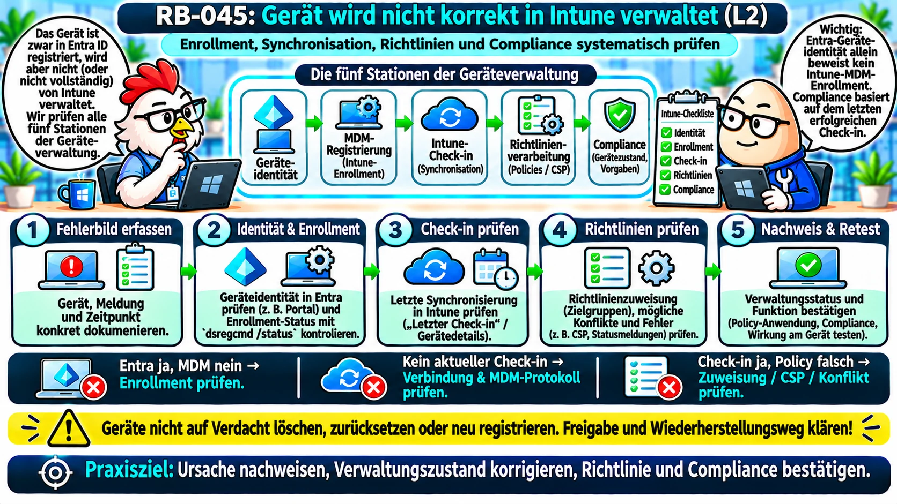

# RB-045 – Praxis-Runbook (L2): Gerät wird nicht korrekt in Intune verwaltet

**Projekt:** 50 typische IT-Supportfälle · **Stand:** 22.11.2026 · **Version:** 1.0  
**Status:** Technisch recherchiert; **noch nicht praktisch validiert**. Beispielwerte sind fiktiv. Keine produktiven Geräte wurden verändert.



**Ziel:** Fehlerhafte Station **Identität → MDM-Enrollment → Check-in → Richtlinien → Compliance** nachweisen und kleinste freigegebene Korrektur anhand des echten Gerätestatus verifizieren.

## 1. Ticketannahme – Betroffenheit präzisieren

- [ ] Hostname, Geräte- und Benutzerkontext, Tenant, Windows-Version/Edition, Standort/VPN dokumentiert?
- [ ] Genaue Meldung, betroffene Richtlinie/App/Compliance, Zeitpunkt, Fehlercode vorhanden?
- [ ] Ein Gerät oder mehrere? Problem nach Neuinstallation/Join, Enrollment oder Policy-Änderung?
- [ ] Bedroht die Störung Anmeldung, Zugang zu Ressourcen, Security-Compliance oder produktive Arbeit?

**STOP:** Keinen Geräteobjektnamen mit einer eindeutigen technischen Identität verwechseln. Ggf. mehrere alte/duplizierte Einträge sichern und korrekt zuordnen.

## 2. Sicherheits- und Freigabeprüfung

- [ ] Gerätetyp, Eigentümer, Zugriffsrecht auf Intune-/Entra-Portale, Recovery- und Rückfallweg geklärt?
- [ ] BitLocker-/Gerätezertifikat-/VPN-/Autopilot-/Hybrid-Join-Risiken bewertet?
- [ ] **Keine** Remote-Wipe-/Retire-/Reset- oder Enrollment-Entfernung auf Verdacht.
- [ ] Geplanter Sync mit Auswirkung auf ausstehende Konfigurationen mit Gerätebesitzer abgestimmt?
- [ ] Nur datensparsame Diagnoseauszüge; MDM-Protokolle geschützt ablegen.

**Sofort eskalieren**, wenn nur Fernzugriff, Benutzer ohne Wiederherstellungsweg, Security-Incident, fälschlich gelöschtes Geräteobjekt oder kritische Conditional-Access-Sperre vorliegt.

## 3. Geräteidentität lokal **lesend** prüfen

```cmd
REM LESEND – Client-Konsole im aktuellen Benutzerkontext:
dsregcmd /status
```

- [ ] `AzureAdJoined`, `DomainJoined` und ggf. `WorkplaceJoined` eingeordnet?
- [ ] `AzureAdPrt` (SSO, Kontext beachten) bei Bedarf geprüft?
- [ ] Gerätekontext und Entra-Datensatz anhand sicherer Merkmale abgeglichen?
- [ ] **Nicht** aus `AzureAdJoined : YES` auf erfolgreiches Intune-Enrollment geschlossen?

## 4. Enrollment und MDM-Berechtigungen im Portal **lesend** prüfen

- [ ] `intune.microsoft.com → Geräte → Alle Geräte`: korrektes Gerät, **MDM-Verwaltungsstatus**, letzter Check-in?
- [ ] Entra-Geräteobjekt (Join-Typ/Device-ID) mit Intune-Geräteobjekt verglichen?
- [ ] Falls **nicht enrolled**: Lizenz, MDM User Scope, Geräteobergrenze, Windows-Edition, Enrollment-Restriktion und Tenant überprüft?
- [ ] Bei hybrid-/GPO-Autoenrollment: GPO und `Microsoft\Windows\EnterpriseMgmt`-Aufgabe prüfen, nicht bei jeder Enrollmentart voraussetzen.
- [ ] Bei `already enrolled`: andere aktive MDM-Verwaltung oder alter Datensatz nachgewiesen, nichts gelöscht?

## 5. Windows-MDM-Ereignisse **lesend** erfassen

```powershell
# LESEND – ggf. erhöhte Berechtigung nötig; nicht den ganzen Log exportieren:
$MdmLog = 'Microsoft-Windows-DeviceManagement-Enterprise-Diagnostics-Provider/Admin'
Get-WinEvent -LogName $MdmLog -MaxEvents 40 |
  Select-Object TimeCreated, Id, LevelDisplayName, Message

# Bei GPO-Autoenrollment: Erfolg 75 / Fehler 76 im Kontext:
Get-WinEvent -FilterHashtable @{LogName=$MdmLog; Id=75,76} -MaxEvents 15 |
  Select-Object TimeCreated, Id, Message
```

- [ ] Fehlercode, Zeitpunkt und Enrollment-/Policy-Kontext dokumentiert?
- [ ] Kein Ereignis 75/76: Automatik eventuell nicht gestartet – Trigger/GPO prüfen?
- [ ] Keine beliebige „MDM-Reparatur“ ohne nachgewiesene Ursache?

## 6. Check-in und Gerätekontakt bewerten

- [ ] Letzter Check-in und Gerätezustand im Portal mit aktuellem Datum verglichen?
- [ ] Client erreichbar? Netzwerk, Uhrzeit, Proxy/DNS/TLS und erforderliche Microsoft-Endpunkte gemäß Netzrichtlinie überprüft?
- [ ] Check-in **veraltet** → zuerst Transport/MDM-Log prüfen, nicht Policy-Filter verändern.
- [ ] Falls genehmigt: *Windows → Konten → Auf Arbeits- oder Schulkonto zugreifen → Info → Synchronisieren* bzw. Intune-Geräteaktion *Sync*; **vorher** betriebliche Auswirkungen klären.
- [ ] **Danach** neue Check-in-Zeit, konkrete Statusmeldung und lokale Wirkung dokumentiert?

## 7. Policy-Zuweisung, CSP und Compliance getrennt prüfen

- [ ] Erwartete Policy wirklich zugewiesen? User-/Gerätegruppe, Filter, Ausschluss und Plattform geprüft?
- [ ] Policy-Status **Pending / Not applicable / Conflict / Error / Succeeded** mit Zeit und Fehlercode erfasst?
- [ ] Bei *Conflict*: tatsächliche konkurrierende Einstellung und Quellprofile identifiziert?
- [ ] Bei *Error*: MDM-Event und unterstützte CSP-/Windows-Voraussetzungen geprüft?
- [ ] Bei *Not evaluated / Pending*: Reportzeit und Check-in geprüft; **nicht** automatisch als *Noncompliant* interpretiert?
- [ ] Lokale Einstellung und tatsächliche Funktion gegen Portalbericht geprüft?

## 8. Entscheidungsmatrix – passende Diagnose statt Universalfix

| Belegter Zustand | Nächster Pfad | Unzulässiger Schnellschuss |
|---|---|---|
| Entra ja, Intune nicht enrolled | Lizenz/Scope/Restriktion, Enrollment-Log | Device aus Entra löschen |
| Intune enrolled, letzter Check-in alt | MDM-Events, Netzwerk, Proxy/TLS | alle Profile neu anlegen |
| Aktueller Check-in, Zielpolicy fehlt | Gruppen, Assignment-Filter, Plattform | MDM-Verbindung entfernen |
| Zielpolicy `Conflict` | Konfliktquelle im Einstellungsreport | Security-Baseline ausschalten |
| Zielpolicy erfolgreich, lokal ohne Wirkung | MDM-CSP-/Client-Log und reale Konfiguration | Ticket ohne Funktionstest schließen |
| Compliance unbekannt/ausstehend | Letzter Status und Gerätekontext | CA-Sicherheitskontrolle umgehen |

## 9. Nur genehmigte Korrektur und anschließender Retest

- [ ] Ursache anhand **mindestens zweier unabhängiger Befunde** gestützt?
- [ ] Zuweisungs-/Enrollment-/Proxy-/Policy-Änderung durch **berechtigte Zuständige** genehmigt und umgesetzt?
- [ ] Kein ungeprüfter `dsregcmd /leave`, kein Wipe/Retire/Reset/Device-Delete, keine Registry- oder Zertifikatslöschung?
- [ ] Richtige Identität weiterhin gültig, Intune enrolled, neue Check-in-Zeit sichtbar?
- [ ] Erwartete Policy verarbeitet, Compliance gemeldet und lokale Einstellung/Arbeitsfunktion bestätigt?
- [ ] Keine ungeplanten Folgen für Anmeldung, VPN, Zertifikate, Sicherheitsmaßnahmen?

## 10. Dokumentation, Eskalation und Abschluss

**Minimale Ticketdokumentation:** betroffenes Gerät (freigegebener Gerätebezeichner), Fehlercode/Zeit, Portalstatus, MDM-Event mit Zeit, Hypothese, trennender Test, genehmigte Maßnahme/Change, neuer Status, Erfolgstest, verbleibende Risiken.

**Eskalation zu** Endpoint Engineering / Identity / Security / Netzwerk / Microsoft Support, wenn Enrollmentzustand unklar, mehrfacher Widerspruch in Gerätestatistiken, Hybrid-Join/Autopilot/Co-Management, Security-/Conditional-Access-Problem, unklarer Datenrückfall oder MDM-Zertifikats-/Tokenkonflikt.

**Musterkommentar – vollständig fiktiv:**

> Gerät sicher zugeordnet, Entra-Join bestätigt, Intune-Enrollment vorhanden; Check-in veraltet. MDM-Event-/Proxyfehler zeitlich korreliert und Netzteam eingeschaltet. Nach freigegebener Korrektur neuer Intune-Check-in und wirksame Zielrichtlinie nachgewiesen. Anmelde-/Sicherheitsstatus unverändert, keine Abmeldung oder neue Registrierung durchgeführt.

**Transparenz:** Kein hier dargestellter Test wurde an einem produktiven Gerät ausgeführt. Aktuelle Verwaltungs-UI und Berechtigungskonzepte im jeweiligen Tenant vor der Durchführung kontrollieren.

### Nachbereitung für das Praxistraining

Ohne Runbook beantworten: *Ist das Problem Identität, Enrollment, Check-in, Targeting, CSP oder Compliance?* Erst drei Hypothesen aufstellen, dann zwei risikoarme Tests auswählen, danach die recherchierte Lösung vergleichen. Nach etwa 7 und 21 Tagen erneut an einem veränderten Testfall prüfen.

### Quellen – Microsoft Learn

1. https://learn.microsoft.com/en-us/windows/client-management/mdm-diagnose-enrollment
2. https://learn.microsoft.com/en-us/troubleshoot/mem/intune/device-enrollment/troubleshoot-windows-enrollment-errors
3. https://learn.microsoft.com/en-us/troubleshoot/mem/intune/device-configuration/troubleshoot-policies-in-microsoft-intune
4. https://learn.microsoft.com/en-us/intune/device-security/compliance/monitor-policy
5. https://learn.microsoft.com/en-us/windows/client-management/mdm-collect-logs
6. https://learn.microsoft.com/en-us/intune/device-management/actions/sync
