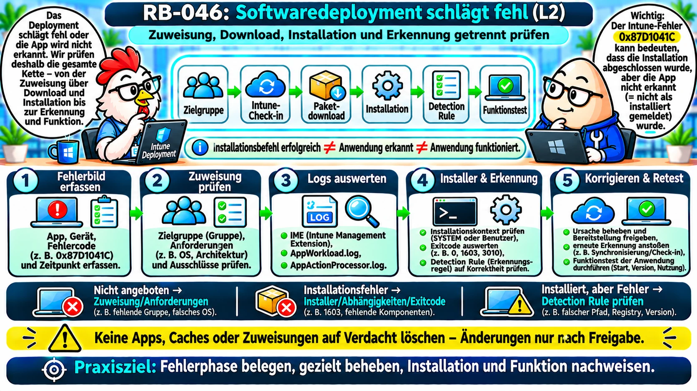

# RB-046 – Softwaredeployment schlägt fehl (L2)

**Projekt:** 50 Tickets – 50 typische IT-Supportfälle  
**Stand:** 23.11.2026 · **Version:** 1.0 · **Systeme:** Windows 11, Microsoft Intune / Intune Management Extension (IME), ergänzend Microsoft Configuration Manager (ConfigMgr) und Windows Installer  
**Status:** Recherche anhand offizieller Microsoft-Dokumentation; **noch nicht praktisch validiert**. Alle Personen, Geräte, Pakete, IDs und Störungsbeispiele sind **fiktiv**. Es wurde keine produktive Software installiert oder verändert.



> **Merksatz:** **Zugewiesen ≠ heruntergeladen ≠ Installer erfolgreich ≠ als installiert erkannt ≠ Anwendung funktioniert.** Für jedes „≠“ gibt es eigene Prüfungen und Protokolle.

---

## 1. Störungsbild, Lernziel und Abgrenzung

**Fiktives Eingangsticket:** „Die neue Fachanwendung wurde gestern zugewiesen, ist aber auf meinem Windows-11-PC nicht verfügbar. Im Company Portal steht ‚Fehlgeschlagen‘.“

**Lernziel:** Den **ersten nachweisbar fehlgeschlagenen Schritt** der Bereitstellungskette finden, statt nach einem beliebigen Fehlercode auf Verdacht App-Pakete oder Caches zu löschen. Belege mit Zeitstempeln, Zielgeräten und Versionsangaben sammeln, die tatsächlich betroffene Ebene korrigieren und danach **Erkennung und reale Funktion** bestätigen.

**Abgrenzung zu anderen Tickets:** RB-045 behandelt den allgemeinen Geräteverwaltungszustand in Intune; RB-046 beginnt bei einer **konkreten Softwarezuweisung** und geht bis zum überprüfbaren Anwendungsstart. RB-013 behandelt allgemein Softwareinstallation auf Einzelgeräten. Bei Problemen mit Windows Update siehe RB-027.

**Vorrangiger Praxisfall:** Intune-Win32-Anwendung als `.intunewin` mit IME. Ergänzend verweisen wir auf ConfigMgr, weil dort das Deployment-Modell ähnlich, aber die Clientprotokolle anders heißen. MSI und EXE unterscheiden sich bei Exit-Codes und Installer-Logs; für EXE-Pakete gelten primär die Herstellerangaben.

## 2. Architektur – die sechs Stationen einer App-Bereitstellung

| Station | Erwarteter Zustand | Denkbare Störung | Prüfquelle |
|---|---|---|---|
| 1. Zuweisung | Benutzer/Gerät im vorgesehenen Required-/Available-Ziel | Falsche Gruppe, Ausschluss, Zuweisung erst neu erfolgt | Intune-App-Zuweisungen, Gerätestatus |
| 2. Agent/Check-in | IME erhält die App-Richtlinie und ist erreichbar | Agent fehlt, kein Check-in, Proxy-/Netzproblem | Intune-Gerätedetails, `IntuneManagementExtension.log` |
| 3. Voraussetzungen/Content | Requirement-/Dependency-Regeln erfüllt, Paket verfügbar und geladen | OS/Architektur unpassend, Abhängigkeit fehlgeschlagen, Contentzugang | `AppWorkload.log`, `AppActionProcessor.log` |
| 4. Installation | Installationsbefehl läuft im richtigen Kontext und liefert auswertbaren Exit-Code | SYSTEM/USER-Kontext, Parameter, Platz, MSI/EXE-Fehler | IME-App-Logs, Installer-Log, Ereignisprotokoll |
| 5. Detection | Erkennungsregel bestätigt die installierte App | Falscher Pfad, HKCU/HKLM, 32-/64-Bit-Registry, Version, Skriptausgabe | Detection Rule, `AppActionProcessor.log` |
| 6. Funktion | App startet, Version passt, benötigte Funktion läuft | App startet nicht, fehlende Lizenz, Dienst oder Konfiguration | Funktionstest mit berechtigtem Benutzer |

**Wichtig:** Portalstatus und lokaler Befund können zeitlich auseinanderliegen. Ein einzelner Statuswert ist daher nur ein Hinweis; die Diagnose muss zum Zeitpunkt der Installation und zu den Client-Logs passen. [Q1][Q2]

## 3. Störungsklassen präzise unterscheiden

- **Nicht angeboten / nicht zugewiesen:** Im Portal fehlt die App; die Zuweisung oder Anforderung passt nicht.
- **Nicht anwendbar:** Eine Requirement Rule lehnt OS-Version, Architektur, Speicher oder eine eigene Bedingung ab.
- **Download-/Contentproblem:** Die App-Richtlinie wurde erkannt, aber Inhalt kann nicht bezogen werden; Netz, Proxy, DNS, Content-Endpunkte und Sicherheitsprodukte überprüfen.
- **Installerfehler:** Paket geladen, Installer gestartet, Rückgabecode ungleich dem als Erfolg eingestuften Code; Kontext, Parameter und Installer-Log korrelieren.
- **Detectionfehler:** Installer endet aus Sicht der Plattform erfolgreich, Detection meldet trotzdem „nicht vorhanden“ (z. B. Intune `0x87D1041C`).
- **Anwendung funktioniert nicht:** Detection erfolgreich, aber Start, Anmeldung oder Fachfunktion defekt. Kein reines Deploymentproblem mehr; je nach Fall L2/Applikationssupport.
- **Ausstehend / Neustart erforderlich:** Noch nicht gescheitert; Status, Retry- und Neustartlogik sowie Zeitfenster prüfen.

## 4. Ticketaufnahme: Reproduzierbarkeit statt Vermutungen

Vor Befehlen folgende Felder erfassen:

1. **Identität:** App-Name, Paket-/App-ID (ggf. intern), Version, Deployment-Typ (Win32, Store, MSI/LOB, ConfigMgr), Zuweisung `Required` oder `Available`, Installationskontext.
2. **Betroffene Systeme:** Hostname, Geräte-ID, Entra-/Intune-Verwaltungsstatus, Windows-Version und Architektur, einzelner PC oder viele PCs; Standort/VPN/Proxy.
3. **Befund:** Exakter Portal-/Company-Portal-Status, Code in Hex und ggf. Dezimal, Uhrzeit mit Zeitzone, letzte erfolgreiche App-Installation.
4. **Änderungen:** Neue Paketversion, neue Gruppe, geänderte Requirements/Detection/Abhängigkeiten, Sicherheitsrichtlinie, Netz-/Proxywechsel.
5. **Auswirkung:** Wer kann wegen der fehlenden Software nicht arbeiten? Rollout in Wellen? Gibt es einen genehmigten Workaround?

Erst die betroffene **App auf genau dem richtigen Client** bestimmen; nicht von einem ähnlichen Programmnamen auf dieselbe Paketversion schließen.

## 5. Sicherheits- und Freigabecheck vor jedem Eingriff

**Zuerst ausschließlich lesend prüfen.** Bei zentral verwalteten Geräten dürfen **Zuweisungen, Detection Rules, Pakete, Abhängigkeiten, Sicherheitsausnahmen, Cacheverzeichnisse und IME-Dienstzustände** nicht auf Verdacht geändert werden. Ebenso keine ungeprüften Skripte, keine eigenmächtigen lokalen Adminrechte und keine ungeplanten Neustarts.

Vor einer Änderung klären: zuständige App-/Endpoint-Administration, Rollout-Ring und Freigabe, Benutzerunterbrechung, Backup der Anwendungskonfiguration, Rollback/Deinstallation, Abhängigkeiten, möglicher Neustart, Auswirkung auf andere Geräte. Bei Cloud-Logs personenbezogene und vertrauliche Felder minimieren; Export nach Unternehmensvorgaben.

**STOP:** Sicherheitssoftware blockiert Installationsdatei; digitale Signatur/Quelle ist fragwürdig; Nutzer hat nur eine Fernverbindung, die durch Neustart oder Netzwerkänderung verloren gehen kann; App ist unternehmensweit betroffen und Change-Fenster fehlt. Nicht eigenmächtig Schutzmechanismen abschalten.

## 6. Diagnose A – Richtige Zuweisung und Requirements verifizieren

Im **Intune Admin Center** die betroffene Anwendung und deren Zuweisungen öffnen, den **tatsächlichen Benutzer- oder Gerätekontext** prüfen: Zielgruppe, Ausschlüsse, Required/Available, OS- und Architekturvoraussetzungen, Requirements und Supersedence/Dependencies. Für `Available` prüfen, ob die Installation überhaupt vom Nutzer im Company Portal ausgelöst wurde. Bei Wechsel von Gruppenmitgliedschaften die Richtlinienaktualisierung berücksichtigen.

**Hypothesentest:** App nicht installiert und im Portal für diesen Benutzer nicht verfügbar → wahrscheinlich vor dem Installer in Zuweisung/Requirements suchen. **Gegenprobe:** Identische Zuweisung auf einem bekannten funktionierenden Testclient; dabei OS und Gruppenzugehörigkeit vergleichen.

Dokumentation: Zeitpunkt der Zuweisung, Status auf dem Gerät, erfüllte bzw. nicht erfüllte Requirement Rules. Nicht bloß „Intune kaputt“ ins Ticket schreiben. [Q2][Q3]

## 7. Diagnose B – IME und Check-in lesend prüfen

Für Intune-Win32-Apps erfolgt die Verarbeitung über die **Intune Management Extension (IME)**. Die lokalen Protokolle liegen typischerweise unter:

`C:\ProgramData\Microsoft\IntuneManagementExtension\Logs`

Relevante Dateien: `IntuneManagementExtension.log` (Agent, Richtlinien, Check-in), `AppWorkload.log` (App-Verarbeitung, Installation, Detection) und `AppActionProcessor.log` (Anwendungsaktionen, Anwendbarkeit, Erkennung). Logs sind je nach Agentversion unterschiedlich umfangreich. [Q1][Q4]

**Lesende PowerShell-Abfragen am betroffenen, autorisierten Client:**

```powershell
# LESEND – IME-Dienststatus; verändert den Dienst nicht:
Get-Service -Name IntuneManagementExtension -ErrorAction SilentlyContinue |
  Select-Object Name, Status, StartType

# LESEND – Logdateien, Größe und Änderungszeit:
$logPath = Join-Path $env:ProgramData 'Microsoft\IntuneManagementExtension\Logs'
Get-ChildItem -LiteralPath $logPath -Filter '*.log' -File -ErrorAction SilentlyContinue |
  Select-Object Name, Length, LastWriteTime | Sort-Object LastWriteTime -Descending

# LESEND – nur aktuelle Zeilen für lokale Sichtprüfung; enthält ggf. sensible Daten:
Get-Content -LiteralPath (Join-Path $logPath 'AppWorkload.log') -Tail 100 -ErrorAction SilentlyContinue
```

**Interpretation:** Ein Dienst im Status „Running“ garantiert **keinen erfolgreichen Check-in**; fehlende frische Logeinträge sind ein Befund, kein alleiniger Beweis für einen bestimmten Netzwerkfehler. Zeitstempel, Portalstatus und Logeinträge korrelieren.

## 8. Diagnose C – Content, Abhängigkeiten und Installation voneinander trennen

Im App-Log gezielt suchen nach **App-ID/Name**, Downloadstart, Status des Content-Bezugs, Requirement- und Dependency-Ergebnis, tatsächlichem Installationsbefehl, **RunAs-Kontext** und Exit-Code. Keine produktive Installation nur zur Diagnose erneut starten.

**Kausalkette:**

- Kein Downloadstart trotz App-Richtlinie → Requirements/Dependencies/Zuweisung prüfen.
- Download startet, bleibt stehen → Netzwerk/Proxy/Contentzugriff; Verlauf und Uhrzeit dokumentieren.
- Download erfolgreich, Installer startet nicht → Kontext, Befehl, Paketpfad, Security-Blockierung, Requirements erneut bewerten.
- Installer läuft, meldet Fehler → Exit-Code **zusammen** mit Hersteller-/MSI-Log deuten.
- Exit-Code als Erfolg klassifiziert, Detection negativ → Detection Rule getrennt untersuchen.

**Nicht jedes Installationspaket ist MSI.** Bei EXE/Vendor-Installern sind Silent-Switches und Exit-Code-Semantik produktspezifisch. Ein fälschlich interaktiv wartendes Setup kann in einem unbeaufsichtigten Deployment scheitern. Bei `System`-Kontext unterscheiden sich Benutzerprofile und HKCU-Verhalten vom angemeldeten Nutzerkontext. [Q2][Q5]

## 9. Diagnose D – MSI-/EXE-Fehlercodes und Installer-Logs

**Häufige Windows-Installer-Rückgaben (nicht auf jede EXE anwendbar):**

| Code | Allgemeine Bedeutung | Konsequenz |
|---|---|---|
| `0` | Installer meldet Erfolg | Detection und Anwendung trotzdem separat überprüfen |
| `1603` | Schwerwiegender MSI-Installationsfehler | MSI-Log nach *konkreter* fehlgeschlagener Aktion und Kontext durchsuchen; nicht allein aus Code reparieren |
| `1618` | Andere Installation läuft | Windows-Installer-Konkurrenz anhand Ereignissen und Zeitpunkt bewerten |
| `3010` | Erfolg, Neustart erforderlich | In Deployment-Rückgabecodes/Neustartstrategie korrekt abbilden; kein ungeplanter Neustart |
| `0x87D1041C` | Intune: App nach erfolgreicher Installation nicht erkannt | Detection-Pfad/Skript/Version/Benutzerkontext untersuchen, nicht automatisch neu installieren |

Die MSI-Codes stammen aus der offiziellen Windows-Installer-Referenz; der Intune-Code beschreibt eine **nachgelagerte Erkennungsbewertung**, nicht einen MSI-Prozesscode. [Q6][Q7]

**Lesende Windows-Ereignisprüfung:**

```powershell
# LESEND – jüngste Windows-Installer-Einträge; keine Veränderung am System:
Get-WinEvent -FilterHashtable @{
  LogName='Application'; ProviderName='MsiInstaller';
  StartTime=(Get-Date).AddDays(-2)
} -MaxEvents 35 -ErrorAction SilentlyContinue |
  Select-Object TimeCreated, Id, LevelDisplayName, Message
```

**Nur im freigegebenen Test/Lab bzw. nach Change-Freigabe** ein MSI mit vollständiger Protokollierung **aktiv installieren** (dieser Befehl ist eine Änderung und gehört nicht in die lesende Erstdiagnose):

```powershell
# AENDERND – NUR FREIGEGEBENES TESTPAKET, Test-VM, Wartungsfenster:
# msiexec.exe /i 'C:\Lab\FreigegebeneTestApp.msi' /qn /norestart /L*V 'C:\Lab\install.log'
```

Im MSI-Log bei Problemen um den Eintrag `Return value 3` nach dem ursächlichen Fehlerkontext suchen. Nicht blind jede Zeile vor `Return value 3` als Ursache interpretieren. [Q8]

## 10. Diagnose E – Detection Rules, Registry-Sicht und Versionsprüfung

Nach erfolgreichem Installeraufruf wertet Intune die **Detection Rule** aus. Mögliche Kriterien: MSI-Product-Code, Dateipfad und Version, Registry-Pfad/Wert, eigenes PowerShell-Erkennungsskript.

**Lesend an einem Beispielpfad:**

```powershell
# LESEND – Beispielpfad an die tatsaechliche App anpassen:
Get-Item -LiteralPath 'C:\Program Files\Contoso\FachApp\FachApp.exe' -ErrorAction SilentlyContinue |
  Select-Object FullName, Length, LastWriteTime

# LESEND – installierte Dateiversion prüfen (falls Datei vorhanden):
[System.Diagnostics.FileVersionInfo]::GetVersionInfo(
  'C:\Program Files\Contoso\FachApp\FachApp.exe'
).FileVersion

# LESEND – 64-Bit- und 32-Bit-Uninstall-Registry vergleichen:
$uninstall = @(
  'HKLM:\SOFTWARE\Microsoft\Windows\CurrentVersion\Uninstall\*',
  'HKLM:\SOFTWARE\WOW6432Node\Microsoft\Windows\CurrentVersion\Uninstall\*'
)
Get-ItemProperty -Path $uninstall -ErrorAction SilentlyContinue |
  Where-Object DisplayName -like '*FachApp*' |
  Select-Object DisplayName, DisplayVersion, Publisher, InstallLocation
```

Der Beispielpfad ist **fiktiv**; wenn die Datei fehlt, kann der zweite Befehl einen Fehler melden – das ist kein Hinweis auf einen echten Produktnamen. Lesende Prüfungen auf lokalen Pfaden nur mit erforderlicher Berechtigung durchführen. Kein pauschales `Win32_Product`-Inventar verwenden, da diese WMI-Klasse unerwünschte Windows-Installer-Konsistenzprüfungen auslösen kann.

**Eigene Detection-Skripte in Intune:** Microsoft verlangt für „erkannt“ `Exit-Code 0` **und** eine Ausgabe auf **STDOUT**; eine Ausgabe auf **STDERR** kann „nicht installiert“ bewirken. 32-/64-Bit-Ausführung und SYSTEM-/USER-Kontext müssen zur erwarteten Installationsart passen. [Q2]

## 11. Fehlermatrix – Befund statt universellem Fix

| Beobachtung | Plausibler Prüfzweig | Gegenprobe / Nachweis |
|---|---|---|
| App für User nicht sichtbar | Zuweisung, Ausschluss, Required/Available, Requirements | Portal-Zielgruppe + Vergleichsuser |
| IME ohne neue App-Aktionen | Check-in, Agent, MDM-Gerätestatus, Proxy | IME-Log-Zeitstempel, andere zugewiesene App |
| Download schlägt fehl | Content, Netzwerk, Proxy, Security | Gleiches Netz vs. Vergleichsnetz/Client, Logfehler |
| Installationscode `1618` | Installer-Konkurrenz | Windows-Installer-Logs und laufende Installation |
| Exit `0`, Erkennung negativ | Detection Rule falsch oder App anders installiert | Datei/Version/Registry **gegen** Regel und Kontext |
| Portal „Installiert“, App startet nicht | Applikation oder Abhängigkeit nach Installation | Start mit Testbenutzer, App-/System-Logs |
| Viele Geräte gleichzeitig betroffen | Paketversion, Zuweisung, gemeinsamer Downloadpfad | Verteilung nach App-Version, Ring, Standort, Uhrzeit |

**Sonderfall ConfigMgr:** Hier sind für Anwendungen insbesondere `AppIntentEval.log` (Anforderungen und Zielzustand), `AppDiscovery.log` (Erkennung) und `AppEnforce.log` (Installationsdurchführung) zu verwenden – **nicht** die Intune-IME-Logs. [Q9]

## 12. Gezielte Maßnahmen – nur nach Befund und Freigabe

1. **Zuweisung fehlt:** Zielgruppe/Assignment und Ausschlüsse vom Endpoint-Team prüfen und genehmigt anpassen; Wirkung beim richtigen Gerät nachweisen.
2. **Requirement/Dependency falsch:** Betroffene Regel oder Paketabhängigkeit in einem Test-Ring anpassen; Kompatibilitäts-/Architekturdaten dokumentieren.
3. **Download scheitert:** Betroffene Netz-/Proxy-/Sicherheitskomponente mit verantwortlichem Team untersuchen; keine universelle Endpoint-Protection-Ausnahme.
4. **Installerparameter fehlerhaft:** Installerhersteller-Silent-Optionen, System-/User-Context, Signatur, Pfade und Reboot-Codes korrigieren; nur im isolierten Test-Ring erneut verteilen.
5. **Detection falsch:** Regel mit dem *tatsächlichen* Installationszustand abgleichen und korrigieren, ohne die Erkennung absichtlich zu umgehen.
6. **App läuft, Funktion fehlt:** Fachanwendungssupport einbeziehen, End-to-End-Funktion und Rechte testen.

**Dokumentationspflicht:** Alte/neue Regel, Change-/Freigabe-ID, betroffene Zielgeräte, Testergebnis, Rollback-Möglichkeit, Uhrzeit und eventuell erforderlicher Neustart. Ein Startskript mit „exit 0“ ohne Installation wäre keine Lösung, sondern ein verfälschter Erfolgsnachweis.

## 13. Zwei realitätsnahe, ausdrücklich fiktive Übungsfälle

### Fall A – Installation erfolgreich, Intune meldet Fehler `0x87D1041C`

**Ticket:** „Die Fachanwendung ist auf `CLIENT-046A` im Startmenü, aber Intune zeigt ‚Fehlgeschlagen‘.“

**Befund (erfunden):** `AppWorkload.log` zeigt einen als Erfolg gewerteten Installer-Exit. Die exe befindet sich unter `C:\Program Files\Contoso\FachApp\FachApp.exe`; die zugewiesene Detection Rule prüft jedoch die Datei unter `C:\Program Files (x86)\Contoso\FachApp\FachApp.exe`.

**Hypothese:** Deployment bis einschließlich Installation erfolgreich, aber Pfad der Detection Rule falsch. **Kontrolltest:** Tatsächlichen Pfad und Dateiversion mit Regel vergleichen; in einem genehmigten Test-Ring Regel korrigieren; Check-in und erneute Erkennung beobachten; Anwendung **tatsächlich starten**. **Ergebnis:** In einem fiktiven Test-Ring wird die App anschließend korrekt erkannt und gestartet. Keine produktive Änderung ist belegt.

### Fall B – Installation startet, kehrt mit `1618` zurück

**Ticket:** „Neue App auf mehreren Geräten in der Onboarding-Welle nicht installiert.“

**Befund (erfunden):** Intune-Download abgeschlossen; Installer-Log zeigt Rückgabecode `1618`. Im Zeitfenster läuft auf den betroffenen PCs eine zweite MSI-Installation.

**Hypothese:** Gleichzeitige Windows-Installer-Aktionen kollidieren. **Kontrolltest:** MSI-/IME-Zeitstempel korrelieren, laufende Installation identifizieren, Change-Freigabe einholen, geordnetes Installationszeitfenster planen; keinen Installerprozess willkürlich beenden. **Ergebnis:** Im fiktiven Labor läuft eine freigegebene Testinstallation danach erfolgreich; Status, Detection und Anwendung werden getrennt geprüft.

**Transferfrage:** Was wäre anders, wenn beide Fälle denselben sichtbaren Company-Portal-Fehler zeigen, aber in unterschiedlichen Logs ihre erste Abweichung hätten?

## 14. Abschluss und Nachweis – vier Kontrollen

Ein Ticket ist erst nach **vier separaten Prüfungen** abgeschlossen:

- **Installation:** Wurde das korrekte Paket mit plausibler Version ausgeführt? Exit-Code und Installer-Log gesichert?
- **Erkennung:** Stimmt der Deployment-Status nach Aktualisierung mit Datei/Version/Registry überein?
- **Funktion:** Startet die Anwendung und erfüllt die geprüfte Mindestfunktion für den berechtigten Testbenutzer?
- **Betrieb:** Sind andere Zielgeräte, Abhängigkeiten, Reboot-Anforderungen und vorhandene Einstellungen unbeschädigt? Ist die Änderung genehmigt und dokumentiert?

**Beispiel-Ticketkommentar (fiktiv):** „App `FachApp 3.2`, betroffen `CLIENT-046A`, Intune `0x87D1041C` um 10:34. Installation laut IME-Log abgeschlossen; ausführbare Datei unter `Program Files`, Detection Rule jedoch auf `Program Files (x86)` konfiguriert. Ursache anhand Dateipfadvergleich nachgewiesen; Änderungsantrag an App-Administration übergeben. Funktionstest und Status nach genehmigter Korrektur noch offen.“

**Eskalation:** Paketmanagement bei fehlerhafter App/Installer; Netzwerkteam bei Proxy-/Contentpfad; Security bei Blockierung; Endpoint-/Intune-Administration bei Assignments/Detection/IME; Applikationsverantwortliche bei Start-/Lizenzfehlern. Ohne Abgleich keine pauschale Aussage „App erfolgreich installiert“.

## 15. Active Recall, Self-Explanation und Labortransfer

**Wissensfragen:**
1. Welche sechs Stationen liegen zwischen Zuweisung und nachgewiesener Funktion?
2. Was bedeutet Intune-Code `0x87D1041C` – und was **beweist** er ausdrücklich nicht?
3. Welche drei IME-Protokolle sind für die Appdiagnose besonders relevant?
4. Wofür stehen MSI-Exit-Codes `1603`, `1618` und `3010`?

**Verständnisfragen:**
5. Warum reicht ein Installer-Exit-Code `0` zur Ticketfreigabe nicht aus?
6. Warum kann eine 32-/64-Bit-Abweichung eine Detection Rule scheitern lassen?
7. Wodurch unterscheidet sich `AppEnforce.log` von `AppWorkload.log`?

**Diagnose-/Transferfragen (ohne Lösungsvorgabe):**
8. Ein Benutzer sieht die App nicht, sein Kollege in derselben Abteilung schon. Welche **drei Befunde** erhebst du zuerst?
9. Die App wird erkannt, kann aber keine Verbindung zum Backend aufbauen. Wo ziehst du die Grenze zwischen Deployment- und Anwendungsfehler?
10. Intune zeigt Fehler, die App lässt sich starten. Welche Tests beweisen, ob wirklich nur die Erkennung betroffen ist?

**Lab-Idee, noch nicht ausgeführt:** In einer isolierten Windows-Test-VM mit autorisiertem Intune-Testtenant und einer harmlosen eigenen Testanwendung zunächst eine funktionierende Win32-App verteilen; dann in einer Testkopie **gezielt** einen falschen Detection-Pfad konfigurieren, Zustände und IME-Logs vergleichen, Ursache belegen und Korrektur dokumentieren. Keine Veränderungen an Produktionsgruppen. Die Verfügbarkeit eines Testtenants darf nicht vorausgesetzt werden. Eine Offline-Alternative ist ein dokumentierter MSI-Test mit eigens erstelltem Installations-/Erkennungsskript in einer VM, **ohne Intune-spezifische Schritte als praktisch validiert auszugeben**.

---

## Offizielle Microsoft-Quellen (abgerufen am 23.11.2026)

- **[Q1]** Problembehandlung bei Win32-Apps in Intune – IME-Logs, Diagnose: https://learn.microsoft.com/de-de/intune/app-management/deployment/troubleshoot-win32
- **[Q2]** Win32-Apps zu Intune hinzufügen und zuweisen – Kontext, Detection, Requirements, Rückgabecodes: https://learn.microsoft.com/en-us/intune/app-management/deployment/add-win32
- **[Q3]** Intune: Allgemeine Fehlerbehandlung bei App-Installationen: https://learn.microsoft.com/en-us/troubleshoot/mem/intune/app-management/troubleshoot-app-install
- **[Q4]** Microsoft Intune Management Extension – Ablauf und Logs: https://learn.microsoft.com/de-de/intune/device-management/tools/management-extension-windows
- **[Q5]** Intune: Technischer Ablauf der Win32-App-Zustellung: https://learn.microsoft.com/en-us/troubleshoot/mem/intune/app-management/develop-deliver-working-win32-app-via-intune
- **[Q6]** Intune: App-Installationsfehlercodes: https://learn.microsoft.com/en-us/troubleshoot/mem/intune/app-management/app-install-error-codes
- **[Q7]** Windows Installer Fehlercodes: https://learn.microsoft.com/de-de/windows/win32/msi/error-codes
- **[Q8]** msiexec /L*V: https://learn.microsoft.com/de-de/windows-server/administration/windows-commands/msiexec
- **[Q9]** Configuration Manager – Protokolldateien für Anwendungen: https://learn.microsoft.com/de-de/intune/configmgr/core/plan-design/hierarchy/log-files
- **[Q10]** Configuration Manager – Technische Referenz der Anwendungsinstallation: https://learn.microsoft.com/de-de/troubleshoot/mem/configmgr/app-management/understand/deployment-install-technical-reference

**Transparenz:** Recherchierte und theoretisch nachvollzogene Fallanalyse. Die vollständige praktische Validierung der beschriebenen Maßnahmen ist **nicht belegt**. Eigene Konzeption, KI-gestützte Visualisierung mit ChatGPT.
