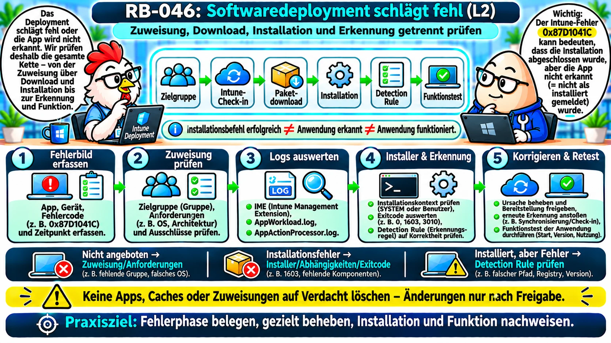

# RB-046 – Praxis-Runbook (L2): Softwaredeployment schlägt fehl

**Projekt:** 50 typische IT-Supportfälle · **Stand:** 23.11.2026 · **Version:** 1.0  
**Status:** Recherchiert und dokumentiert; **noch nicht praktisch validiert**. Beispielwerte fiktiv. Schwerpunkt: Intune-Win32-Anwendung (IME), ergänzend ConfigMgr.



**Ziel:** Die erste fehlgeschlagene Station **Zuweisung → Check-in → Content → Installation → Erkennung → Anwendung** mit einem Befund nachweisen, genehmigt korrigieren und Erfolg **im Portal und an der Anwendung** überprüfen.

> **Sicherheitsprinzip:** Lesend untersuchen; **keine** Zuweisungen, Installer, IME-Caches, Detection Rules, Security-Ausnahmen oder Neustarts ohne Freigabe ändern.

## 1. Ticketannahme: Fehlerbild reproduzierbar erfassen

- [ ] App-Name, **konkrete Version**, Installer-Typ (Win32/Store/LOB/ConfigMgr), App-ID, Zuweisungsart (Required/Available) dokumentiert?
- [ ] Geräte-ID/Hostname, Benutzer, Tenant, OS/Architektur, Standort, Uhrzeit mit Zeitzone festgehalten?
- [ ] Was steht **exakt** im Intune Admin Center/Company Portal (Status, Hex-Fehlercode, Zeitstempel)?
- [ ] Ist nur ein Gerät betroffen, eine Gruppe, ein Standort oder der ganze Rollout-Ring?
- [ ] Ist die App wirklich nicht installiert, bloß im Portal nicht sichtbar oder installiert, aber nicht startbar?

**Häufige Fehldeutung:** „Intune zeigt fehlgeschlagen“ bedeutet noch **nicht**, dass die App lokal fehlt.

## 2. STOP-Check: Daten, Rechte, Wartungsfenster

- [ ] Unternehmensfreigabe, verantwortliches App-/Endpoint-Team, Benutzerbeeinträchtigung, Sicherung von App-Daten/Config geklärt?
- [ ] Nur notwendige Leserechte; Logdateien vor Weitergabe auf personenbezogene Daten prüfen.
- [ ] Keine produktive Neuinstallation, kein App-/Registry-/Cache-Löschen und keine Änderung von Zuweisungen/Detection Rules als Erstmaßnahme.
- [ ] Bei Security-Blockade nicht Defender/EDR abschalten, sondern IT-Security einschalten.
- [ ] Bei Remotezugriff: Keine Maßnahme, die die einzige Verbindung ohne Fallback gefährdet.

**Eskalation sofort**, wenn Installerherkunft unklar, Signatur verdächtig, viele Systeme betroffen oder ein freigegebenes Rollback fehlt.

## 3. Intune-App-Zuweisung und Voraussetzungen **lesend** kontrollieren

- [ ] Richtige App-Version und richtiger Zuweisungsumfang? Included-/Excluded-Gruppen kontrollieren.
- [ ] `Required` oder `Available`? Bei Available: Nutzerinstallation tatsächlich ausgelöst?
- [ ] Requirements: Windows-Version, Architektur, Datenträgerplatz, eigene Regeln, Benutzer-/SYSTEM-Kontext passend?
- [ ] Abhängigkeiten und Supersedence passend, keine fehlgeschlagene Vorbedingung?
- [ ] Gerätestatus und letzte Rückmeldung zur App prüfen; nicht mit der allgemeinen Device Compliance verwechseln.

**Befund sichern:** Screenshot oder textuelle Statusnotiz nach Unternehmensvorgaben, App-ID, Zuweisungsring und Uhrzeit.

## 4. Client-Check-in und IME-Dienst **lesend** prüfen

```powershell
# LESEND – Status des Intune-Management-Extension-Dienstes:
Get-Service -Name IntuneManagementExtension -ErrorAction SilentlyContinue |
  Select-Object Name, Status, StartType

# LESEND – IME-Protokollübersicht:
$imeLogs = Join-Path $env:ProgramData 'Microsoft\IntuneManagementExtension\Logs'
Get-ChildItem $imeLogs -Filter '*.log' -File -ErrorAction SilentlyContinue |
  Select-Object Name, Length, LastWriteTime | Sort-Object LastWriteTime -Descending
```

- [ ] Sind **neue** App-Check-in-/Policy-Ereignisse zeitlich zum Fehler vorhanden?
- [ ] IntuneManagementExtension.log, AppWorkload.log, AppActionProcessor.log auf betroffene App-ID prüfen.
- [ ] Nur bei belegtem Netzwerk-/Proxyproblem an Netzwerkteam eskalieren; kein Proxy- oder Firewallwechsel auf Verdacht.

**Interpretation:** Dienst „Running“ ist noch kein erfolgreicher App-Check-in.

## 5. Contentpfad, Voraussetzungen und Download aus IME-Logs auswerten

- [ ] Wurde die Zielzuweisung verarbeitet? Welche Requirement Rule entschied „nicht anwendbar“?
- [ ] Startete der Download? Abgeschlossen oder Timeout/Proxy-/Contentfehler?
- [ ] Entstanden Abhängigkeitsfehler oder fehlende Paket-/Contentdateien?
- [ ] Stimmen Logzeitpunkte, App-ID und Geräte-ID überein?

```powershell
# LESEND – letzte IME-App-Logzeilen; vor externem Teilen sensible Werte prüfen:
Get-Content -LiteralPath (Join-Path $imeLogs 'AppWorkload.log') -Tail 150 -ErrorAction SilentlyContinue
Get-Content -LiteralPath (Join-Path $imeLogs 'AppActionProcessor.log') -Tail 120 -ErrorAction SilentlyContinue
```

**Kein Check-in** → Station 2; **Downloadfehler** → Station 3; **Installerfehler** → Station 4; **Detectionfehler** → Station 5. Nicht alle Pfade gleichzeitig verändern.

## 6. Installationsbefehl, Ausführungskontext und Exit-Code prüfen

- [ ] Mit welchem Befehl und in welchem Kontext (SYSTEM/USER) wurde der Installer gestartet?
- [ ] Passt die Architektur x86/x64? Sind Silent-Parameter und Pfade herstellerkonform?
- [ ] Gibt es eine Installer-Kollision oder einen Neustartbedarf?
- [ ] Ist der Exit-Code als **Erfolg, Fehler, Retry oder Soft/Hard Reboot** korrekt klassifiziert?
- [ ] Gibt es ein MSI- oder Hersteller-Installationslog mit zeitlich passender Fehlerursache?

| Code | Typische Bedeutung | Weiterer Schritt |
|---|---|---|
| `0` | Installer meldet Erfolg | Detection und echte Funktion separat testen |
| `1603` | Fataler MSI-Fehler | Fehlerkontext im Installer-Log analysieren |
| `1618` | Andere MSI-Installation läuft | Konflikt zeitlich belegen, Installationsfenster abstimmen |
| `3010` | Erfolg, Neustart nötig | Neustart nach Betriebsfreigabe/Policy kontrollieren |
| `0x87D1041C` | Intune erkennt App nach Installationslauf nicht | Detection Rule und tatsächlichen Installationszustand vergleichen |

**Wichtig:** Die ersten vier Codes gehören zur Windows-Installer-Familie; EXE-Installer dürfen andere Semantik besitzen. `0x87D1041C` ist ein Intune-Status und kein MSI-Rückgabecode.

```powershell
# LESEND – neueste MSI-Ereignisse im Windows-Anwendungsprotokoll:
Get-WinEvent -FilterHashtable @{
  LogName='Application'; ProviderName='MsiInstaller';
  StartTime=(Get-Date).AddDays(-2)
} -MaxEvents 30 -ErrorAction SilentlyContinue |
  Select-Object TimeCreated, Id, LevelDisplayName, Message
```

## 7. Detection Rule gegen **tatsächlich installierte App** prüfen

- [ ] Detection-Art identifiziert: MSI Product Code, Datei, Registry oder Custom Script?
- [ ] Erwarteten Pfad mit realem Pfad **inklusive `Program Files` vs. `Program Files (x86)`** verglichen?
- [ ] Anwendungs-/Dateiversion mit Regel verglichen, HKLM/HKCU und 32-/64-Bit-Registry geklärt?
- [ ] Detection-Skript: Exit 0 **und** Ausgabe nach STDOUT; keine unerwartete STDERR-Ausgabe? [Q2]
- [ ] App lokal vorhanden? Nur für diesen User oder systemweit? Stimmt der Kontext?

```powershell
# LESEND – Beispiel nur nach Anpassung an reale Paketpfade:
Get-Item -LiteralPath 'C:\Program Files\Contoso\FachApp\FachApp.exe' -ErrorAction SilentlyContinue |
  Select-Object FullName, Length, LastWriteTime

$paths = @(
 'HKLM:\SOFTWARE\Microsoft\Windows\CurrentVersion\Uninstall\*',
 'HKLM:\SOFTWARE\WOW6432Node\Microsoft\Windows\CurrentVersion\Uninstall\*'
)
Get-ItemProperty $paths -ErrorAction SilentlyContinue |
 Where-Object DisplayName -like '*FachApp*' |
 Select-Object DisplayName, DisplayVersion, InstallLocation
```

**Sonderfall:** `0x87D1041C` legt den Fokus auf Detection, beweist aber weder, dass Dateien korrekt installiert wurden, noch dass die Anwendung funktionsfähig ist.

## 8. Entscheidungsmatrix und ConfigMgr-Abzweig

| Gesicherter Befund | Nächster Zuständigkeits-/Diagnosepfad |
|---|---|
| App nicht zugewiesen/nicht anwendbar | Intune-Zuweisung, Requirements, Rollout-Gruppe (Endpoint-Team) |
| Kein aktueller IME-App-Check-in | IME/Device Management/Netz (Endpoint-/Netzteam) |
| Download bricht ab | Content/Proxy/Security/Netz (Netz/Security/Endpoint) |
| Installer liefert Fehler | Paketparameter, SYSTEM/USER, MSI-/Vendor-Log (Paketmanagement) |
| Installer Erfolg, Detection negativ | Detection und Kontext (Paketmanagement) |
| Portal Erfolg, Anwendung defekt | App-/Lizenz-/Backendfunktion (Applikationssupport) |

**Wenn ConfigMgr statt Intune verwendet wird:** Nicht im IME-Log suchen, sondern `AppIntentEval.log` (Anwendbarkeit), `AppDiscovery.log` (Erkennung), `AppEnforce.log` (Installation) und ggf. Content-Logs. Quelle: Microsoft-ConfigMgr-Logreferenz [Q9].

## 9. Freigegebene Korrektur und zwei getrennte Retests

- [ ] Vorherigen Fehlerpfad (Befund + Logzeitpunkt) dokumentieren.
- [ ] Eigentümer/Change-Freigabe klären; minimale passende Maßnahme im Test-Ring anwenden; Rollback festhalten.
- [ ] Falls erforderlich kontrollierten neuen Check-in / neue Erkennung **nach Freigabe** beobachten.
- [ ] **Retest 1:** Portal-/Detection-Status nach Aktualisierung korrekt, Version passt?
- [ ] **Retest 2:** App tatsächlich starten und benötigte Mindestfunktion im richtigen Benutzerkontext ausführen?
- [ ] Nachwirkungen prüfen: Benutzerkonfiguration, andere Zielgeräte, Abhängigkeiten, notwendiger Neustart.

**Nicht als Erfolg deklarieren:** „App ist im Portal grün“ ohne Test der tatsächlich benötigten Funktion.

## 10. Ticketabschluss, Eskalation, Lernkontrolle

**Belegfelder für Ticket/Weitergabe:** App-ID/Version, Client-/Geräte-ID, Fehlerbild, Zeitpunkt/Zeitzone, verwendete Logs, erste fehlerhafte Station, nachvollziehbare Ursache/Hypothese, Freigabe, konkrete Änderung, Retest für **Detection und Funktion**, zuständige Rolle.

**Muster-Ticketkommentar – ausdrücklich fiktiv:**

> „RB-046: `FachApp 3.2` auf `CLIENT-046A` meldet `0x87D1041C`. IME-Log: Installerlauf mit Erfolgscode; App-Datei lokal vorhanden. Detection Rule prüft abweichend `Program Files (x86)` statt `Program Files`. Pfadabweichung als plausible Ursache dokumentiert, Change an Paketmanagement weitergegeben; nach Korrektur sind erneute Erkennung und Funktionstest vorgesehen. Bis dahin **nicht abgeschlossen**.“

**Eskalation:** Unklare Paketquelle/Securityblockade → Security; server-/netzübergreifende Contentprobleme → Netzwerk/Endpoint; Deployment-Regeln → Intune-/ConfigMgr-Administration; Installationslog/Herstellerfehler → Paketmanagement/Hersteller; reine Appfunktion → Anwendungsteam.

**Active Recall:** Warum ist `exit 0` nicht gleich „App funktioniert“? Welche Logs unterscheiden Intune und ConfigMgr? Welche zwei getrennten Nachweise braucht der Abschluss?

### Quellen – offizielle Microsoft-Dokumentation (23.11.2026)

- [Q1] https://learn.microsoft.com/de-de/intune/app-management/deployment/troubleshoot-win32
- [Q2] https://learn.microsoft.com/en-us/intune/app-management/deployment/add-win32
- [Q4] https://learn.microsoft.com/de-de/intune/device-management/tools/management-extension-windows
- [Q6] https://learn.microsoft.com/en-us/troubleshoot/mem/intune/app-management/app-install-error-codes
- [Q7] https://learn.microsoft.com/de-de/windows/win32/msi/error-codes
- [Q9] https://learn.microsoft.com/de-de/intune/configmgr/core/plan-design/hierarchy/log-files

**Transparenz:** Alle Beispiele sind fiktiv und alle technischen Verfahren noch praktisch zu validieren. Keine Änderungen an Produktivsystemen durchgeführt.
