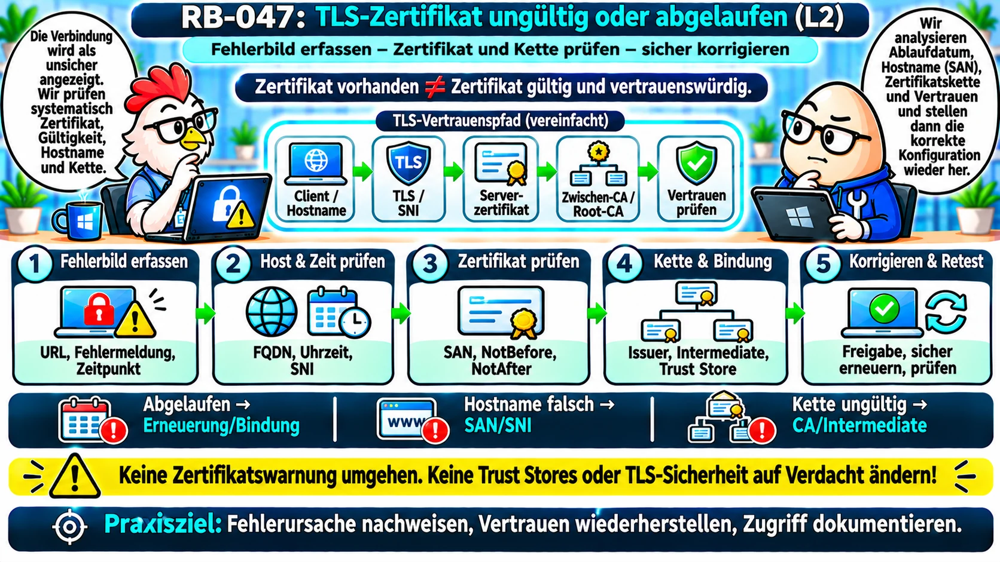

# RB-047 – TLS-Zertifikat ungültig oder abgelaufen (L2)

**Projekt:** 50 Tickets – 50 typische IT-Supportfälle  
**Stand:** 23.11.2026 · **Version:** 1.0 · **Systeme:** Windows 11, Windows Server/IIS, HTTPS/TLS, Reverse Proxy und Load Balancer; ergänzend OpenSSL und Linux  
**Status:** Offizielle Hersteller- und Protokolldokumentation recherchiert und theoretisch nachvollzogen; **noch nicht praktisch validiert**. Alle Hostnamen, IP-Adressen, Zertifikatsdaten und Tickets sind **fiktiv**. Keine produktive PKI-/TLS-Konfiguration wurde verändert.



> **Merksatz:** **HTTPS-Port erreichbar ≠ TLS-Aushandlung erfolgreich ≠ Zertifikat gültig ≠ Gegenstelle vertrauenswürdig ≠ Anwendung funktionsfähig.** Jede Aussage braucht ihren eigenen Nachweis.

---

## 1. Störungsbild, Lernziel und Abgrenzung

**Fiktives Eingangsticket:** „Beim Öffnen von `https://portal.example.test/` erscheint seit heute ‚Verbindung nicht privat‘. Andere interne Webseiten funktionieren. Gestern wurde am Webserver ein Zertifikat erneuert.“

**Lernziel:** Die erste fehlerhafte Validierungsebene nachweisen: Netzwerkverbindung, TLS-Aushandlung, Hostname/SNI, Gültigkeitszeitraum, Zertifikatskette und Vertrauensspeicher, serverseitige Zertifikatsbindung oder Anwendung. Danach **minimalinvasiv**, mit Genehmigung, korrigieren und den geschützten Zugriff ohne Ausnahmen wiederherstellen.

**Abgrenzung:** RB-034 behandelt DNS-Auflösung, RB-038 die allgemeine Servererreichbarkeit, RB-039 TCP-Port und Listener. RB-047 setzt dort an, wo eine gesicherte Verbindung aufgebaut werden soll und ein Zertifikats- oder TLS-Validierungsfehler vermutet wird. Ein reiner TLS-Protokoll-/Cipher-Mismatch ist ein eigener Diagnosezweig und **kein Beweis für ein schlechtes Zertifikat**.

**Scope:** Primär HTTPS auf Port 443, mit Blick auf IIS, Reverse Proxies und TLS-terminierende Load Balancer. Bei SMTP/LDAPS gelten ähnliche Zertifikatsgrundsätze, die Prüfbefehle und Dienste unterscheiden sich.

## 2. Was beim Aufbau einer HTTPS-Verbindung geprüft wird

Vereinfachter Ablauf:

1. Der Client löst den **FQDN** auf und stellt eine TCP-Verbindung zur Ziel-IP und zum Zielport her.
2. Im TLS-Handshake kann der Client über **SNI** den gewünschten Hostnamen angeben; die TLS-terminierende Gegenstelle wählt das dazu konfigurierte Zertifikat.
3. Der Server präsentiert sein **End-Entity-/Leaf-Zertifikat** und üblicherweise die benötigten **Intermediate-Zertifikate**.
4. Der Client überprüft **Hostname**, **Gültigkeitszeit**, **Zertifikatszweck**, **Signatur und Zertifikatskette**, Vertrauensanker und – je nach Software und Richtlinie – **Sperrstatus**.
5. Erst bei passender und akzeptierter TLS-Verbindung folgt die **HTTP-Anfrage**; dabei kann noch ein HTTP- oder Anwendungsfehler auftreten.

Die Kette ist vereinfacht: Manche TLS-Versionen und Produkte kombinieren Handshake-Nachrichten unterschiedlich; die Validierungsprinzipien bleiben relevant. Wichtig ist, **welche Komponente TLS terminiert**: Das ist bei CDN, WAF, Reverse Proxy oder Application Gateway nicht zwingend der eigentliche Applikationsserver. [Q1][Q2][Q3]

## 3. Sechs Fehlerklassen, die ähnlich aussehen können

| Fehlerklasse | Typischer Befund | Nächster Nachweis |
|---|---|---|
| **Ablaufdatum** | `notAfter` liegt vor dem Prüfzeitpunkt; Zertifikatswarnung | Remote präsentiertes Leaf prüfen, Uhrzeit beachten |
| **Noch nicht gültig / Systemuhr** | `notBefore` liegt in der Zukunft oder Clientuhr ist falsch | UTC-Zeit von Client/Server und Gültigkeitsfenster prüfen |
| **Hostname/SAN** | Aufgerufener FQDN fehlt im Subject Alternative Name | Ziel-URL, SAN, SNI und Proxy-/IIS-Bindung vergleichen |
| **Unvollständige/nicht vertraute Kette** | Intermediate fehlt, CA nicht vertrauenswürdig | Gelieferte Kette und zulässigen Client-Trust-Store vergleichen |
| **Sperr-/Statusprüfung** | CRL/OCSP-Validierung schlägt je nach Client/Policy fehl | Sicherheits-/PKI-Verantwortliche und detaillierte Fehler prüfen |
| **Kein korrekter TLS-Dienst** | TCP geht, TLS-Handshake scheitert vor/nach Zertifikat oder falscher Endpunkt | Listener, Version, Cipher, SNI, TLS-Terminierung, Schannel-Ereignisse |

**Wichtig:** Ein Zertifikat mit künftigem `notAfter` ist nicht automatisch vertrauenswürdig. Ein erfolgreiches `Test-NetConnection ... -Port 443` beweist nur den TCP-Connect, keine Zertifikatsprüfung. Ein `HTTP 500` nach erfolgreichem HTTPS-Handschlag gehört in die Anwendungsdiagnose. [Q2][Q4]

## 4. Ticketaufnahme: exakt, reproduzierbar, ohne Geheimnisse

Erfassen:

- **Exakte URL/FQDN, Port, Umgebung:** interne/externe URL, DNS-Ziel, VPN, Standort, Proxy/WAF/Load Balancer.
- **Auswirkung:** ein Client oder viele, nur Browser oder auch APIs/Agenten, ein Hostname oder mehrere.
- **Exakte Warnung:** Wortlaut/Fehlercode, Screenshot mit geschwärzten Benutzerinformationen, Uhrzeit inklusive Zeitzone.
- **Änderungen:** Zertifikatserneuerung, neues Hosting, neue Proxy-/SNI-Regel, CA-Rotation, Windows-/Browserupdate, Uhrzeitabweichung.
- **Zertifikatsmetadaten:** Subject/SAN, Issuer, `notBefore`, `notAfter`, SHA-256-Fingerprint; ggf. Thumbprint der Serverbindung.
- **Grenze:** **Keine privaten Schlüssel, `.pfx`-Passwörter, Tokens oder Session-Cookies** in Tickets, Screenshots oder Chatprotokolle kopieren.

Fiktive Platzhalter: `portal.example.test` und `192.0.2.10` sind Dokumentationswerte, **kein** realer produktiver Endpoint.

## 5. Sicherheitscheck vor jeder Korrektur

**Zuerst nur lesende Prüfungen.** Zertifikatswarnungen nicht durch „Trotzdem fortfahren“, `curl -k`, Abschalten von Trust-/Hostname-Checks oder pauschales Importieren fremder Root-CAs umgehen. Keine TLS-Versionen, Windows-Schannel-Registry-Einträge, HSTS-Einstellungen oder Zertifikatspeicher auf Verdacht verändern.

Bei produktiver Änderung vorab prüfen: **Eigentümer der Domain, Zertifikats-/PKI-Verantwortliche, Change-Freigabe, Wartungsfenster, alte/funktionierende Bindung als Rollback, private Schlüssel sicher vorhanden, alle TLS-Endpunkte und abhängige Systeme bekannt.** Bei internem CA-Ausfall an PKI/Security eskalieren.

**STOP:** Unbekannte CA, verdächtige oder unerwartete Zertifikatsänderung, möglicher Man-in-the-Middle/Proxy-Eingriff, kompromittierter Schlüssel oder ungeklärte Identität der Gegenstelle → Security/PKI einschalten. Nicht einfach eine Ausnahme freigeben.

## 6. Client, DNS, Uhrzeit und TCP getrennt prüfen

**Lesende Windows-/PowerShell-Prüfungen** am autorisierten Client:

```powershell
# LESEND – Systemzeit und Synchronisierungsstatus:
Get-Date
w32tm /query /status

# LESEND – Auflösung und TCP-Zugänglichkeit:
Resolve-DnsName -Name portal.example.test
Test-NetConnection -ComputerName portal.example.test -Port 443

# LESEND – lokaler Zertifikatsbestand (nicht automatisch Remote-Zertifikat!):
Get-ChildItem Cert:\LocalMachine\My -ErrorAction SilentlyContinue |
  Select-Object Subject, Thumbprint, NotBefore, NotAfter, HasPrivateKey |
  Sort-Object NotAfter
```

**Interpretation:** `TcpTestSucceeded : True` sagt nichts über Zertifikatsvalidität. `Get-ChildItem Cert:` liest nur den **lokalen** Zertifikatspeicher; das remote tatsächlich präsentierte Zertifikat muss separat geprüft werden. Eine falsche Systemuhr kann zeitbezogene Zertifikatsfehler verursachen; sie darf in verwalteten Umgebungen nicht ohne Analyse der Zeitquelle „frei Hand“ verstellt werden. [Q4][Q5]

## 7. Das tatsächlich vom Remote-Endpunkt gesendete Zertifikat prüfen

Die wichtigste Frage ist nicht „Welches Zertifikat wurde irgendwo installiert?“, sondern: **Welches Zertifikat erhält dieser Client bei genau diesem Hostnamen?**

**Lesende OpenSSL-Prüfung** (OpenSSL muss installiert sein; auf Linux/macOS im Terminal, auf Windows in einer geeigneten OpenSSL-Umgebung):

```bash
# LESEND – TLS-Verbindung und Validierung für den erwarteten Hostnamen;
# Beispiel-Domain ersetzen, ohne -verify_return_error kann s_client
# trotz Zertifikatsproblemen weiterverhandeln, daher hier explizit:
openssl s_client -connect portal.example.test:443 \
  -servername portal.example.test \
  -verify_hostname portal.example.test \
  -verify_return_error -showcerts </dev/null
```

`-servername` steuert **SNI** (Zertifikatsauswahl am Ziel); `-verify_hostname` prüft zusätzlich den erwarteten Zertifikatsnamen. `-showcerts` zeigt die vom Server präsentierte Kette; dabei nicht annehmen, dass ein `Verify return code: 0` automatisch den gewünschten HTTP-Anwendungszugriff beweist. Trust-Stores von OpenSSL und dem tatsächlichen Windows-/Browser-Client können voneinander abweichen. [Q6]

**Zertifikat aus einer zuvor gesicherten, unkritischen PEM-Datei lesen:**

```bash
# LESEND – nur öffentliche Zertifikatsmetadaten, kein privater Schlüssel:
openssl x509 -in server-leaf.pem -noout -subject -issuer -dates \
  -ext subjectAltName -fingerprint -sha256
```

Wichtig: Ein PEM-Export von `s_client -showcerts` kann mehrere Zertifikate enthalten; beim Leaf-Zertifikat das richtige Zertifikat auswählen. Das Zertifikat ist grundsätzlich öffentlich, trotzdem unternehmensinterne Metadaten vertraulich behandeln. [Q7]

## 8. Gültigkeitsfenster und Hostnamen/SAN korrekt interpretieren

**Gültigkeit:** `notBefore` markiert den Beginn und `notAfter` das Ende der Gültigkeitsdauer; Zertifikatszeiten werden in der Regel als UTC-Werte ausgegeben. Das Zertifikat darf **nicht vor** `notBefore` und **nicht nach** `notAfter` als zeitlich gültig gelten. Bei Abweichung zwischen Server-, Client- und vertrauenswürdiger Zeitquelle Ursache der Synchronisierung untersuchen.

**Hostname:** Der beim Zugriff verwendete Host muss zur **Subject Alternative Name (SAN)**-Liste passen. Beispiele:

- URL `https://portal.example.test` → SAN benötigt passende DNS-Identität `portal.example.test` oder eine zulässig passende Wildcard.
- SAN `www.example.test` deckt `portal.example.test` **nicht** ab.
- `*.example.test` deckt in der üblichen DNS-Namensprüfung `portal.example.test` ab, aber nicht `example.test` oder `a.b.example.test`.
- Zugriff direkt auf eine **IP-Adresse** benötigt bei normgerechter IP-Identitätsprüfung einen passenden iPAddress-SAN; ein DNS-SAN für die Website ist kein Ersatz.

Bei Reverse Proxy/Load Balancer müssen **Client-URL, SNI, Zertifikats-SAN und konkrete Listener-/Host-Bindung** zusammenpassen. [Q2][Q8]

## 9. Zertifikatskette, Vertrauensanker und Sperrprüfung

Vereinfacht: **Leaf → Zwischen-CA(s) → vertrauenswürdige Root-CA**. In vielen Webserver-Konfigurationen sendet der Server Leaf **plus Intermediate(s)**, aber nicht notwendigerweise die Root-CA. Der Client muss die Kette zu einem **bereits vertrauenswürdigen** Anker validieren können. [Q3]

Ursachen für unterschiedliche Clientergebnisse:

- Eine Intermediate-CA fehlt am Server, ist aber auf einem Testclient zufällig bereits gecacht.
- Eine interne CA wird von verwalteten Clients vertraut, aber nicht von einem externen/unverwalteten Gerät.
- TLS-Inspektion ersetzt aus Sicht des Clients das ausgestellte Serverzertifikat durch ein Proxy-Zertifikat; nur nach genehmigter Unternehmensrichtlinie vertrauenswürdig.
- Ketten-, Sperrstatus- oder Richtlinienprüfung unterscheidet sich nach Client, Trust Store und Netzwerkzugang zu CRL/OCSP.

**Nicht zulässig als generischer Fix:** Zertifikatsprüfung ausschalten oder eine unbekannte Root-CA global als vertrauenswürdig eintragen. Ein fehlendes Intermediate gehört auf die korrekte Server-/Proxy-Konfiguration; Trust-Anker unterliegen PKI-/Security-Vorgaben. [Q3][Q9]

## 10. IIS, Reverse Proxy, Load Balancer: Zertifikat installiert ≠ Zertifikat aktiv

Ein neu ausgestelltes Zertifikat kann korrekt im Zertifikatspeicher liegen, **während eine alte Bindung weiterhin das abgelaufene Zertifikat ausliefert**. Das ist ein klassischer L2-Befund.

**Lesende Prüfung am autorisierten IIS-/HTTP.sys-Server:**

```powershell
# LESEND – Windows-Zertifikatsbestand (ggf. auch WebHosting-Store prüfen):
Get-ChildItem Cert:\LocalMachine\My -ErrorAction SilentlyContinue |
  Select-Object Subject, Thumbprint, NotAfter, HasPrivateKey

# LESEND – HTTP.sys-SSL-Bindungen einschließlich Hostname:Port:
netsh http show sslcert

# LESEND – falls IIS-WebAdministration installiert ist:
Get-WebBinding -Protocol https |
  Select-Object protocol, bindingInformation, sslFlags
```

**Vergleich:** SHA-1-Windows-Thumbprint des installierten/bindenden Zertifikats und SHA-256-Fingerprint des remote präsentierten Zertifikats sind **unterschiedliche Hashverfahren**; nicht blind 1:1 vergleichen. Für einen Abgleich denselben Algorithmus oder eindeutige Seriennummer + Issuer + Subject verwenden.

Zusätzlich bei Proxy/LB/CDN prüfen: Frontend- und Backend-Zertifikat getrennt, SNI-/Hostzuordnung, mehrere Nodes/Regionen, aktives Secret/Key-Vault-Objekt, neu geladene Konfiguration und gegebenenfalls Backend-Health-Checks. Ein gültiges Frontend-Zertifikat beweist nicht die Integrität der Backend-TLS-Kette. [Q1][Q8][Q10]

## 11. TLS-Handshakes und Schannel-Meldungen richtig abgrenzen

Nicht jeder Fehler an Port 443 ist ein Zertifikatsfehler. Beispiele: **TLS-Version/Cipher Suite ohne gemeinsame Schnittmenge**, falscher Port, fehlende Private-Key-Berechtigung des Dienstkontos, SNI-Routing, Serverprozess gestoppt oder Proxy-Abbruch. Microsoft erläutert Schannel-Ereignisse und zugehörige TLS-Fehlercodes. [Q4][Q11]

**Lesende Windows-Ereignisabfrage:**

```powershell
# LESEND – vorhandene Schannel-Ereignisse der letzten 24 Stunden;
# Treffer allein beweisen noch nicht den Zusammenhang mit diesem Ziel:
Get-WinEvent -FilterHashtable @{
  LogName='System'; ProviderName='Schannel';
  StartTime=(Get-Date).AddDays(-1)
} -MaxEvents 40 -ErrorAction SilentlyContinue |
  Select-Object TimeCreated, Id, LevelDisplayName, Message
```

**Wichtig:** Ereignisse mit Uhrzeit, Quell-/Zielkontext und einem reproduzierten Test korrelieren; die alleinige Ereignis-ID ist häufig zu unspezifisch. Schannel-Logging nicht ohne Change erweitern; es kann Auswirkungen auf Protokollvolumen haben. [Q4]

## 12. Entscheidungsmatrix: gesicherter Befund → passende Maßnahme

| Gesicherter Befund | Fachliche Folgerung | Genehmigungspflichtige Korrektur (Beispiele) |
|---|---|---|
| Remote `notAfter` überschritten | Ausgeliefertes Leaf abgelaufen | Zertifikat erneuern, **richtige** TLS-Bindung/Endpunkte aktualisieren |
| Remote `notBefore` in Zukunft | Zeit-/Ausstellungsproblem möglich | Zeitquelle analysieren oder korrekt ausgestelltes Zertifikat bereitstellen |
| SAN passt nicht zu FQDN | Hostname/Bindung/SNI falsch | Passendes Zertifikat oder korrekte Hostbindung bereitstellen |
| Intermediate fehlt / Root nicht vertraut | Ketten- oder PKI-Vertrauensproblem | Chain am TLS-Endpunkt korrigieren, PKI-Vorgaben für Trust beachten |
| Nur einzelne Clients betroffen | Unterschied bei Uhrzeit, Trust Store, Proxy oder Filter | Clientvergleich, Verwaltung/PKI prüfen, keine Ausnahme setzen |
| Nur ein LB-Node liefert altes Zertifikat | Unterschiedliche TLS-Endpunkte | Gezieltes Rollout/Binding auf betroffener Node korrigieren |
| TLS gültig, HTTP/API scheitert | Keine nachgewiesene Zertifikatsstörung | Anwendung, Authentifizierung, Backend weiterdiagnostizieren |
| Handshake scheitert vor Zertifikatsprüfung | Möglicher TLS-/Cipher-/Listenerfehler | Schannel/Server/Proxy nachweisorientiert untersuchen |

**Generell:** Zertifikate mit privatem Schlüssel werden nur über die genehmigte PKI-/Secret-Verwaltung erneuert, verteilt und gebunden; niemals Schlüsselmaterial im Ticket ablegen. Rollback/Verfügbarkeit vor Aktivierung klären.

## 13. Zwei fiktive Praxisfälle mit Diagnosebegründung

### Musterfall A: Zertifikat erneuert, Warnung bleibt

**Ticket:** Nach Zertifikatstausch auf einem IIS-Server meldet `portal.example.test` weiterhin ein abgelaufenes Zertifikat. Die Administratorin zeigt, dass im lokalen Zertifikatsspeicher ein neues Zertifikat bis 2027 liegt.

**Eigenständige Hypothese:** Der Server **hat** ein neues Zertifikat, aber ein HTTPS-Binding oder vorgeschalteter Reverse Proxy liefert weiter das alte aus.

**Belege:** Externer OpenSSL-Test mit `-servername` zeigt einen Fingerprint und `notAfter`, die zum alten Zertifikat passen. `netsh http show sslcert` bzw. die Proxy-/LB-Konfiguration zeigt noch die alte Zuordnung. **Theoretisch plausible Ursache:** Falsche/stale Bindung; durch Tests erst zu bestätigen.

**Freigegebene Korrektur:** Eigentümer ändert die betroffene Bindung mit Rollback-Plan; unabhängiger Test verifiziert anschließend **Remote-Fingerprint, SAN, Chain und HTTPS-Anwendungsfunktion**. Nicht bereits aufgrund des neuen Zertifikats im Store abschließen.

### Musterfall B: Intern funktioniert es, extern nicht

**Ticket:** `https://service.example.test` funktioniert auf einem verwalteten Notebook, ein externes Testgerät zeigt „Nicht vertrauenswürdig“.

**Hypothesen:** Fehlendes Intermediate, ausschließlich interne Root-CA, unterschiedliche Proxy-/TLS-Endpunkte oder TLS-Inspection.

**A/B-Test:** Beide Geräte mit identischem FQDN und Zeitpunkt prüfen; Zertifikats-Fingerprint/Issuer/Chain, Trust-Stores und Netzwerkpfad vergleichen. **Mögliche Diagnose:** Externe Gegenstelle sendet unvollständige Kette oder vertraut einer internen CA nicht. Beide Ausgänge werden separat belegt; der Unterschied allein beweist die genaue Ursache noch nicht.

**Korrektur:** PKI-/Webteam stellt die passende, vollständig ausgelieferte Vertrauenskette oder den genehmigten externen Zertifikatspfad sicher. **Keine** unkontrollierte Root-CA-Installation oder Umgehung des Browserwarnhinweises.

## 14. Active Recall, Self-Explanation und Transfer

**Wissensabruf (ohne Artikel):**

1. Warum beweist `Test-NetConnection ... -Port 443` keine gültige HTTPS-Verbindung?
2. Welche Aufgaben haben `-servername` und `-verify_hostname` bei `openssl s_client`?
3. Was ist der Unterschied zwischen `notBefore`, `notAfter` und SAN?
4. Warum zeigt der lokale Windows-Store nicht zwingend das ausgelieferte Zertifikat?
5. Welche Rolle spielen Intermediate-CA und Root-Trust-Store?

**Verständnisfragen:**

6. Ein Zertifikat läuft erst nächstes Jahr ab, trotzdem erscheint eine Warnung: Welche drei Prüfungen folgen?
7. Warum kann ein Browser erfolgreich zugreifen, während ein anderer Client denselben Host ablehnt?
8. Ein Reverse Proxy zeigt nach Zertifikatswechsel weiterhin den alten Fingerprint: Welche Ebenen müssen verglichen werden?

**Diagnose-/Transferkarten:**

9. Auf Client A: Hostname-Mismatch, auf Client B: keine Warnung. Welche A/B-Daten erfasst du, bevor du von DNS als Ursache sprichst?
10. Die Zertifikatsprüfung ist erfolgreich, aber HTTP 503 erscheint: Warum ist die PKI zunächst nicht die Hauptverdächtige?
11. Nenne zwei Gründe, weshalb `-k`/„Warnung ignorieren“ kein zulässiger Ticketabschluss ist.

**Praktischer Transfer (isoliertes Lab):** Zwei lokale TLS-Endpunkte mit fiktiven Hostnamen und eigens erzeugten Testzertifikaten vorsehen: eines mit absichtlich falschem SAN, ein anderes mit unvollständiger Testkette. Zuerst erwartete Befunde **vorhersagen**, dann getrennt mit `s_client` und einem Client der vorgesehenen Trust-Policy prüfen. Test-CA niemals ungeprüft global oder im Produktivsystem vertrauen. Abschluss mit selbst formuliertem Ticketkommentar und späterer Wiederholung nach ca. 7 und 21 Tagen.

**Kompetenznachweis:** Eine richtige Befehlsausgabe abzulesen ist noch kein Diagnoseerfolg; der Nutzer muss die **erste gesichert abweichende Ebene** eigenständig benennen und mit einer unabhängigen Prüfung bestätigen können.

## 15. Quellen, Qualitäts- und Validierungsstatus

Die folgenden Quellen belegen **technische Prüfmechanismen und Herstellerverfahren**, nicht die fiktiven Praxisfälle. Kommandos und UI-Pfade können je nach Produktversion/Deployment abweichen. Recherchezeitpunkt: **23.11.2026**.

- **[Q1]** Microsoft Learn – Azure Application Gateway Backend Health, TLS-Zertifikat, Chain, Name und Gültigkeit: https://learn.microsoft.com/en-us/troubleshoot/azure/application-gateway/application-gateway-backend-health-troubleshooting
- **[Q2]** Microsoft Learn – HTTPS/TLS Backend-Prüfung und SNI: https://learn.microsoft.com/en-us/azure/application-gateway/configuration-http-settings
- **[Q3]** Let's Encrypt – Zertifikatsketten/Intermediate-CAs: https://letsencrypt.org/certificates/
- **[Q4]** Microsoft Learn – TLS/Schannel-Protokollierung: https://learn.microsoft.com/en-us/troubleshoot/developer/webapps/iis/health-diagnostic-performance/enable-schannel-event-logging
- **[Q5]** Microsoft Learn – PowerShell-Zertifikatsanbieter: https://learn.microsoft.com/en-us/powershell/module/microsoft.powershell.security/about/about_certificate_provider?view=powershell-7.5
- **[Q6]** OpenSSL – `s_client`, SNI, Zertifikatskette und `-verify_return_error`: https://docs.openssl.org/3.4/man1/openssl-s_client/
- **[Q7]** OpenSSL – `x509`, Gültigkeitsdaten, Issuer und SAN: https://docs.openssl.org/3.4/man1/openssl-x509/
- **[Q8]** Microsoft Learn – IIS-/HTTP.sys-SSL-Bindung: https://learn.microsoft.com/en-us/iis/manage/configuring-security/how-to-set-up-ssl-on-iis
- **[Q9]** Microsoft Learn – CA-Pfadprüfung und Zertifikatssperrung: https://learn.microsoft.com/en-us/windows-server/identity/ad-cs/configure-certificate-path-validation-revocation-policy
- **[Q10]** Microsoft Learn – `netsh http show sslcert`: https://learn.microsoft.com/en-us/windows-server/administration/windows-commands/netsh-http
- **[Q11]** Microsoft Learn – Schannel TLS/SSL-Fehlercodes: https://learn.microsoft.com/en-us/windows/win32/secauthn/schannel-error-codes-for-tls-and-ssl-alerts

**Validierungsstatus:** Recherche und plausibilisierte Diagnoseverfahren liegen vor; **keine** echten Zertifikate, Anwendungen, Proxy-Konfigurationen oder produktiven Endpunkte wurden praktisch getestet. Die Henne-und-Ei-Grafik dient als Lernanker und ersetzt nicht die Primärquellen. Zur Veröffentlichung auf GitHub Pages sind Quellen, relative Assetpfade und Kennzeichnung „Eigene Konzeption, KI-gestützte Visualisierung mit ChatGPT“ beizubehalten.
