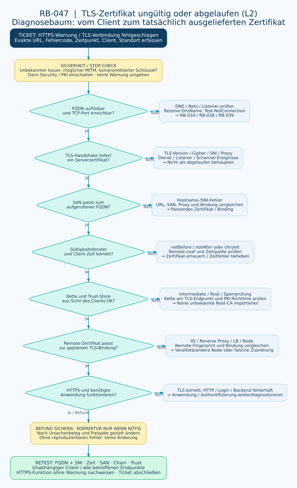

# RB-047 – Praxis-Runbook: TLS-Zertifikat ungültig oder abgelaufen (L2)

**Projekt:** 50 typische IT-Supportfälle · **Version:** 1.0 · **Stand:** 23.11.2026  
**Validierungsstatus:** Recherche anhand Microsoft-/OpenSSL-/Let's-Encrypt-Quellen; **noch nicht praktisch validiert**. Alle Beispiele sind fiktiv. Lesende Schritte zuerst; jede Korrektur nur nach Freigabe.



## 1. Eingangsticket und Auswirkung erfassen

- [ ] Exakte **URL/FQDN**, Port, Browser/Client, Uhrzeit/Zeitzone und **Originalwarnung** dokumentiert?
- [ ] Wann zuletzt erfolgreich? Seit wann Fehler? Gab es Zertifikatserneuerung, TLS-Proxy-, DNS-, IIS- oder LB-Change?
- [ ] Nur ein Benutzer/Client oder viele? Intern vs. extern? Browser vs. API/Agent?
- [ ] Welche Anwendungen und kritischen Dienste hängen von diesem Host ab?
- [ ] Keine geheimen Schlüssel, `.pfx`-Kennwörter, Tokens oder Cookies im Ticket speichern.

**Fiktives Meldungsbeispiel:** „`https://portal.example.test/` zeigt eine Zertifikatswarnung seit 08:15 Uhr nach Zertifikatstausch.“

## 2. STOP-/Sicherheitskontrolle

- [ ] Liegen erlaubte Diagnosebefugnis und korrekte Geräte-/Domainzuordnung vor?
- [ ] Warnung deutet auf unbekannte CA, unerwarteten Issuer, mögliche TLS-Manipulation oder kompromittierten Private Key? **STOP → PKI/Security.**
- [ ] **Kein** `curl -k`, kein „trotzdem fortfahren“ als Problemlösung, kein blindes Importieren von Stammzertifikaten.
- [ ] Keine Änderung an SNI/Binds/Trust-Stores, TLS-Algorithmen oder Schannel ohne Change-Freigabe, Sicherung und Rollback.
- [ ] Vor produktivem Eingriff Zertifikatseigentümer, betroffene Front-/Backend-Endpunkte und Wartungsfenster klären.

## 3. Fehlerort eingrenzen: DNS, Netzwerk oder TLS

**Lesende Befehle** am betroffenen Windows-Client:

```powershell
Get-Date
w32tm /query /status
Resolve-DnsName portal.example.test
Test-NetConnection portal.example.test -Port 443
```

**Interpretation:**

- Keine DNS-Auflösung → RB-034 (DNS), hier vorerst keine Zertifikatsthese als bestätigt betrachten.
- TCP 443 nicht erreichbar → RB-038/039 (Pfad/Listener/Firewall).
- TCP 443 erreichbar, Browser warnt → jetzt **Remote-TLS-Zertifikat** prüfen.
- TCP 443 erreichbar, aber Handshake ohne Zertifikat scheitert → TLS-Version, Cipher, Listener, SNI, Proxy und Schannel prüfen; nicht vorschnell „abgelaufen“ eintragen.

## 4. Remote-Zertifikat und Hostname mit SNI prüfen

**Lesender OpenSSL-Test** in dafür zugelassener Umgebung; Platzhalter ersetzen:

```bash
openssl s_client -connect portal.example.test:443 \
  -servername portal.example.test \
  -verify_hostname portal.example.test \
  -verify_return_error -showcerts </dev/null
```

- [ ] Welches **Leaf-Zertifikat** wird tatsächlich präsentiert (Issuer, SAN, Fingerprint, Gültigkeit)?
- [ ] Ist der FQDN im **SAN** passend abgedeckt, ohne unzulässige Wildcardannahme?
- [ ] Stimmen `notBefore`, `notAfter` und verlässliche Uhrzeit?
- [ ] Sind Intermediate(s) in der präsentierten Chain enthalten und kann der konkrete Client zu einer genehmigten Root-CA validieren?
- [ ] Berücksichtigt: OpenSSL und Windows-/Browser-Trust können sich unterscheiden; der Test muss im passenden Clientkontext interpretiert werden.

**Separat, lesend – nur aus bereits vorliegender öffentlicher PEM-Zertifikatsdatei:**

```bash
openssl x509 -in server-leaf.pem -noout -subject -issuer -dates \
  -ext subjectAltName -fingerprint -sha256
```

## 5. Clientvergleich und Zertifikatskette

- [ ] Gleicher FQDN und ungefähr gleicher Zeitpunkt an **zwei unabhängigen** genehmigten Clients (z. B. intern/extern) geprüft?
- [ ] Unterscheiden sich **Remote-Fingerprint**, Zertifikatsketten, Proxy-Pfad, SNI oder IPv4/IPv6-Ziel?
- [ ] Falls nur ein Client scheitert: Zeitquelle, Trust Store, lokale Sicherheitssoftware, Proxy-/TLS-Inspektion und ggf. Sperrprüfung untersuchen.
- [ ] Falls alle scheitern: Zertifikat der TLS-terminierenden Komponente und ihre Chain/Binds prüfen.
- [ ] Fehlende Intermediate-CA nicht mit einer willkürlichen neuen Root-CA „reparieren“.

**A/B-Test:** Ein „Internet-Client scheitert, internes Gerät funktioniert“-Befund deutet auf unterschiedliche Vertrauensbedingungen oder Endpunkte, **beweist aber ohne Fingerprintvergleich keine konkrete Ursache**.

## 6. Serverseitige Bindung und private Schlüssel *nur lesend* prüfen

Auf autorisiertem Windows-/IIS-Server:

```powershell
# Zertifikatsinventar; nicht die tatsächlich ausgelieferte Bindung:
Get-ChildItem Cert:\LocalMachine\My -ErrorAction SilentlyContinue |
  Select-Object Subject, Thumbprint, NotAfter, HasPrivateKey

# Aktive HTTP.sys-Bindungen und zugeordnete Fingerprints:
netsh http show sslcert

# Falls WebAdministration/IIS verfügbar:
Get-WebBinding -Protocol https |
  Select-Object protocol, bindingInformation, sslFlags
```

- [ ] Ist das **erneuerte** Zertifikat im richtigen Store vorhanden?
- [ ] Ist der passende private Schlüssel im erforderlichen **Sicherheitskontext** verfügbar? Nicht exportieren.
- [ ] Welche IIS-/HTTP.sys-/Proxy-/LB-/CDN-Bindung liefert **tatsächlich** für `Hostname:443` das Zertifikat?
- [ ] Sind mehrere Nodes, SNI und unterschiedliche interne/externe TLS-Endpunkte berücksichtigt?
- [ ] **Nicht** SHA-1-Windows-Thumbprint und SHA-256-OpenSSL-Fingerprint unmittelbar vergleichen; Algorithmus angleichen oder Seriennummer/Issuer gegenüberstellen.

## 7. Schannel und TLS-Handshakes bei unklarem Befund prüfen

```powershell
# LESEND – Ereignisse der letzten 24 Stunden:
Get-WinEvent -FilterHashtable @{
 LogName='System'; ProviderName='Schannel';
 StartTime=(Get-Date).AddDays(-1)
} -MaxEvents 40 -ErrorAction SilentlyContinue |
 Select-Object TimeCreated, Id, LevelDisplayName, Message
```

- [ ] Handshake-Fehler mit **Testzeitpunkt und Ziel** korreliert?
- [ ] Zertifikatsbezogener Fehler oder TLS-Version/Cipher/SNI/Private-Key-Problematik?
- [ ] Falls TCP/TLS erfolgreich, aber HTTP/App fehlschlägt → Anwendungs- bzw. Backenddiagnose statt Zertifikatsfix.
- [ ] Ausführliche Schannel-Protokollierung **nicht** ohne Genehmigung verändern.

## 8. Entscheidungsmatrix und Eskalation

| Nachgewiesener Befund | Zuständiger Korrekturpfad |
|---|---|
| Remote-Zertifikat abgelaufen | Web/PKI: Erneuerung, richtige Bindung und vollständiger Rollout |
| FQDN im SAN nicht passend | Web/PKI: korrekter Hostname, SAN, SNI/Binding |
| Unvollständige Chain | PKI/Web: Intermediate korrekt am Server/Proxy bereitstellen |
| Nicht genehmigter Issuer oder möglicher MITM | **STOP:** Security/PKI Incident-Bewertung |
| Nur Client A betroffen | Endpoint/PKI: Uhrzeit, Trust, Proxy, Richtlinie vergleichen |
| Nur ein Reverse-Proxy-Node betroffen | Plattform/Web-Team: Endpoint-/Listener-Konfigurationsdrift |
| TLS erfolgreich, App defekt | Applikations-/Backend-Team: HTTP/Auth/Dienstzustand |
| TLS-Aushandlung ohne Zertifikat scheitert | Server/Netz: Protokoll, Cipher, Listener/Proxy, Schannel |

**L2-Grenze:** Genehmigte, reversible Konfigurationsänderung durch zuständiges Betriebsteam. Root-CA-Rollout, kompromittierter Schlüssel, öffentliches Zertifikatsmanagement und Massenrollout können PKI-/Security-/L3-Aufgaben sein.

## 9. Freigabe, Korrektur und **vollständiger** Retest

- [ ] Erst Diagnosebefund mit überprüfbarer Kette aus **Fehlermeldung → Remote-Zertifikat → Ursache** dokumentieren.
- [ ] Minimale Änderung nach Freigabe, Backup/Export des **Konfigurationszustands** und Rückfallplan; private Schlüssel sicher behandeln.
- [ ] Neuerlicher Aufruf mit **exaktem FQDN** und SNI, **ohne** Vertrauens-Bypass.
- [ ] Remote präsentes Leaf/Fingerprint, SAN, Gültigkeit, Chain und Vertrauensentscheidung kontrollieren.
- [ ] Mindestens ein unabhängiger Client und ggf. jede relevante Node/Region/Frontend-Backend-Route getestet.
- [ ] Anwendung selbst mit geschützter Sitzung testen (z. B. genehmigte GET-Anfrage, Anmeldung, Fachfunktion), nicht nur TCP-Connect.
- [ ] Monitoring/Automatisierung zur Zertifikatserneuerung und rechtzeitiger Ablaufwarnung als Präventionspunkt an Betriebsteam übergeben.

**Erfolg erst dann:** erwartete Zertifikatsidentität, kein Warnhinweis, notwendige Anwendung funktioniert, Änderung und Nachtest dokumentiert.

## 10. Ticketabschluss, fiktiver Kommentar und Active Recall

**Ticketbelege:** Host/FQDN, URL/Port, Datum/Zeitzone, Clients/Standort, exakte Warnung, Name/SAN/Issuer, `notBefore/notAfter`, Remote-Fingerprint, Chainbefund, gegebenenfalls Listener-/LB-Fingerprint, Testbefehle und relevante Ergebnisse, Ursache, Change-Freigabe, neue Bindung/Version, unabhängiger Retest.

**Muster-Ticketkommentar – ausdrücklich fiktiv:**

> „RB-047, `portal.example.test` meldet seit 08:15 Zertifikatswarnung. Vergleich am Client mit Host-SNI ergibt remote `notAfter` überschritten; IIS-Inventar enthält bereits erneuertes Zertifikat, aber die aktive HTTPS-Bindung referenziert noch das ältere Zertifikat. Abweichung samt Endpoint-Fingerprint dokumentiert und an zuständiges Web-/PKI-Team zur genehmigten Änderung übergeben. Nach dem Change sind Remote-Zertifikatsprüfung, Chain-/SAN-Validierung und Anwendungstest von zwei Clients als Retest erforderlich. **Bis dahin nicht als gelöst markiert.**“

**Active Recall:**

1. Weshalb reicht `Test-NetConnection -Port 443` als Erfolgskriterium nicht?
2. Welche **zwei verschiedenen** Zwecke erfüllen `-servername` und `-verify_hostname`?
3. Woran erkennst du „erneuert, aber alte TLS-Bindung“?
4. Warum ist ein fehlendes Intermediate etwas anderes als eine nicht vertrauenswürdige Root-CA?
5. Welche Art von Änderung wäre ohne Freigabe besonders riskant?

### Quellen – offizielle Dokumentationen (recherchiert 23.11.2026)

- [Q1] Microsoft Learn – Azure Application Gateway: https://learn.microsoft.com/en-us/troubleshoot/azure/application-gateway/application-gateway-backend-health-troubleshooting
- [Q3] Let's Encrypt – Zertifikatsketten: https://letsencrypt.org/certificates/
- [Q4] Microsoft Learn – Schannel Event Logging: https://learn.microsoft.com/en-us/troubleshoot/developer/webapps/iis/health-diagnostic-performance/enable-schannel-event-logging
- [Q5] Microsoft Learn – PowerShell Zertifikatsanbieter: https://learn.microsoft.com/en-us/powershell/module/microsoft.powershell.security/about/about_certificate_provider?view=powershell-7.5
- [Q6] OpenSSL – `s_client`: https://docs.openssl.org/3.4/man1/openssl-s_client/
- [Q7] OpenSSL – `x509`: https://docs.openssl.org/3.4/man1/openssl-x509/
- [Q8] Microsoft Learn – IIS SSL einrichten: https://learn.microsoft.com/en-us/iis/manage/configuring-security/how-to-set-up-ssl-on-iis
- [Q9] Microsoft Learn – CA-Pfadprüfung: https://learn.microsoft.com/en-us/windows-server/identity/ad-cs/configure-certificate-path-validation-revocation-policy
- [Q10] Microsoft Learn – `netsh http`: https://learn.microsoft.com/en-us/windows-server/administration/windows-commands/netsh-http

**Validierung:** Die genannten Verfahren sind recherchiert und theoretisch nachvollzogen, **nicht praktisch im Zielnetz getestet**. Die verwendeten Daten sind fiktiv; produktive Änderungen nicht allein anhand dieses Musters ausführen.
