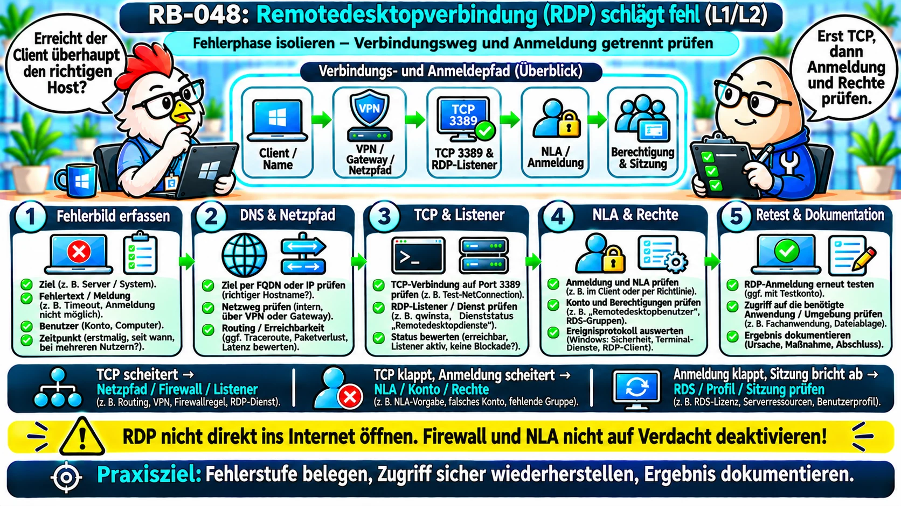

# RB-048 – Remotedesktopverbindung (RDP) schlägt fehl (L1/L2)

**Projekt:** 50 Tickets – 50 typische IT-Supportfälle  
**Stand:** 23.11.2026 · **Version:** 1.0 · **Systeme:** Windows 11 Pro/Enterprise/Education als Host, Windows Server, Active Directory, VPN und ggf. Remote Desktop Gateway (RD Gateway)  
**Status:** Technische Quellenrecherche und theoretisch begründeter Diagnoseweg; **keine praktische Validierung**. Alle Fallbeispiele, Namen, Zeiten und IP-Adressen sind fiktiv. Keine produktive Konfiguration wurde verändert.



> **Merksatz:** **Zielsystem läuft ≠ DNS korrekt ≠ TCP-Port erreichbar ≠ RDP-Listener funktionsfähig ≠ Anmeldung autorisiert ≠ Remotesitzung nutzbar.** Jede Ebene erfordert einen eigenen Nachweis.

---

## 1. Eingangsticket, Lernziel und fachliche Abgrenzung

**Fiktives Eingangsticket:** „Seit heute 08:15 Uhr komme ich von meinem Firmenlaptop aus nicht mehr per Remotedesktop auf `ws-rdp-01.corp.example.test`. Über VPN bin ich angemeldet. Bei meinen Kollegen klappt es.“

**Lernziel:** Ohne blinde Regeländerungen die **erste nachweisbar fehlerhafte Ebene** identifizieren, passende Tests auswählen, den Befund dokumentieren und eine begrenzte, genehmigte Korrektur mit funktionaler Erfolgskontrolle durchführen.

**Abgrenzung:** RB-011 behandelt allgemeine VPN-Störungen, RB-034 DNS, RB-038 die Servererreichbarkeit, RB-039 generische TCP-Ports und RB-047 TLS-Zertifikate. RB-048 vertieft den RDP-spezifischen Pfad: Hostfähigkeit, RDP-Konfiguration, Listener, NLA, Kontorechte und Sitzungserstellung.

**Produktgrenze:** Windows 11 Home kann als RDP-**Client**, nicht als integrierter RDP-**Host** dienen. Ein normaler Arbeitsplatzhost (Windows 11 Pro/Enterprise/Education) ist nicht dasselbe wie eine Windows-Server-RDS-Farm mit RD Session Host, Gateway, Broker und RDS-CAL-Lizenzierung. [Q1][Q2]

## 2. Technisches Modell: die sieben Prüfebenen

```text
RDP-Client (mstsc) / richtiges Ziel
  → DNS oder IP-Adresse
  → VPN / RD Gateway / Netzroute und Firewall
  → TCP-Port (typisch 3389 bei direktem RDP)
  → RDP-TCP-Listener / Remote Desktop Services am Host
  → NLA und Kontoauthentifizierung
  → RDP-Anmelderecht und Sitzung / Profil / Anwendung
```

**TCP 3389** ist bei direktem klassischem RDP der Standard. Konfigurierte Ports können abweichen; bei **RD Gateway** wird vom Client zunächst das Gateway, typischerweise per **HTTPS 443**, erreicht und der Zielhost über den Gateway-Pfad verbunden. Ein fehlgeschlagener direkter Clienttest auf `Ziel:3389` ist **kein** alleiniger Beweis für ein Gateway-Problem. RDP kann neben TCP auch UDP einsetzen; ein ausgefallener UDP-Pfad darf nicht automatisch mit einem vollständigen RDP-Ausfall gleichgesetzt werden. [Q2][Q3][Q4]

**NLA (Network Level Authentication)** verlagert die Authentifizierung vor die Desktop-Sitzung. Es erhöht die Sicherheit und sollte nicht zum „Schnelltest“ deaktiviert werden. **TCP erfolgreich** sagt nur, dass der Port eine Verbindung zulässt; nicht, dass Anmeldung, Autorisierung und Anwendung funktionieren. [Q1][Q5]

## 3. Fehlersymptome unterscheiden, bevor getestet wird

| Benutzerbefund | Plausible Fehlerklasse | Wodurch abgrenzen? |
|---|---|---|
| „Computer nicht erreichbar“ / Timeout | Falscher Host, DNS, VPN, Routing, Filter oder Listener | FQDN/IP, `Test-NetConnection`, Vergleichsclient |
| „Verbindung wird abgelehnt“ | Kein Listener am Zielport oder aktive Ablehnung durch Ziel/Netzgerät | Lokales `qwinsta`, Listener, Port/Bindung prüfen |
| Zugangsdaten werden abgelehnt | Falscher Konto-Kontext, Kennwort, Konto- oder NLA-Problem | Exakten Fehler, lokale Security-Events, Richtlinien prüfen |
| „Anmeldetyp nicht zulässig“ | Fehlendes Recht „Anmelden über Remotedesktopdienste“ oder Deny-Recht | Gruppenmitgliedschaft und lokale/GPO-Benutzerrechte |
| Anmeldung erfolgreich, sofort getrennt | RDS-Sitzung, Benutzerprofil, Ressourcen, Lizenzierung bei RDS-Farm | TerminalServices-Ereignisse und Sitzungsstatus |
| Nur vom Homeoffice betroffen | VPN, Gateway, Split-DNS, standortbezogene Netzregeln | Gleiches Ziel aus internem Standort vergleichen |

**L2-Hinweis:** Symptomtexte geben Hinweise, aber **keine eindeutigen Ursachen**. Ein Timeout allein belegt weder einen Firewallblock noch einen Serverausfall. [Q2][Q5][Q6]

## 4. Ticketaufnahme: notwendige Informationen ohne Geheimnisse

- Ziel-FQDN, beabsichtigtes Zielgerät bzw. RemoteApp und **vorgesehener Port/Gateway-Pfad**; Hostname nicht mit einer zufällig erreichbaren IP verwechseln.
- Clientgerät, Windows-Edition, RDP-Client, Benutzerkonto und **welcher Identitätskontext** verwendet wird (lokal, Domäne, Microsoft Entra, ggf. RD Gateway).
- Exakter Fehlertext, Fehlercode, Start- und Fehlerzeitpunkt mit Zeitzone; seit wann und von wo aus (Büro/Homeoffice/VPN)?
- Betroffenheitsgrad: ein Benutzer, ein Client, ein Zielserver, alle Benutzer oder ein Standort?
- Letzte Änderungen: Passwort, GPO, Gruppenmitgliedschaft, VPN, Firewall, Zertifikate, Updates, Hostwechsel, RDS-/Gateway-Konfiguration.
- Auswirkungen: Kritikalität, Alternativzugriff (vorhandene VM-/Hostkonsole, genehmigtes Remote-Management), Change-/Wartungsfenster.

**Datenschutz:** Keine Kennwörter, MFA-Codes, private Schlüssel, komplette Anmelde-Tokens oder unnötige personenbezogene Eventlog-Inhalte in öffentlichen Dokumenten bzw. Tickets ablegen. Eventdaten nur zweckgebunden und möglichst redigiert erfassen.

## 5. Sicherheits- und STOP-Check vor jeder Maßnahme

**Zunächst nur lesend prüfen.** Keine Firewall vollständig deaktivieren, keine eingehende Regel „für alle“ anlegen, Port 3389 nicht per Router-Portweiterleitung öffentlich bereitstellen, NLA nicht abschalten und keine anonymen Zugänge erlauben. Für externe Verbindungen sichere Wege wie genehmigtes VPN oder RD Gateway nutzen. [Q1][Q7]

**Nicht blind:** `TermService` neu starten (kann aktive Sitzungen trennen), Security-Richtlinien ändern, lokale RDP-Gruppe erweitern, RDS-Rollen entfernen, Zertifikate ersetzen, Registry-Listener neu erstellen. Vor Änderungen: Verantwortlichen, Change-Freigabe, Rollback, Sitzungsbelegung und gesicherten alternativen Zugang klären.

**STOP/Eskalation:** Unbekannte Anmeldung, Brute-Force-/Sicherheitsverdacht, unklare Berechtigung, drohender vollständiger Remotezugriffsverlust, RDS-Farm oder geschäftskritischer Terminalserver → zuständigen Endpoint-/RDS-/Security-Betrieb einschalten.

## 6. L1: Hostfähigkeit und Netzwerkpfad prüfen

1. **Zielsystem eindeutig zuordnen:** Name, IP, Edition, Standort, erwarteter RDP-Host. Bei Windows Home als Zielhost ist der integrierte RDP-Host nicht verfügbar.
2. **Hoststatus** aus CMDB, Monitoring, Hypervisor- oder autorisierter Konsole prüfen: Läuft der Rechner? Ist er im richtigen Netz?
3. **DNS vergleichen:** Ist der FQDN korrekt aufgelöst? Bei VPN sowohl internen als auch externen Namensraum beachten.
4. **Von demselben Client und einem genehmigten Vergleichsclient** testen. Unterschiedliche Ergebnisse lokalisieren oft ein Client-/VPN-/Quellnetzproblem.
5. **Ziel-IP und Port** nur auf genehmigtem Pfad testen. Ein Ping-Timeout sagt wenig über RDP aus: ICMP kann blockiert werden.

```powershell
# LESEND am Client; Test-Namen und Port gemäß Ticket ersetzen:
Resolve-DnsName -Name ws-rdp-01.corp.example.test
Test-NetConnection -ComputerName ws-rdp-01.corp.example.test -Port 3389 -InformationLevel Detailed

# Optional: zeigt Verbindungs- und Routeninformationen an, kein Authentifizierungstest:
Test-NetConnection -ComputerName ws-rdp-01.corp.example.test -DiagnoseRouting -InformationLevel Detailed
```

**Interpretation:** `TcpTestSucceeded = True` belegt **TCP-Konnektivität bis zu einem akzeptierenden Endpunkt**, nicht die richtige Serveridentität und nicht eine gültige Anmeldung. Bei `False` zuerst IP, Quell-/Zielroute, VPN/Gateway, Filter und Ziel-Listener vergleichen; nicht blind Firewall öffnen. [Q2][Q8]

## 7. L2: RDP-Konfiguration, Listener und Dienst am Ziel

Die nächsten Schritte benötigen **berechtigten Zugang am Zielsystem**, beispielsweise über Konsole oder bereits genehmigte Management-Verbindung. Niemals einen zuvor fehlerfreien entfernten Managementpfad gefährden.

```powershell
# LESEND auf dem Zielhost:
Get-Service -Name TermService | Select-Object Name, Status, StartType
Get-NetTCPConnection -LocalPort 3389 -State Listen -ErrorAction SilentlyContinue |
    Select-Object LocalAddress, LocalPort, State, OwningProcess
qwinsta

# LESEND: Einstellungen können durch Gruppenrichtlinie überschrieben werden:
Get-ItemProperty -Path 'HKLM:\SYSTEM\CurrentControlSet\Control\Terminal Server' |
    Select-Object fDenyTSConnections
Get-ItemProperty -Path 'HKLM:\SYSTEM\CurrentControlSet\Control\Terminal Server\WinStations\RDP-Tcp' |
    Select-Object PortNumber, UserAuthentication

# LESEND: relevante Firewallregeln (Gruppen-/Anzeigenamen können lokalisiert sein):
Get-NetFirewallRule -Direction Inbound |
    Where-Object { $_.DisplayName -match 'Remote|Remotedesktop|RDP' } |
    Select-Object DisplayName, Enabled, Profile, Action
```

`qwinsta` sollte am erwarteten RDP-Listener `rdp-tcp` mit Status **Listen** (oder lokalisierter Variante) zeigen; lokaler Listener-Port kann konfigurationsbedingt von 3389 abweichen. Ein laufender `TermService` allein beweist keine funktionierende Portbindung. Windows-Firewallregeln, Netzwerkprofile und ggf. Netzwerk-Firewalls/NSGs sind getrennte Ebenen. [Q2][Q9]

**Typische Ursachen:** RDP deaktiviert/GPO blockiert, Hostedition nicht geeignet, TermService/Listener defekt, Konflikt auf zugewiesenem Port, falsche Bindung, Firewall-Regel nur für anderes Profil, Host ist gar nicht erreichbar. **Korrekturen** (z. B. RDP einschalten, Listener reparieren, Firewallregel anpassen) sind **nicht** Teil lesender Diagnose und erfolgen nur mit berechtigtem Change.

## 8. L2: Anmeldung, NLA, Benutzerrechte und Ereignisprotokolle

Wenn der **TCP-Pfad erfolgreich** ist, endet die Diagnose nicht. Jetzt prüfen:

- **Wer meldet sich an?** `DOMAIN\user` vs. lokales `HOST\user`; ggf. spezieller Anmeldeweg bei Entra-joined Geräten. Keine Konten auf Verdacht wechseln.
- **NLA/Kerberos/CredSSP:** Funktionieren Authentifizierung und erforderliche Domänen-/DC-Erreichbarkeit? Gibt es Richtlinien- oder Zertifikatshinweise?
- **Autorisierung:** Ist das Konto passend berechtigt (Administrators oder Remote Desktop Users / genehmigte Gruppen), und ist das Recht **„Anmelden über Remotedesktopdienste zulassen“** vorhanden? Hat ein **Deny**-Recht Vorrang?
- **Anmeldetoken:** Nach Gruppenänderung kann eine bestehende Sitzung alte Informationen enthalten; neue Anmeldung nur kontrolliert.
- **Ereignisse:** Windows Security (z. B. fehlgeschlagene Anmeldung **4625**) und TerminalServices-Logs zeitlich korrelieren. Event-IDs nie ohne konkreten Kontext als alleinigen Nachweis betrachten.

```powershell
# LESEND auf dem Zielhost mit geeigneten Leserechten:
Get-WinEvent -FilterHashtable @{
  LogName='Security'; Id=4625; StartTime=(Get-Date).AddHours(-4)
} -MaxEvents 20 -ErrorAction SilentlyContinue |
  Select-Object TimeCreated, Id, Message

Get-WinEvent -FilterHashtable @{
  LogName='Microsoft-Windows-TerminalServices-LocalSessionManager/Operational';
  StartTime=(Get-Date).AddHours(-4)
} -MaxEvents 30 -ErrorAction SilentlyContinue |
  Select-Object TimeCreated, Id, Message

# LESEND: lokale Gruppen und effektive Computer-GPO:
Get-LocalGroupMember -Group 'Remote Desktop Users' -ErrorAction SilentlyContinue
# Hinweis: Gruppenname kann auf deutschem Windows lokalisiert sein.
gpresult /r /scope computer
```

**Wichtig:** `4625` mit Unterstatus und Logon Type 10 kann helfen; Eventkorrelation ist erforderlich. Ein TCP-Erfolg und selbst akzeptierte Anmeldedaten bedeuten noch nicht, dass eine vollständige Remotesitzung erstellt wurde. [Q5][Q6][Q10]

## 9. Sonderfälle: RD Gateway, RDS-Farm, Entra ID und Sitzungsabbruch

**RD Gateway:** Prüfen, ob der Client auf den richtigen Gatewaynamen/HTTPS-Endpunkt zugreift, ob Benutzer- und Ressourcenrichtlinien (CAP/RAP) die Zielverbindung erlauben und ob Gateway → internes Ziel funktioniert. Bei einem Gateway-Dienstpfad kann der direkte Test `Client → Ziel:3389` absichtlich blockiert sein. [Q4][Q7]

**RDS-Farm:** Zusätzlich Broker, Collection, Session Host, Lizenzierungsdiagnose und RDS-CAL-Rahmen kontrollieren. Ein „keine RD-Lizenzserver verfügbar“-Fehler betrifft die RDS-Infrastruktur; nicht mit Windows-11-Einzelhostdiagnose vermischen. [Q11]

**Entra-joined Endpoint:** Für Microsoft-Entra-Authentifizierung gelten besondere Konfigurations- und Identitätsvorgaben. Diagnose nicht blind auf `DOMAIN\user` reduzieren. [Q12]

**Direkt nach Anmeldung getrennt:** Session-/Profildienst, Hostressourcen, Sicherheitsrichtlinien, vorhandene Sitzungen und TerminalServices-Ereignisse prüfen; bei Profilfehlern Querverweis **RB-042**.

## 10. A/B-Testmatrix: aus einem Symptom eine Hypothese machen

| Vergleichstest | Ergebnis | Interpretation / nächster Schritt |
|---|---|---|
| Hostname vs. fest zugeordnete Ziel-IP | Nur IP funktioniert | DNS/Suffix/Zielnamen- oder Identitätskontext prüfen; nicht dauerhaft unsichere IP-Umgehung etablieren |
| Betroffener vs. bekannter funktionierender Client | Nur ein Client scheitert | Client, VPN, Gateway, Credential-/RDP-Konfiguration vergleichen |
| Direkt im LAN vs. über genehmigtes VPN | Nur VPN scheitert | VPN-Route/ACL/DNS/Gateway prüfen |
| TCP-Port erreichbar, RDP-Anmeldung scheitert | TCP OK, Auth-Fehler | NLA, Konto, Gruppen-/Benutzerrechte und Eventlogs |
| RDP von allen Clients auf einen Host fehlerhaft | Isolierter Zielhost | Hostzustand, Listener, Richtlinien und Firewall prüfen |
| Mehrere Session Hosts betroffen | Farmweit | Gateway, Broker, gemeinsame Richtlinien, Lizenzierung prüfen |

Jeder Test braucht eine Ausgangshypothese, einen zu erwartenden Befund und eine eindeutige Angabe von **Quellgerät und Zielgerät**. In Produktionsumgebungen niemals unautorisiert fremde Hosts oder Ports scannen.

## 11. Fehlerursachen und passende, freigabepflichtige Korrekturen

| Nachgewiesene Ursache | Zuständige Maßnahme nach Freigabe |
|---|---|
| Falscher Host/FQDN | Zuordnung, DNS-/Inventareintrag und Clientkonfiguration korrigieren |
| Windows Home als Ziel | Geeignete Host-Edition oder genehmigte Remote-Support-Alternative verwenden |
| VPN-/Route-/Gatewayfehler | Zuständiges Netzwerk-/Gateway-Team behebt nach dokumentiertem Pfadbefund |
| RDP-Listener nicht aktiv | Host-/RDS-Administration prüft Dienst, Listener, Policy und Portkonflikt |
| Hostfirewall- oder Netz-Firewallregel blockiert | Präzise genehmigte Regel mit kleinstmöglichem Scope; **nicht Firewall deaktivieren** |
| NLA-/Konto- oder Benutzerrechtproblem | Authentifizierungs- und GPO-Ursache korrigieren; **nicht NLA abschalten** |
| RDS-Lizenzierung oder Broker | RDS-Administration; L1/L2 eskalieren |
| Sitzung wird nach Anmeldung beendet | Profil-/Sitzungs-/Hostressourcenanalyse, bei Bedarf Profilteam |

**Keine Maßnahme vor dem Nachweis**. Ein Dienstneustart kann produktive Remotesitzungen trennen und muss vorab organisatorisch geklärt werden.

## 12. Fiktiver Musterfall A – Ein Benutzer scheitert nach Kennwortwechsel

**Meldung:** „Auf `ws-rdp-01.corp.example.test` kann ich mich nicht mehr anmelden; mein Kollege erreicht den Rechner.“

**Befunde (fiktiv):** DNS korrekt; `Test-NetConnection ... -Port 3389` zeigt `True`; Listener auf Ziel `Listen`; Vergleichskonto kann sich anmelden; beim betroffenen Konto Security-4625-Einträge mit zum Versuch passendem Zeitfenster.

**Hypothesen:** Veraltete lokal gespeicherte Anmeldeinformationen, falscher Benutzerpräfix, Passwortänderung noch nicht berücksichtigt, Kontosperr-/Richtlinienproblem.

**Diagnoseplan:** Benutzerpräfix und vorgesehenen Authentifizierungsweg abgleichen; Authentifizierungsstatus anhand Sicherheitsereignissen und Konto-/DC-Zustand prüfen; gespeicherte Credentials nur mit Benutzer und Richtlinie untersuchen; **kein** wahlloses Löschen anderer Einträge.

**Korrekturbeispiel (nur nach Nachweis):** Vorgesehenes Konto mit aktuellen Anmeldeinformationen nutzen, kontospezifische Fehlerursache durch berechtigte Stelle beseitigen. **Validierung:** Betroffener Benutzer erreicht RDP, meldet sich an, startet benötigte Anwendung; Eventlage und Ticket sind dokumentiert.

**Lernfrage:** Warum ist ein erneutes Öffnen von Port 3389 hier nicht begründbar?

## 13. Fiktiver Musterfall B – RDP geht intern, über VPN nicht

**Meldung:** „Aus dem Büro komme ich auf `rdsh-02.corp.example.test`, aus dem Homeoffice nur auf das VPN-Portal.“

**Befunde (fiktiv):** Interner Client erreicht Ziel-TCP-Port und meldet sich an. VPN-Client löst Zielhostname auf eine erwartete interne Adresse auf; Verbindungsversuch zum vorgesehenen TCP-Port scheitert; mehrere VPN-Nutzer betroffen. Gateway-/VPN-Design muss vor Porttests geklärt sein.

**Hypothesen:** Fehlende VPN-Route, Filter zwischen VPN-Pool und Servernetz, Gateway-Policy oder falscher Verbindungsweg. Ein RDP-Listener-Defekt ist angesichts funktionierender LAN-Verbindung weniger wahrscheinlich.

**Diagnoseplan:** Quell-/Zielnetz, beabsichtigten VPN-/Gatewaypfad, Routingtabellen und Firewall-/Gateway-Protokolle durch Netzteam vergleichen. Keine pauschale Regel und keine öffentliche Portweiterleitung.

**Korrekturbeispiel (nur nach Nachweis):** Eine konkrete, autorisierte Route/Policy korrigieren; vom VPN-Segment erneut TCP, Anmeldung und Anwendung prüfen.

**Lernfrage:** Welche Messung trennt RDP-Authentifizierung vom Netzwerkpfad?

## 14. Lernkontrolle: Active Recall, Verständnis und Transfer

**Wissensfragen (aus dem Gedächtnis):**
1. Welcher TCP-Port wird für direkte RDP-Verbindungen standardmäßig verwendet? Welche Abweichungen sind möglich?
2. Welches Tool zeigt den lokalen RDP-TCP-Listenerstatus an?
3. Kann Windows 11 Home regulär eingehende RDP-Hostverbindungen anbieten?
4. Was bedeutet NLA, und weshalb bleibt es aktiviert?

**Verständnisfragen:**
5. Weshalb ist `TcpTestSucceeded=True` kein Nachweis für erfolgreiche RDP-Anmeldung?
6. Warum ist bei RD Gateway ein direkter Test Client → Ziel:3389 nicht zwingend aussagekräftig?
7. Wie unterscheiden sich Gruppenmitgliedschaft, Anmelderecht und erfolgreicher Sitzungaufbau?

**Diagnosefragen:**
8. TCP 3389 erreichbar, Anmeldung wird abgelehnt: Welche drei Hypothesen testest du zuerst und warum?
9. Ein einzelner VPN-Standort betroffen, LAN funktioniert: Welche Messungen vergleichst du?
10. RDP-Anmeldung gelingt, sofortiger Sitzungsabbruch: Welche Logs und Systeme untersuchst du?

**Transfer:** Nach 7 und 21 Tagen neue Kombinationen testen: falscher FQDN, Firewall-Profile, NLA, GPO-Deny, RDS-Lizenzierung. Ziel ist Diagnosebegründung **ohne vorheriges Öffnen des Runbooks**.

## 15. Praxistraining, Validierungsgrenzen und Ticketabschluss

**Laborvorschlag:** Zwei autorisierte VMs (Windows 11 Pro/Enterprise-Testhost oder Windows Server als RDP-Host; Windows-Client als Ausgangspunkt) in einem isolierten Netzwerk. Vorher VM-Checkpoints und ein alternativer Konsolenzugang. Nacheinander nur **eine** simulierte Fehlerursache setzen: deaktivierte RDP-Einstellung, gezielte Testfirewallregel, falscher Zielport, fehlende Berechtigung eines Testkontos. **NLA bleibt aktiviert; kein öffentliches RDP.**

**Training:** Zuerst nur fiktives Ticket lesen → Hypothesen formulieren → lesende Tests durchführen → Befund präsentieren → genehmigte Laborkorrektur → Gegenprüfung aus zweiter Sitzung → eigenes Runbook und Ticket schreiben → mit dieser Vorlage vergleichen.

**Erfolgskriterien:** Korrekte Zielidentität, erreichbarer sicherer Transportpfad, erlaubte Authentifizierung, passende Benutzerrechte, stabile Sitzung, benötigte Anwendung nutzbar, reproduzierbarer Gegencheck. Bei produktiven Systemen ausdrücklich auch andere Benutzer/Sitzungen und Sicherheitswirkung berücksichtigen.

**Muster-Ticketabschluss, fiktiv:** „RDP-Verbindungsfehler seit 08:15 Uhr nachgestellt. Namensauflösung und TCP-Listener geprüft; Ursache lag in [nachgewiesener Ebene]. Änderung [ID/Freigabe] durch [zuständiges Team]. RDP-Anmeldung und Fachanwendung von [Quellnetz] getestet; keine bekannten Nebenwirkungen. Ergebnis dokumentiert.“

---

## Quellen und technische Verifikation (23.11.2026)

- **[Q1]** Microsoft Learn – Remotedesktop aktivieren, Windows-Edition und NLA: https://learn.microsoft.com/de-de/windows-server/remote/remote-desktop-services/remotepc/remote-desktop-allow-access
- **[Q2]** Microsoft Learn – Remotedesktop kann keine Verbindung herstellen (Host, Port, Listener, Richtlinien, Firewall): https://learn.microsoft.com/de-de/troubleshoot/windows-server/remote/remote-desktop-cannot-connect-remote-computer
- **[Q3]** Microsoft Learn – Von Remotedesktopdiensten verwendete Ports: https://learn.microsoft.com/de-de/troubleshoot/windows-server/remote/ports-used-by-rds
- **[Q4]** Microsoft Learn – RD-Gateway und RDP-Zugriff: https://learn.microsoft.com/de-de/windows-server/remote/remote-desktop-services/rds-roles
- **[Q5]** Microsoft Learn – Einschränkungen von RDP-Anmeldetypen: https://learn.microsoft.com/de-de/troubleshoot/windows-server/remote/system-admin-restrict-types-logon
- **[Q6]** Microsoft Learn – Anmeldeereignis 4625: https://learn.microsoft.com/en-us/windows/security/threat-protection/auditing/event-4625
- **[Q7]** Microsoft Learn – Remotedesktop-Zugriff außerhalb des lokalen Netzes und VPN-Empfehlung: https://learn.microsoft.com/en-us/windows-server/remote/remote-desktop-services/clients/remote-desktop-allow-outside-access
- **[Q8]** Microsoft Learn – `Test-NetConnection`: https://learn.microsoft.com/de-de/powershell/module/nettcpip/test-netconnection?view=windowsserver2022-ps
- **[Q9]** Microsoft Learn – Listener-/Dienst-/Firewall-Problembehandlung: https://learn.microsoft.com/de-de/windows-server/remote/remote-desktop-services/troubleshoot/rdp-error-general-troubleshooting
- **[Q10]** Microsoft Learn – Windows-Client: RDP-Anmeldeschwierigkeiten: https://learn.microsoft.com/en-us/troubleshoot/windows-client/remote/terminal-server-client-connection-failures
- **[Q11]** Microsoft Learn – RDS-Lizenzierungsdiagnose: https://learn.microsoft.com/de-de/troubleshoot/windows-server/remote/troubleshoot-rds-licensing-guidance
- **[Q12]** Microsoft Learn – RDP zu Entra-joined PCs: https://learn.microsoft.com/de-de/windows/client-management/client-tools/connect-to-remote-aadj-pc

**Validierungsstand:** Herstellerrecherche und technische Plausibilisierung; **keine echte RDP-Störung oder Konfigurationsänderung wurde im Labor reproduziert oder getestet**. Die Infografik ist ein Lernanker, nicht der Nachweis für eine produktive Fehlerursache. Veröffentlichungshinweis: „Eigene Konzeption, KI-gestützte Visualisierung mit ChatGPT.“
