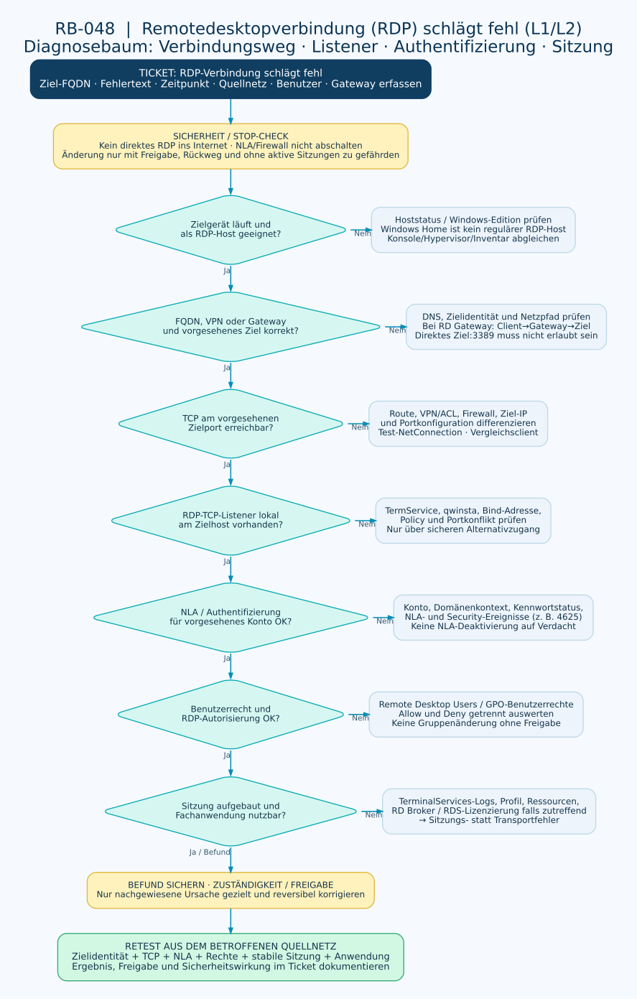

# RB-048 – Praxis-Runbook: Remotedesktopverbindung (RDP) schlägt fehl (L1/L2)

**Projekt:** 50 typische IT-Supportfälle · **Stand:** 23.11.2026 · **Version:** 1.0  
**Status:** Recherchiert und theoretisch nachvollzogen, **nicht praktisch validiert**. Fiktive Daten. Erst lesend prüfen; produktive Änderungen nur mit Freigabe.



## 1. Eingangsticket und Geltungsbereich

- [ ] Ziel-FQDN und **beabsichtigtes Zielgerät** eindeutig bekannt? Port und ggf. RD Gateway im Verbindungsdesign definiert?
- [ ] Exakter Wortlaut der Fehlermeldung/Code und Zeitpunkt dokumentiert?
- [ ] Welcher Client, welches Benutzerkonto (Domäne/lokal/Entra), welches Quellnetz (LAN/VPN/Homeoffice)?
- [ ] Nur ein Anwender/Client oder mehrere? Nur ein Host oder mehrere RDS-Hosts?
- [ ] Letzter Erfolg und Änderungen: Kennwort, GPO, VPN, Firewall, Windows Update, Host-/RDS-/Gatewaykonfiguration?
- [ ] Hoststatus und genehmigten Alternativzugang (Hypervisor-/lokale Konsole) ermittelt?
- [ ] **Windows-Edition des Zielhosts** geeignet? Windows Home ist kein regulärer integrierter RDP-Host.

**Muster-Ticket (fiktiv):** „Von VPN-Notebook `CLIENT-07` kein RDP auf `ws-rdp-01.corp.example.test`, seit 08:15, Fehlermeldung [Wortlaut]; internes LAN funktioniert.“

## 2. Sicherheitsgrenze / STOP-Kriterien

- [ ] Aktiver Fernzugang vorhanden? **Nicht** ohne Rückweg den Netzwerkadapter, Dienst, Firewall oder RDP-Port ändern.
- [ ] **Keine** öffentliche TCP-3389-Portweiterleitung, kein Firewall-Disable, **NLA nicht abschalten**, keine Berechtigungen „auf Verdacht“ vergeben.
- [ ] Vor Dienstneustart, GPO-/Registry-/Firewalländerung: Change-Freigabe, Sitzungsbelegung, Rollback und zuständiges Team geklärt.
- [ ] Bei unbekannten RDP-Anmeldeversuchen, Sicherheitsverdacht, unklarer Identität oder großflächigem Ausfall → Security/RDS/Netzteam.
- [ ] Keine Klartextkennwörter, Tokens, MFA-Codes oder unnötigen vollständigen Security-Events ins Ticket kopieren.

**STOP:** Kein sicherer alternativer Zugang oder drohende Unterbrechung laufender Sitzungen → nicht ohne Betriebsfreigabe fortfahren.

## 3. L1 – Host, DNS und Netzweg prüfen

```powershell
# LESEND – Beispieladresse, bitte an das autorisierte Ziel anpassen:
Resolve-DnsName -Name ws-rdp-01.corp.example.test
Test-NetConnection -ComputerName ws-rdp-01.corp.example.test -Port 3389 -InformationLevel Detailed
```

- [ ] DNS-Antwort gehört zum **richtigen** Host und Zielnetz? Falscher FQDN/Alias ausgeschlossen?
- [ ] Ist Verbindung über VPN oder RD Gateway vorgesehen? **Nicht** direkte Ziel-TCP-Tests als Beweis gegen Gateway interpretieren.
- [ ] Bei direktem RDP: Richtiger Port (standardmäßig TCP 3389) oder absichtlich abweichende Portnummer?
- [ ] Quellnetz und Zielnetz dokumentiert; Vergleich eines autorisierten Clients aus anderem Netz?
- [ ] `TcpTestSucceeded=True` nur als **TCP-Erreichbarkeit**, nicht als RDP-/Anmeldeerfolg gewertet?

**Entscheidung:** TCP vom vorgesehenen Netzpfad nicht erreichbar → IP/DNS/VPN/Gateway/Route/Firewall/Listener differenzieren; L2-Netz/Endpoint einschalten. TCP erfolgreich → Authentifizierung und Sitzungsaufbau weiter prüfen.

## 4. L2 – Hostkonfiguration, Dienst und Listener

Nur auf dem **berechtigt erreichbaren Zielhost** oder via genehmigter Verwaltungskonsole:

```powershell
# LESEND – auf dem Zielhost:
Get-Service -Name TermService | Select-Object Name, Status, StartType
qwinsta
Get-NetTCPConnection -LocalPort 3389 -State Listen -ErrorAction SilentlyContinue |
    Select-Object LocalAddress, LocalPort, OwningProcess, State
Get-ItemProperty 'HKLM:\SYSTEM\CurrentControlSet\Control\Terminal Server' |
    Select-Object fDenyTSConnections
Get-ItemProperty 'HKLM:\SYSTEM\CurrentControlSet\Control\Terminal Server\WinStations\RDP-Tcp' |
    Select-Object PortNumber, UserAuthentication
```

- [ ] RDP laut Einstellungen/GPO für diesen Host zulässig?
- [ ] `rdp-tcp` laut `qwinsta` im **Listen**-Status? Wenn nicht, Listener/Policy/Port prüfen.
- [ ] Richtiger Listener-Port und IP-Bindung? Beim benutzerdefinierten Port gezielt prüfen; `3389` nicht starr voraussetzen.
- [ ] Dienstzustand und PID/Portkonflikt dokumentiert? **Dienst läuft ≠ Listener lauscht.**

## 5. L2 – Firewall, Routing und Gateway

```powershell
# LESEND – keine Regel ändern:
Get-NetFirewallRule -Direction Inbound |
  Where-Object { $_.DisplayName -match 'Remote|Remotedesktop|RDP' } |
  Select-Object DisplayName, Enabled, Profile, Action
```

- [ ] Firewall-Regel am Ziel aktiv, mit korrektem Profil und Quelladressbereich? Anzeige-/Gruppennamen sind sprachabhängig.
- [ ] Besteht zusätzlich Netzfirewall, VPN-ACL, NSG oder RD Gateway mit CAP/RAP? Vom **richtigen** Netzpfad testen.
- [ ] Falls Gateway: Client → Gateway und Gateway → Ziel getrennt bewerten; direkte Ziel-Porttests aus dem Internet sind möglicherweise absichtlich blockiert.
- [ ] **Keine** breiten Any-Any-Regeln als Reparatur; Änderungen durch Firewall-/RDS-Verantwortliche.

## 6. L2 – NLA, Konto und Benutzerrechte

- [ ] TCP erreichbar, aber „Anmeldung fehlgeschlagen“, „Anmeldetyp eingeschränkt“ oder NLA-Warnung?
- [ ] Richtiges Konto (`DOMAIN\user`, `HOST\user`, Entra-Identität) und erwartete Anmeldeoption?
- [ ] Konto aktiv, Kennwortzustand, Sperre und eventuelle Domänencontroller-Erreichbarkeit geprüft?
- [ ] Erforderliche Mitgliedschaft in berechtigter lokaler bzw. Domänengruppe vorhanden?
- [ ] Benutzerrecht **„Anmelden über Remotedesktopdienste zulassen“** wirksam? Ein **Deny**-Recht kann erlaubende Gruppenrechte überstimmen.
- [ ] NLA bleibt aktiviert. Richtlinien-/Client-/Identitätsprobleme klären statt Sicherheitskontrollen deaktivieren.

## 7. L2 – Ereignisprotokolle und Sitzung

```powershell
# LESEND auf dem Ziel, mit den erforderlichen Rechten:
Get-WinEvent -FilterHashtable @{
    LogName='Security'; Id=4625; StartTime=(Get-Date).AddHours(-4)
} -MaxEvents 20 -ErrorAction SilentlyContinue |
    Select-Object TimeCreated, Id, Message

Get-WinEvent -FilterHashtable @{
    LogName='Microsoft-Windows-TerminalServices-LocalSessionManager/Operational';
    StartTime=(Get-Date).AddHours(-4)
} -MaxEvents 30 -ErrorAction SilentlyContinue |
    Select-Object TimeCreated, Id, Message

# Aktuelle Computer-GPO (LESEND):
gpresult /r /scope computer
```

- [ ] Ereignisse mit **genau diesem** Fehlversuch korreliert? Security 4625 mit Status/Substatus bewertet?
- [ ] Erfolgreiche Anmeldung, aber sofortiger Abbruch → Session Host, Benutzerprofil, Ressourcen, RDS-Farm/Lizenzierung prüfen.
- [ ] Bei RDS-Farm ggf. RD Broker, Collection, Licensing-Diagnoser und zentrale Policies einschalten; **nicht** ohne Befund RDS-Rollen neu installieren.
- [ ] Datenschutz: keine kompletten personenbezogenen Logexporte ungeschützt anhängen.

## 8. Entscheidungsmatrix / Zuständigkeit

| Befund | Wahrscheinliche Ebene | Nächste Maßnahme |
|---|---|---|
| Zielhost Windows Home | Hostfähigkeit | Geeigneten RDP-Host/zugelassene Alternative prüfen |
| Name falsch / andere IP | DNS/Zielidentität | DNS/Inventar/Clientziel korrigieren lassen |
| Nur VPN betroffen | VPN/Gateway/ACL | Netz- oder Gatewayteam mit Vergleichsbefund |
| TCP falsch, Hostlistener vorhanden | Pfad/Firewall | Quell-/Zielregel prüfen lassen; kein pauschales Öffnen |
| Listener lokal fehlt | TermService/RDP-Policy/Port | Endpoint- oder RDS-Team, lokale Konsole |
| TCP OK, Konto abgewiesen | NLA/Auth/Anmelderecht | Kontokontext, Ereignis 4625, GPO/Gruppe prüfen |
| Login OK, sofort getrennt | Sitzung/Profil/RDS-Lizenz | L2/RDS-/Profilteam einschalten |

**L1-Grenze:** Fehlermeldung, Ziel, Reichweite, DNS/VPN und vom Client aus erlaubte TCP-Tests. **L2-Grenze:** Zielhost, Listener, Ereignisprotokolle, GPO-/Berechtigungsbewertung. Produktive Policy-/Firewall-/RDS-Änderungen nur durch zuständige Administratoren.

## 9. Korrektur, Retest und Nachweis

- [ ] Fehlerhypothese durch **lesenden Befund** bestätigt; verantwortliches Team und Freigabe dokumentiert.
- [ ] Nur nötige, möglichst reversible Änderung; Zugang über alternative Konsole bleibt erhalten.
- [ ] Nach Korrektur FQDN/Port aus dem **betroffenen Quellnetz** erneut prüfen.
- [ ] RDP-Client verbindet sich ohne neue Ausnahme; **NLA aktiv** und Sicherheitsrichtlinien unverändert wirksam.
- [ ] Betroffener Benutzer kann sich anmelden und die **eigentliche Fachaufgabe** ausführen; Sitzung stabil.
- [ ] Wenn ein Gateway involviert ist: vorgesehenen Client → Gateway → Ziel-Pfad testen.
- [ ] Gegebenenfalls Vergleichsuser und andere Hosts/Anwendungen gegenprüfen; keine Nebenwirkungen auf aktive Sessions.

## 10. Muster-Ticketkommentar und Validierungsstatus

> **Fiktiver Ticketkommentar:** „RDP-Verbindungsstörung auf `ws-rdp-01.corp.example.test` seit 08:15 Uhr aufgenommen. FQDN, Netzwerkpfad, TCP-Port, Listener, Authentifizierung und Nutzerrecht geprüft. Fehlerursache: [nachgewiesene Ebene und Befund]. Maßnahme: [freigegebene Änderung/Team/Change-ID]. Retest: betroffener Benutzer kann sich aus vorgesehenem Quellnetz anmelden und die benötigte Anwendung nutzen. Keine unautorisierten Firewall-, NLA- oder Berechtigungsänderungen. Ticket dokumentiert.“

**Quellen (Microsoft Learn, abgerufen 23.11.2026):**
- [Q1] RDP-Host/Edition/NLA: https://learn.microsoft.com/de-de/windows-server/remote/remote-desktop-services/remotepc/remote-desktop-allow-access
- [Q2] Allgemeine RDP-Fehlerdiagnose: https://learn.microsoft.com/de-de/troubleshoot/windows-server/remote/remote-desktop-cannot-connect-remote-computer
- [Q3] Listener und Dienst: https://learn.microsoft.com/de-de/windows-server/remote/remote-desktop-services/troubleshoot/rdp-error-general-troubleshooting
- [Q4] RDP-Anmeldetypen: https://learn.microsoft.com/de-de/troubleshoot/windows-server/remote/system-admin-restrict-types-logon
- [Q5] RDS-Lizenzierung: https://learn.microsoft.com/de-de/troubleshoot/windows-server/remote/troubleshoot-rds-licensing-guidance
- [Q6] Sichere externe Verbindungen: https://learn.microsoft.com/en-us/windows-server/remote/remote-desktop-services/clients/remote-desktop-allow-outside-access
- [Q7] `Test-NetConnection`: https://learn.microsoft.com/de-de/powershell/module/nettcpip/test-netconnection?view=windowsserver2022-ps

**Validierungsstatus:** Recherchiert und theoretisch nachvollzogen, **noch nicht an einem tatsächlichen Störungssystem getestet**. Das Runbook ist eine Arbeitsgrundlage, keine Freigabe für ungeprüfte produktive Änderungen.
