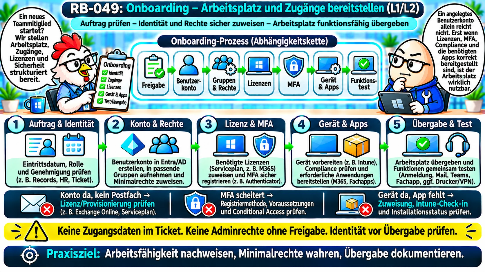
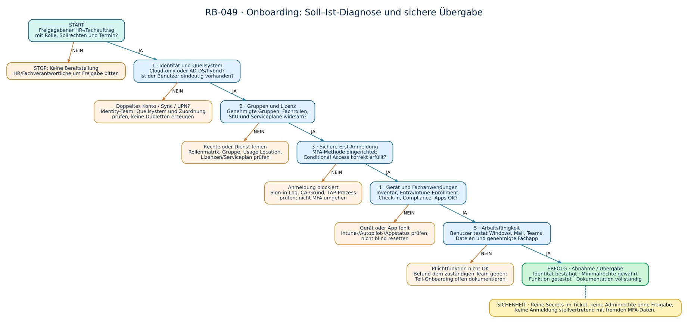

# RB-049 – Onboarding: Arbeitsplatz und Zugänge bereitstellen (L1/L2)

**Projekt:** 50 Tickets – 50 typische IT-Supportfälle  
**Stand:** 23.11.2026 · **Version:** 1.0 · **Systeme:** Microsoft 365, Microsoft Entra ID, optional Active Directory DS (hybrid), Intune/Windows Autopilot, Exchange Online, Teams, OneDrive/SharePoint und Fachanwendungen  
**Status:** Aktuelle Herstellerquellen recherchiert; **keine praktische Validierung**. Alle Personen, Organisationsdaten, Gerätenamen, Tickets, Konten und Ergebnisse in diesem Dokument sind fiktiv. Es wurden keine produktiven Systeme verändert.



> **Merksatz:** **Konto erstellt ≠ Berechtigungen genehmigt ≠ Lizenz aktiv ≠ MFA eingerichtet ≠ Gerät verwaltet ≠ Mitarbeiter arbeitsfähig.** Jede Voraussetzung muss für die tatsächlich benötigte Tätigkeit nachgewiesen werden.

---

## 1. Eingangsticket, Lernziel und Abgrenzung

**Fiktives Eingangsticket:** „Neue Kollegin, Jana Weber, beginnt am Montag als Sachbearbeiterin. Bitte Windows-Laptop, Firmen-E-Mail, Microsoft Teams, OneDrive und Zugriff auf das freigegebene Teamlaufwerk sowie die Fachanwendung `Kundenportal` bereitstellen. Genehmigungsnummer: `HR-ONB-1049`. Ansprechpartnerin ist die Teamleitung. Auslieferung vor Dienstbeginn.“

**Lernziel:** Aus einem freigegebenen Eintrittsauftrag einen **nachvollziehbar funktionsfähigen Arbeitsplatz** mit minimal erforderlichen Rechten bereitstellen. Dabei Abhängigkeiten, Verantwortlichkeiten und Prüfpunkte erkennen, statt lediglich Konten zu erstellen.

**Abgrenzung:** RB-012 behandelt MFA-Störungen; RB-017 Netzlaufwerke; RB-029 Lizenzfehler; RB-041 Gruppenmitgliedschaft; RB-045 Intune-Geräteverwaltung; RB-046 Softwaredeployment. RB-049 integriert diese Teilfähigkeiten in einen kontrollierten **Joiner-Prozess**. RB-050 behandelt den gegenteiligen Prozess (Offboarding).

**Organisatorischer Grundsatz:** Die Quelle für Eintritt, Name, Funktion und Startdatum ist der **autorisierte HR-/Personalprozess**; Zugriffsrechte benötigen die dokumentierte Zustimmung der fachlich Verantwortlichen. Eine mündliche Nachricht ohne belegbaren Auftrag ersetzt keine Freigabe.

## 2. Technisches Modell: die Onboarding-Abhängigkeitskette

```text
HR-/Fachauftrag und Eintrittsdatum bestätigt
  → Identitäts-Quellsystem (Cloud oder AD DS/hybrid) festlegen
  → Benutzerkonto / UPN / eindeutige Zuordnung
  → Rollenbasierte Gruppen und Ressourcenrechte mit Genehmigung
  → Erforderliche Lizenzprodukte und Servicepläne
  → Sichere Erstauthentifizierung und MFA/Conditional Access
  → Inventarisiertes Gerät, Enrollment, Compliance und Anwendungen
  → Funktionstest mit berechtigter Person / Übergabe / Ticketabschluss
```

**Warum diese Reihenfolge?** Gruppen können Apps, Lizenzen und Richtlinien steuern; Intune und Autopilot benötigen passende Benutzer-/Gerätevoraussetzungen; Conditional Access kann Zugriff trotz korrekter Lizenz blockieren. Die **Kette ist eine praktische Prozesslogik**, keine einzige fest verdrahtete Reihenfolge aller Microsoft-Tenants. Viele Teilprozesse können parallel ablaufen oder werden automatisiert, müssen aber am Ende gemeinsam geprüft werden. [Q1][Q3][Q4][Q6][Q8]

## 3. Auftragsaufnahme: notwendige und unzulässige Angaben

| Erforderlicher Sachverhalt | Beispiel / Prüfung | Zuständig |
|---|---|---|
| Genehmigung und Startdatum | HR-Ticket, Rolle, Team, Standort, voraussichtlicher Eintritt | HR/Teamleitung |
| Identitätsdaten | Namensschreibweise, eindeutige Mitarbeiterkennung, UPN-Konvention | Identity-Team |
| Funktion und Soll-Rechte | Freigegebene Rollenmatrix, Datenbereiche, Fachapp, Dateifreigaben | Fachbereich/Dateneigner |
| Microsoft-365-Leistungen | Exchange, Teams, Office-Desktop, OneDrive, Zusatzdienste | Lizenzadministration |
| Gerät | Inventarnummer, Modell, Standort, Zubehör, Übergabetermin | Endpoint-/Asset-Team |
| Authentifizierung | Vorgesehene MFA-Methode, sichere Initialübergabe | Identity/Security |
| Abnahme | Testperson, Sollfunktionen, Übergabeprotokoll, Restarbeiten | Support/Benutzer |

**Nicht ins Ticket:** Klartextkennwort, Temporary Access Pass, Recovery-Schlüssel, Passkeys, private MFA-Daten, Ausweiskopien oder vollständige vertrauliche Personalunterlagen. Stattdessen Art und Ergebnis der zulässigen Identitätsprüfung dokumentieren; Secrets nur über freigegebene, zeitlich begrenzte Übergabewege. Bei ungeklärter Identität oder fehlender Genehmigung **STOP**.

## 4. Quellsystem der Identität: Cloud-only oder hybrid?

**Cloud-only:** Benutzer wird nach genehmigter Identitätsprüfung in Entra ID / Microsoft 365 angelegt und verwaltet. 

**Hybrid:** Das Unternehmen kann das lokale **Active Directory DS** als maßgebliche Quelle für synchronisierte Benutzerkonten verwenden. In diesem Fall darf nicht nebenbei ein zweites gleichnamiges Cloudkonto entstehen; für Änderungen sind der zuständige Schreibort und Synchronisierungsweg maßgeblich. Die konkrete Source-of-Authority-Konfiguration ist zu prüfen und kann von neuen Cloud-Sync-Funktionen beeinflusst werden. [Q2][Q11]

**Vor dem Anlegen prüfen:** Existiert der Benutzer bereits (z. B. Vorvertrag, Wiederanstellung, Gastkonto)? Ist UPN/Anmeldename eindeutig? Sind Anzeigename, Manager, Kostenstelle und `usageLocation` entsprechend Richtlinie gepflegt? Stimmt der geplante Aktivierungszeitpunkt? Keine zusätzlichen Konten erzeugen, nur weil ein Sync noch aussteht.

**Beobachtbare Befunde:** Konto in AD aber noch nicht in Entra → Synchronisationsstatus; Cloudkonto vorhanden, aber Login blockiert → Account-Status/Conditional Access; doppeltes Objekt → Identitätskonflikt durch Identity-Team untersuchen.

## 5. Gruppen, Rollen und Minimalberechtigung

- Eine **Rollenmatrix** nennt erforderliche Ressourcen, Geschäftsrolle, Besitzer und Genehmigung. Nur diese Gruppen vergeben; kein Kopieren aller Gruppen eines Kollegen.
- **Entra-Sicherheitsgruppen, Microsoft-365-Gruppen und AD-Sicherheitsgruppen** dienen unterschiedlichen Zwecken; eine Mitgliedschaft bedeutet nicht automatisch Zugriffsrecht auf jede Ressource. Gruppenverschachtelung, Token-Aktualisierung und Rechte auf der Zielressource müssen berücksichtigt werden. [Q3]
- **Adminrollen** nur mit gesondertem Auftrag, Least Privilege und ggf. privilegiertem Freigabeprozess. Normale Endbenutzer brauchen in der Regel keine lokalen Adminrechte.
- Freigaben, SharePoint, Teams, Fachapplikation und Datei-/Druckdienste haben möglicherweise **eigene Berechtigungsmodelle**. Alle Soll-Zugriffe getrennt nachweisen.

**Sicherheitsstop:** Wenn ein Antrag „alle Rechte wie bei Kollege X“ lautet, Rückfrage an den Ressourceneigner; keine ungeprüfte Übernahme historisch gewachsener Sonderberechtigungen.

## 6. Lizenzen, Servicepläne und Bereitstellungsverzug

Eine zugewiesene **SKU** garantiert nicht, dass der benötigte **Serviceplan** aktiv ist oder die Anwendung schon bereitsteht. Beispiel: Ein Lizenzprodukt mit Exchange-Online-Leistung ist eine Voraussetzung für das reguläre Benutzerpostfach, doch dessen Provisionierung kann zeitlich verzögert sein. [Q4][Q9][Q10]

**Prüfkette:** Konto → Nutzungsstandort → Lizenzprodukt und verfügbares Kontingent → direkter oder gruppenbasierter Zuweisungsweg → Serviceplanstatus → tatsächlicher Dienst (Postfach/Teams/etc.). Bei gruppenbasierter Zuweisung können Fehler später auf dem Benutzerobjekt sichtbar werden; daher Status nachprüfen. [Q4][Q15]

**Diagnosebeispiele:** Lizenzzuweisung fehlgeschlagen wegen fehlendem Usage Location, zu wenigen verfügbaren Plätzen oder Konflikten; Postfach fehlt trotz Lizenz → Exchange-Provisionierung und Dienststatus prüfen. **Nicht** planlos Lizenzen entziehen und erneut vergeben, um Verzögerungen vermeintlich zu beheben.

## 7. Sichere Erstanmeldung: MFA, TAP, Conditional Access

- Vor Erstzugang die **Personenidentität und autorisierte Geräteübergabe** nach Organisationsprozess verifizieren.
- Vorgesehene MFA-Methode bzw. passwortlose Methode **durch den Benutzer selbst** einrichten lassen, nicht durch einen Supportmitarbeiter stellvertretend registrieren.
- Falls organisatorisch vorgesehen, kann ein **Temporary Access Pass (TAP)** eine zeitlich begrenzte Ersteinrichtung von Anmeldemethoden unterstützen. TAP ist ein sensibler Zugangscode und nur nach Berechtigung, Gültigkeits- und Übergaberichtlinien zu verwenden. [Q5]
- **Conditional Access** kann App-Zugriff an MFA, Gerätecompliance oder andere Bedingungen knüpfen; ein gesperrter Zugriff wird über **Anmeldeprotokoll und angewendete Richtlinie** diagnostiziert, nicht durch pauschales Deaktivieren der Policy. [Q8][Q13]

**Nachweis:** Benutzer kann die vorgesehene Authentifizierung erfolgreich und ohne Sicherheitsausnahme abschließen; Support dokumentiert nur **erfolgreich / Fehlercode / Zeit**, keine Codes oder Authenticator-Inhalte.

## 8. Arbeitsplatzgerät, Intune, Autopilot und Schutzstatus

**Gerätebereitstellung:** Zugeordnetes Gerät stimmt mit Assetverwaltung/Seriennummer überein; Windows-Version und Unternehmensimage freigegeben; vorgesehenes Enrollment (z. B. Intune per Windows Autopilot) abgeschlossen; Gerät erscheint mit **passendem Benutzer, Gerätezustand, Check-in und Compliance-Status**. [Q6][Q7][Q12]

**Kontrollen:** Verschlüsselungsstatus und **gesicherte BitLocker-Recovery-Informationen** nach Richtlinie, Sicherheitslösung und Richtlinienzustand, erforderliche Anwendungen, Updates, Hostname, Unternehmensnetz/VPN sowie Drucker und Zubehör nach Bedarf. BitLocker-Schlüssel niemals im Ticket notieren.

**Nicht verwechseln:** Entra-Geräteidentität ≠ MDM-Enrollment ≠ erfolgreicher Check-in ≠ Policy-Anwendung ≠ betriebsbereites Gerät. [Q6][Q12]

**Abweichung:** App fehlt trotz Unternehmensportal-Eintrag → Targeting/IME-Installation/Detection unterscheiden (RB-046). Gerät ist nicht compliant → Compliance-Grund/Check-in statt pauschalem Policy-Bypass prüfen (RB-045).

## 9. Fachliche End-to-End-Prüfung statt oberflächlicher Checkliste

| Sollfunktion | Tatsächlicher Funktionstest |
|---|---|
| Windows | Benutzer kann sich anmelden; Windows-Sitzung und Profil korrekt |
| Exchange | Postfach erreichbar; autorisierte Testmail senden und empfangen |
| Teams | Anmeldung, Team-/Chat-Zugriff und erforderliche Kommunikation |
| OneDrive/SharePoint | Zugriff auf genehmigte Testdatei; Synchronisierung, falls benötigt |
| Fachanwendung | Mit echter Benutzerrolle starten und erlaubte, ungefährliche Testaktion |
| Dateiablage | Berechtigte Freigabe öffnen; Schreibzugriff nur falls genehmigt |
| Drucker/VPN/Peripherie | Nur wenn der Arbeitsplatz dies tatsächlich benötigt |
| Sicherheit | MFA/Conditional Access und Gerätecompliance erfüllt; keine unnötigen Rechte |

**Testprinzip:** Kein Support-Login „als Benutzer“ ohne zulässige Methode; MFA-Secret nicht abfragen. Der betroffene Mitarbeiter oder eine ausdrücklich berechtigte Testperson führt interaktive Tests aus. Die IT begleitet und dokumentiert das Ergebnis.

## 10. Lesende Windows-/Microsoft-Graph-Diagnose

**Voraussetzung:** Nur mit genehmigter Rolle, freigegebener Arbeitsstation und den jeweils notwendigen Microsoft Graph-/RSAT-Modulen. Die Beispiele sind **lesend**, benötigen passende Rollen/Berechtigungen, und die Rückgabe muss datenschutzkonform behandelt werden.

```powershell
# Optional: Microsoft Graph PowerShell, nur lesende Beispiele.
# Connect-MgGraph startet eine interaktive Anmeldung; keine Konfigurationsänderung.
Connect-MgGraph -Scopes 'User.Read.All','Directory.Read.All'

$upn = 'jana.weber@firma.example'  # fiktiv
Get-MgUser -UserId $upn `
    -Property 'Id,DisplayName,UserPrincipalName,AccountEnabled,UsageLocation,AssignedLicenses,OnPremisesSyncEnabled' |
    Select-Object Id, DisplayName, UserPrincipalName, AccountEnabled, UsageLocation, OnPremisesSyncEnabled

# Lizenzdetails lesend prüfen; Verfügbarkeit der Felder hängt von Rechten ab.
Get-MgUserLicenseDetail -UserId $upn |
    Select-Object SkuPartNumber, SkuId, ServicePlans

# Lokal auf dem bereitzustellenden Gerät:
dsregcmd /status
Get-ComputerInfo | Select-Object CsName, WindowsProductName, WindowsVersion
Get-Tpm  # nur Status, kein TPM-Clear
Get-BitLockerVolume -MountPoint 'C:' | Select-Object MountPoint, ProtectionStatus, VolumeStatus
```

**Bei Hybrid-AD** und vorhandenen RSAT-/Lese-Rechten:

```powershell
Import-Module ActiveDirectory
Get-ADUser -Identity 'jweber' -Properties Enabled,UserPrincipalName,MemberOf,WhenCreated |
    Select-Object SamAccountName, Enabled, UserPrincipalName, WhenCreated, MemberOf
```

`Get-ADUser ... MemberOf` zeigt nicht zwangsläufig **alle verschachtelten effektiven Berechtigungen**. Abfragen direkt am Verzeichnis ersetzen nicht den ressourcenbezogenen Funktionstest. Keine Kennwörter oder Authentifizierungstokens im Skript hinterlegen.

## 11. Diagnosematrix bei fehlgeschlagenem Onboarding

| Symptom | Plausible Ursache | Nächster gezielter Nachweis |
|---|---|---|
| Kein Benutzerkonto sichtbar | Auftrag unvollständig, falsches Quellsystem, Hybrid-Sync | HR-Freigabe; AD/Entra-Abgleich und Syncstatus |
| Login scheitert | Account-Status, Kennwortübergabe, MFA/CA | Entra-Anmeldelog/Fehlercode; TAP-Methode falls genehmigt |
| Outlook ohne Postfach | Exchange-Serviceplan, Lizenzfehler, Provisionierung | User-Lizenzdetails und Exchange-Empfängerstatus |
| Teams oder SharePoint verweigert | Falsche Gruppe/Sollrolle, CA, Ressource | Rollenmatrix, Gruppenstatus, Sign-in-Log, Site/Team-Rechte |
| Gerät nicht verwaltet | Autopilot-Profil/Enrollment/Intune-Lizenz | Geräteidentität, Enrollmentstatus, Intune-Check-in |
| App fehlt | Targeting/Installation/Erkennung | Intune-Appstatus, Anforderungen, IME-Logs |
| Nutzer kann anmelden, aber nicht arbeiten | Fachapp- oder Netzfreigabe fehlt | End-to-End-Test der geforderten Tätigkeit |

**Diagnoselogik:** Immer feststellen, an welcher Stelle **Soll und Ist erstmals auseinanderlaufen**. Ein „grüner“ Portalstatus ist nur ein Teilnachweis und kein Ersatz für den Benutzer-Funktionstest. [Q10][Q12][Q13]

## 12. Fiktiver Praxisfall A – Konto und Lizenz vorhanden, Mail fehlt

**Ticket:** `HR-ONB-1049` – Jana Weber beginnt heute; Entra-Konto vorhanden, Windows-Anmeldung erfolgreich, Outlook meldet fehlendes Postfach.

**Erste Hypothesen:** (H1) Exchange-Online-Serviceplan nicht aktiv; (H2) gruppenbasierte Lizenzzuweisung fehlgeschlagen; (H3) Postfachprovisionierung verzögert; (H4) falscher Benutzer/Tenant.

**Prüfweg:** UPN/Benutzer-ID aus HR-Auftrag → eindeutige Identität → Nutzungsstandort und Lizenzdetails → Servicepläne und Zuweisungsfehler → Exchange-Empfängerstatus und Zeitpunkt der Zuweisung → ggf. Service Health/Exchange-Support. Vergleich mit genehmigtem Referenznutzer der gleichen Rolle, ohne dessen Rechte zu kopieren.

**Fiktiver Befund:** Die gruppenbasierte Zuweisung steht auf Fehler, weil der Nutzungsstandort nicht gepflegt ist. **Freigegebene Maßnahme** des Lizenzteams: Nutzungsstandort nach HR-Standortdaten korrigieren, Zuweisung erneut verarbeiten lassen, Exchange-Provisionierung abwarten und verifizieren.

**Funktionstest:** Die Kollegin öffnet Outlook, sendet eine Testmail an eine genehmigte Testadresse und empfängt die Antwort. Zeit und Ergebnis dokumentieren, keine Mailinhalte im allgemeinen Ticket speichern. **Dies ist eine Übung, kein durchgeführter Test.**

## 13. Fiktiver Praxisfall B – Konto und Laptop bereit, Fachapp gesperrt

**Ticket:** `HR-ONB-1050` – Neue Mitarbeiterin kann Windows, Exchange und Teams benutzen, aber `Kundenportal` meldet „Access denied“.

**Hypothesen:** (H1) Ressourcengruppe fehlt; (H2) Gruppenänderung noch nicht im aktuellen Token; (H3) Fachapp benötigt eine zusätzliche Rollenvergabe; (H4) Conditional Access verlangt einen verwalteten/complianten Client.

**Prüfweg:** Fachbereichsfreigabe mit Rollenmatrix → erforderliche Gruppenzuordnung → App-spezifische Rollen → Entra-Sign-in-Log und angewendete CA-Policy → Gerätecompliance → benutzerseitiger Test nach kontrollierter Aktualisierung der Sitzung.

**Fiktiver Befund:** Zugriff ist an die genehmigte Sicherheitsgruppe gebunden, die im Auftrag fehlte. Nach dokumentierter Zustimmung des App-Eigners und Gruppenänderung ist erneute **autorisierte Anmeldung** nötig, bevor das neue Recht wirksam wird.

**Retest:** Die Mitarbeiterin kann die erlaubte Funktion öffnen; unzulässige Bereiche bleiben gesperrt. **Nicht** zusätzliche Administratorrechte als Schnelllösung zuweisen. Auch dieser Fall ist **nicht real getestet**.

## 14. Sicherer Abschluss, Ticketkommentar, Eskalation

**Abschlusskriterien:** HR-/Fachfreigabe verknüpft, eindeutiger Benutzer, Soll- und Ist-Gruppen/Lizenzen abgeglichen, MFA erfolgreich, Gerät inventarisiert und verwaltet, geforderte Apps vorhanden, End-to-End-Test mit Benutzer bestätigt, Übergabe (Gerät/Zubehör/Einweisung) quittiert. Restpunkte mit Owner und Termin offen dokumentieren; bei ausstehenden Pflichtzugängen **nicht** „vollständig abgeschlossen“ melden.

**Fiktiver Muster-Ticketkommentar:**

> „Onboarding für neue Mitarbeiterin gemäß HR-ONB-1049 und dokumentierter Rollenfreigabe vorbereitet. Identität und Quellsystem verifiziert; benötigte Gruppen und Lizenzen nach Sollrolle geprüft. Windows-Gerät `LT-049` inventarisiert, Verwaltung/Compliance kontrolliert. MFA-Ersteinrichtung begleitet, ohne Zugangsdaten im Ticket zu speichern. Funktionstests: Windows [Status], Outlook [Status], Teams [Status], OneDrive [Status], Fachapp [Status]. Übergabe am [Datum] durch berechtigte Person bestätigt. Offene Punkte: [keine/Owner und Frist]. Keine ungeprüften Administrationsrechte vergeben.“

**Eskalation:** Identity-Team bei Duplicate/Hybrid/Sync; Lizenz- und Exchange-Team bei Dienstbereitstellung; Security bei MFA/CA-Konflikt oder unklarer Identität; Endpoint bei Autopilot/Intune; App-Owner für Fachrollen. STOP bei fehlender Freigabe, unklarem Quellsystem, Sicherheitsverdacht oder sensiblen Sonderrollen.

## 15. Wissenstransfer, Active Recall und spätere Laborvalidierung

**Active Recall – Antworten zunächst ohne Runbook formulieren:**

1. Warum ist ein Entra-Konto noch kein Nachweis für eine abgeschlossene Arbeitsplatzbereitstellung?
2. Worin unterscheiden sich Gruppenmitgliedschaft, Serviceplan, MDM-Enrollment und Conditional Access?
3. Weshalb ist bei hybriden Konten das Quellsystem wichtiger als der Ort, an dem du gerade angemeldet bist?
4. Wie prüfst du „Lizenz vorhanden, aber Postfach fehlt“ **ohne** Lizenz-Reset auf Verdacht?
5. Wann ist ein Temporary Access Pass sinnvoll, und was gehört dabei **nicht** ins Ticket?
6. Warum ist „in Intune sichtbar“ nicht identisch mit „alle Anwendungen installiert und Gerät compliant“?
7. Wie beweist du die tatsächliche Fachanwendungsberechtigung ohne übermäßige Rechte?
8. Wie dokumentierst du ein Teil-Onboarding, bei dem der Arbeitsplatz noch nicht vollständig arbeitsfähig ist?

**Laboridee:** Mit autorisierter Testumgebung und fiktiven Testbenutzern einen Eintrittsauftrag simulieren. Erst eigenen Soll-/Ist-Prüfplan entwickeln; dann Konto, Gruppen, Lizenzen, MFA, Gerät und Apps kontrolliert nachstellen, soweit passende Testlizenzen/Hardware vorhanden sind. Anschließend absichtlich **einen** Fehler (z. B. fehlende Rollen-Gruppe oder App-Zuweisung) setzen und ohne Vorabansicht des Muster-Runbooks diagnostizieren. **Nicht vorhandene Microsoft-365-/Intune-Funktionen als theoretisch geprüft, nicht praktisch validiert markieren.**

**Spaced Repetition:** Geeignete Wissens-, Verständnis- und Diagnosekarten nur nach Auswahl; erneute Diagnose eines abgewandelten Falls ungefähr nach 7 und 21 Tagen.



---

## Offizielle Quellen (Microsoft Learn; Recherche 23.11.2026)

- [Q1] Microsoft 365 – Benutzer anlegen und Lizenzen zuweisen: https://learn.microsoft.com/en-us/microsoft-365/admin/add-users/add-users
- [Q2] Microsoft Entra – Benutzer erstellen und verwalten: https://learn.microsoft.com/en-us/entra/fundamentals/how-to-create-delete-users
- [Q3] Microsoft Entra – Gruppen verwalten: https://learn.microsoft.com/en-us/entra/fundamentals/how-to-manage-groups
- [Q4] Microsoft 365 – Lizenzen direkt oder gruppenbasiert vergeben und Fehler prüfen: https://learn.microsoft.com/en-us/entra/fundamentals/license-users-groups
- [Q5] Microsoft Entra – Temporary Access Pass für sichere Einrichtung von Authentifizierungsmethoden: https://learn.microsoft.com/en-us/entra/identity/authentication/howto-authentication-temporary-access-pass
- [Q6] Microsoft Intune – Windows-Geräteregistrierung: https://learn.microsoft.com/en-us/intune/device-enrollment/windows/guide
- [Q7] Windows Autopilot – benutzergesteuerte Bereitstellung: https://learn.microsoft.com/en-us/autopilot/user-driven
- [Q8] Microsoft Entra – Compliance und Conditional Access: https://learn.microsoft.com/en-us/intune/intune-service/protect/create-conditional-access-intune
- [Q9] Exchange Online – Benutzerpostfächer und Lizenzierung: https://learn.microsoft.com/en-us/exchange/recipients-in-exchange-online/create-user-mailboxes
- [Q10] Exchange Online – Verzögerte Benutzer-/Postfachbereitstellung: https://learn.microsoft.com/en-us/troubleshoot/exchange/user-and-shared-mailboxes/delays-provision-mailbox-sync-changes
- [Q11] Microsoft Entra – Hybrididentität und Quellsystem: https://learn.microsoft.com/en-us/microsoft-365/enterprise/deploy-identity-solution-identity-model
- [Q12] Intune – Richtlinienstatus/MDM-Check-in prüfen: https://learn.microsoft.com/en-us/troubleshoot/mem/intune/device-configuration/troubleshoot-policies-in-microsoft-intune
- [Q13] Microsoft Entra – Anmeldeprobleme mit Conditional Access diagnostizieren: https://learn.microsoft.com/en-us/entra/identity/conditional-access/troubleshoot-conditional-access
- [Q14] Microsoft Entra – Mitarbeiter-Lebenszyklus / Joiner-Workflows: https://learn.microsoft.com/en-us/entra/architecture/governance-deployment-employee-lifecycle
- [Q15] Microsoft Entra – Gruppenbasierte Lizenzfehler: https://learn.microsoft.com/en-us/entra/fundamentals/concept-group-based-licensing


**Dokumentationshinweis:** „Eigene Konzeption, KI-gestützte Visualisierung mit ChatGPT.“ Die oben dargestellten Abläufe sind auf Grundlage der Quellen zusammengestellt, **nicht praktisch validiert**. Keine produktiven Änderungen durchgeführt.
