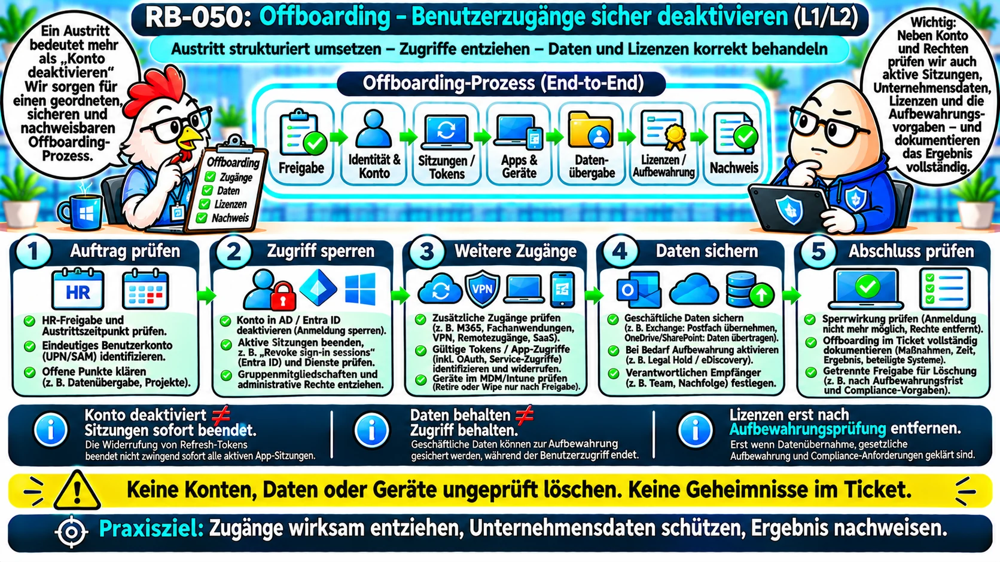

# RB-050 – Offboarding: Benutzerzugänge sicher deaktivieren (L1/L2)

**Projekt:** 50 Tickets – 50 typische IT-Supportfälle  
**Stand:** 23.11.2026 · **Paketversion:** 1.0  
**Systeme:** Microsoft Entra ID, Microsoft 365, Exchange Online, OneDrive/SharePoint, optional Active Directory DS (hybrid), Microsoft Intune, VPN/SaaS/Fachanwendungen  
**Status:** Herstellerquellen recherchiert; **noch nicht praktisch validiert**. Alle Personen, Konten, Daten und Ergebnisse in den Beispielen sind fiktiv. Kein produktiver Benutzer wurde verändert.



> **Merksatz:** **Konto gesperrt ≠ bestehende Anwendungssitzungen beendet ≠ alle externen Zugänge entzogen ≠ Unternehmensdaten rechtssicher gesichert.** Offboarding ist ein überprüfbarer Sicherheits- und Datenprozess.

---

## 1. Eingangsticket, Lernziel und Abgrenzung

**Fiktives Ticket `HR-OFF-1050`:** „Mitarbeiterin **Mira Seidel** verlässt das Unternehmen am 30.11.2026 um 17:00 Uhr. Unternehmenszugänge ab diesem Zeitpunkt sperren, Firmenlaptop und Mobilgerät zurücknehmen, Projektablage übergeben und Mail-/OneDrive-Daten gemäß Aufbewahrungsvorgabe behandeln. Genehmigt durch HR und fachlich verantwortliche Führungskraft.“ Konto `mira.seidel@firma.example` und Gerät `LT-050` sind **ausschließlich Beispieldaten**.

**Lernziel:** Den autorisierten Austritt technisch und organisatorisch so begleiten, dass neue Anmeldungen verhindert, laufende Sitzungen und sonstige Zugangswege nach dokumentiertem Verfahren entzogen, benötigte Unternehmensdaten geschützt und abschließend Nachweise gesichert werden.

**Abgrenzung:** RB-049 behandelte das Onboarding. RB-041 behandelt AD-Gruppenrechte; RB-044 BitLocker; RB-045 Intune; RB-031 Shared Mailbox. RB-050 integriert die Rücknahme aller Berechtigungen und den geordneten Datenlebenszyklus. L1 darf Auftrag, Status und Geräteannahme prüfen; das tatsächliche Sperren, die Sitzungswiderrufe, sensible Datenübergabe und Löschungen erfolgen nur durch dazu berechtigte Stellen.

**Kritische Voraussetzung:** Rechtliche Aufbewahrungs-/Löschpflichten und Datenschutz werden **nicht** durch dieses Muster festgelegt. HR, Datenschutz, Legal/Compliance, Ressourcen- und Geräteverantwortliche entscheiden nach Unternehmensrichtlinien. [Q1]

## 2. Prozessmodell: Sperren, Sitzungen, Daten und Nachweise

```text
Autorisierter HR-Austritt (eindeutige Person + Wirksamkeitszeitpunkt)
   → Identität & Quellsystem (Cloud-only / AD DS-hybrid) verifizieren
   → Zum genehmigten Zeitpunkt Konto sperren / erforderliche Zugangsdaten absichern
   → Entra-Sitzungen widerrufen + eigene SaaS-/VPN-/App-Sitzungen berücksichtigen
   → privilegierte Zugänge, Freigaben, Gruppen, Geräte, Integrationen erfassen
   → Datenübergabe, Retention, Holds, Postfach und OneDrive klären
   → Lizenzentzug und Kontolöschung ausschließlich nach eigener Freigabe
   → Sperrwirkung und Übergabe anhand geeigneter Nachweise verifizieren
```

**Keine starre Reihenfolge für jeden Sonderfall:** Eine geplante Beendigung, ein Sicherheitsvorfall und ein privates Mobilgerät erfordern unterschiedliche Entscheidungen. Die **zeitkritische Zugangssperrung** darf bei Gefahr nicht auf die vollständige Datenübergabe warten; umgekehrt dürfen **irreversible Lösch- und Lizenzschritte** nicht vor dem Daten-/Aufbewahrungscheck erfolgen. [Q1][Q2]

## 3. Autorisierung, Identität und genaues Zeitfenster

| Prüfpunktsgruppe | Beispiel / Erwartung | Zuständigkeit |
|---|---|---|
| Auftrag | HR-Referenz, genehmigtes Austrittsdatum und Uhrzeit samt Zeitzone | HR / Teamleitung |
| Betroffenes Identitätsobjekt | UPN, eindeutige Objekt-ID, ggf. `sAMAccountName`; keine Namensgleichheit raten | Identity / AD |
| Auslöser | Geplanter Austritt, fristloser Austritt, Kompromittierung oder Dienstwechsel | HR / Security |
| Bestandszugänge | AD/Entra, SaaS, VPN, Gerät, lokale Administrationskonten, Service-/API-Zugänge | Fach-/Systemeigner |
| Geschäftsdaten | Postfach, OneDrive, Teams, SharePoint, Geräte-/Projektdateien | Data Owner / Compliance |
| Besitz und Rückgabe | Notebook, Smartphone, Zutrittsmittel, Schlüssel, Token, Hardware | Asset / Security |
| Nachweis | Maßnahmen, Zeitpunkt, ausführende Rolle, Zielobjekt, Prüfergebnisse | Ticketverantwortliche |

**STOP:** Unklare oder widersprüchliche Identität, fehlende Genehmigung, unklarer Austrittszeitpunkt oder fehlender geeigneter Wiederherstellungs-/Eskalationsweg. Keine Kontoaktion allein auf Zuruf. Personaldetails nur in minimal erforderlichem Umfang speichern.

## 4. Cloud-only vs. Hybrid: Quelle der Identität bestimmen

**Cloud-only:** Konto ist primär in Microsoft Entra ID administriert. Der berechtigte Administrator sperrt die Anmeldung im Entra Admin Center und widerruft Sitzungen. Der Vorgang wird im Audit nachvollzogen. [Q2][Q4]

**Hybrid-AD:** Wird das Benutzerkonto aus dem lokalen AD DS synchronisiert, ist der lokale Verzeichniszustand ein wesentlicher Ausgangspunkt für die Sperrung. Microsoft beschreibt explizit das Deaktivieren des lokalen Kontos und ergänzende Maßnahmen in der Cloud. Synchronisation kann zeitlich verzögert sein. Nur den Cloudzustand oder nur `Get-ADUser` zu betrachten reicht daher nicht. [Q2]

**Diagnose:** Konto in AD gesperrt, Entra weiterhin `AccountEnabled=True` → Syncstatus und Übergangsphase prüfen/Identity eskalieren; Konto in Entra gesperrt, Zugriff auf separate Fachanwendung noch aktiv → lokale Anwendungssitzung beziehungsweise unabhängige Anmeldemethode untersuchen. Für alternative Identitätsquellen (separate lokale Fachkonten, B2B-Gastzugänge) eigene Offboarding-Schritte vorsehen.

## 5. Zugang blockieren und bestehende Sitzungen widerrufen

Microsoft dokumentiert sowohl das Blockieren neuer Anmeldungen als auch den **Widerruf von Refresh-Tokens und Entra-Sitzungsinformationen**. Ein Widerruf via `revokeSignInSessions` macht ältere Refresh-Tokens und bestimmte Browser-Sitzungsdaten ungültig; er beendet nicht verlässlich jede bereits aktive Anwendungssitzung eines Drittanbieters. Bereits ausgestellte Access Tokens können bis zu ihrem Ablauf oder einer von der Anwendung unterstützten kontinuierlichen Zugriffsbewertung gültig bleiben. [Q2][Q3][Q4]

**Kontrollfragen:**

1. Ist das richtige Objekt zum genehmigten Zeitpunkt gesperrt?
2. Wurden die vorgesehenen Entra-Sitzungen widerrufen und die Aktion protokolliert?
3. Sind vorhandene VPN-, SaaS-, RDS- und Anwendungssitzungen eigenständig kontrolliert?
4. Werden Funktionen mit eigenem Benutzerverzeichnis (z. B. Fachapp ohne SSO) separat entzogen?
5. Muss aufgrund eines Sicherheitsvorfalls zusätzlich Credential-Rotation, Geräteisolation oder Sicherheitseskalation erfolgen?

**Wichtig:** Kein Supportmitarbeiter versucht eine Prüfung durch Anmeldung mit dem Kennwort der ausgeschiedenen Person. Der Nachweis erfolgt über Accountstatus, Audit-/Sign-in-Logs, vertrauenswürdige Anwendungssignale und einen **genehmigten, datenschutzkonformen Negativtest**. „Logout aller Systeme sofort bestätigt“ ist ohne entsprechende Nachweise nicht zulässig.

## 6. Rollen, Gruppen und privilegierte Zugänge

Die Deaktivierung der Identität ist die zeitkritische Grundlage, aber die spätere Berechtigungsbereinigung bleibt ein eigener Prozess. Zu prüfen sind AD-/Entra-Gruppen, lokale Administratorrechte, Exchange-Delegationen, SharePoint-/Teams-Berechtigungen, VPN, RDP, SaaS-Gruppen, cloudbasierte Rollen und ggf. PIM-/Privileged-Access-Zuweisungen.

**Servicekonten und Shared Secrets:** Ein Benutzer kann Eigentümer oder Mitnutzer von API-Schlüsseln, SSH-Schlüsseln, Service-Accounts, Runbooks, Git-/CI-Deployments, Zertifikaten oder App-Registrierungen sein. Solche Abhängigkeiten nicht automatisch löschen: Erst Eigentum, Ersatzverantwortliche, Wirkbereich und Rotation nach genehmigtem Change prüfen. Ein ohne Prüfung entfernter Kontoinhaber kann produktive Integrationen unterbrechen.

**Minimalrechte:** Datenzugriff für Nachfolgepersonen nur mit gesonderter fachlicher Freigabe; keine pauschale Vollzugriffsrolle. Ein „Rechte entzogen“-Häkchen darf sich nicht nur auf Entra-Gruppen beziehen.

## 7. Geräte und Mobile Management: Retire ist nicht Wipe

**Firmenhardware:** Gerät eindeutig mit Inventarnummer und Benutzer zuordnen, Rückgabe und Zustand dokumentieren, Schutz von Unternehmensdaten priorisieren. Vor Neuverwendung nach genehmigter Prozessvorgabe verschlüsselte Datenträger, lokale Dateien, Zugangsartefakte, Zertifikate und Browserprofile beachten. BitLocker-Recovery-Schlüssel bleiben Geheimnisse.

**Private/BYOD-Geräte:** Die Intune-Aktion **Retire** dient typischerweise dazu, Unternehmensverwaltung und Unternehmensdaten zu entfernen, ohne grundsätzlich alle privaten Inhalte per Werksreset zu löschen. **Wipe** kann Daten auf dem Gerät durch einen Reset vollständig entfernen; Plattform und konkrete Optionen sind entscheidend. Die Auswahl ist eine Eigentums-, Datenschutz- und Freigabeentscheidung. [Q8][Q9][Q10]

**Offline-Geräte:** Eine Intune-Aktion, die nur *ausgelöst* oder *ausstehend* ist, ist kein Nachweis, dass sie tatsächlich auf dem Gerät ausgeführt wurde. Device-Action-Status und Gerätekontakt separat verifizieren; bei Diebstahl Verlust-/Incident-Prozess anwenden.

## 8. Exchange Online: Postfach erhalten oder löschen?

**Option A – regulär aufbewahren / übertragen:** Vor Änderung prüfen, ob Geschäftsvorgänge, Kalender, Aufbewahrungspflichten, eDiscovery/Holds oder Nachfolgerrechte zu berücksichtigen sind. Die Auswahl trifft der Daten-/Compliance-Verantwortliche, nicht der Support nach Bauchgefühl. [Q1][Q6]

**Option B – zum freigegebenen Postfach umwandeln:** Microsoft beschreibt die Konvertierung eines Benutzerpostfachs in eine Shared Mailbox. Vor Konvertierung braucht das Benutzerpostfach eine passende Lizenz. Danach kann bei Einhaltung der Bedingungen ggf. die Lizenz entfallen; die Shared Mailbox benötigt weiterhin ein zugehöriges Benutzerobjekt, das **nicht gelöscht** werden darf. Ohne eigene Lizenz liegt die Größenbeschränkung grundsätzlich bei 50 GB; Archive, Holds oder größere Postfächer können besondere Lizenzvoraussetzungen haben. **Anmeldung des zugrunde liegenden Benutzerobjekts muss weiterhin gesperrt bleiben.** [Q5][Q12]

**Option C – Aufbewahrung/Inaktives Postfach:** Wenn rechtliche oder organisatorische Aufbewahrung vorgeschrieben ist, vor einer Löschung die anwendbaren Purview-/Exchange-Retention-/Hold-Konfigurationen und Lizenzanforderungen durch Compliance prüfen lassen. Eine Kontolöschung ohne diese Prüfung kann Daten dauerhaft verlieren lassen.

**Entscheidungsstopp:** Mail-Weiterleitung oder Delegation darf erst mit Zustimmung des verantwortlichen Fachbereichs und datenschutzrechtlicher Prüfung eingerichtet werden; keine automatische Weiterleitung an private Adressen.

## 9. OneDrive, SharePoint, Teams und Datenübergabe

Für OneDrive beträgt die **Standard-Aufbewahrungszeit nach Löschung des Benutzerkontos** typischerweise 30 Tage; sie ist konfigurierbar und Retention Policies/Holds beeinflussen den Lebenszyklus. Wichtig: Der OneDrive-Löschprozess startet durch Kontolöschung, **nicht allein** durch Blockieren der Anmeldung oder Entfernen einer Lizenz. Seit den neueren Regeln können **unlizenzierte OneDrive-Konten nach 93 Tagen automatisch archiviert** werden; Kosten und Datenhaltung sind vorher zu klären. [Q6][Q7]

**Übergabeprozess:**

- Fachlich benannte und berechtigte Nachfolgeperson bestimmen, nicht pauschal Teamzugang erweitern.
- Projektrelevante Dateien kontrolliert in Team-/SharePoint-Ablagen übertragen und erforderliche Berechtigungen prüfen.
- Besitzerrollen für Teams, SharePoint-Websites, Planner, Power Automate und Fachanwendungen prüfen; fehlende verantwortliche Eigentümer ersetzen.
- Unternehmensrelevante Kalender, Termine, laufende Freigaben und Workflows nach Freigabe übergeben.
- Persönliche/private und rechtlich geschützte Daten nicht ungeprüft kopieren. Rechts- und Datenschutzvorgaben können engere Schranken setzen.

## 10. Lizenzen, Fristen und Konto-Lebenszyklus

**Lizenzentzug nicht als erste Sperrmaßnahme verwenden.** Zuerst autorisierte Kontosperrung und weitere Zugriffswege, dann Daten-/Retention-Entscheid, danach Lizenzverwaltung nach Freigabe. Microsoft beschreibt Folgen für Exchange-Daten und OneDrive; die konkret wirksamen Fristen hängen von Dienst, Konfiguration und Retention ab. [Q1][Q5][Q7]

| Entscheidung | Vorbedingung | Risiko, wenn übersprungen |
|---|---|---|
| Lizenz entziehen | Datenaufbewahrung, Mailbox-Typ, Archiv/Hold, Servicepläne geprüft | Postfachzugriff/Archivierung gefährdet |
| Benutzerkonto löschen | Alle geschäftlichen Abhängigkeiten, Shared Mailbox, Holds und Retention geklärt | Verlust von Daten und Ressourcenankern |
| Shared Mailbox weiterverwenden | Benutzerobjekt als Anker erhalten, Anmeldung blockiert, Zugriff genehmigt | Postfach oder Security-Zustand inkonsistent |
| Gerät zurücksetzen | Eigentum, Datensicherung, Gerätedaten, Freigabe, Status geprüft | Irreversibler lokaler Datenverlust |
| Projektzugriff übertragen | Rechteinhaber und schutzwürdige Daten geprüft | Unzulässige Datenweitergabe |

**Wichtig:** Mit einem abgeschlossenen zeitkritischen Sicherheits-Offboarding kann das Ticket einen **separaten Daten-/Lizenz-Folgeprozess** eröffnen; der Gesamtvorgang wird nicht fälschlich als „alles erledigt“ markiert. [Q1][Q11]

## 11. Lesende Diagnosebefehle und Statusprüfungen

Alle Beispiele sind **nur lesend** und benötigen die notwendigen Module, Rollen und freigegebenen Zugriffswege. Namen und Objekt-IDs sind fiktiv. `Connect-MgGraph` startet eine Anmeldung, **ändert aber keinen Benutzerzustand**.

```powershell
# Microsoft Graph PowerShell – Status, keine Kontenänderung
Connect-MgGraph -Scopes 'User.Read.All','Directory.Read.All'
$upn = 'mira.seidel@firma.example'
Get-MgUser -UserId $upn `
  -Property 'Id,DisplayName,UserPrincipalName,AccountEnabled,OnPremisesSyncEnabled' |
  Select-Object Id, DisplayName, UserPrincipalName, AccountEnabled, OnPremisesSyncEnabled

# Lizenzdetails lesen – keine Lizenzentfernung
Get-MgUserLicenseDetail -UserId $upn | Select-Object SkuPartNumber, ServicePlans
```

**Bei Hybrid-AD mit RSAT/lesender Berechtigung:**

```powershell
Import-Module ActiveDirectory
Get-ADUser -Identity 'mseidel' -Properties Enabled,UserPrincipalName,MemberOf |
  Select-Object SamAccountName,Enabled,UserPrincipalName,MemberOf
```

**Bei freigegebenem Exchange-Read-Zugriff:**

```powershell
# Bestehende EXO-Verbindung und geeignete Rolle vorausgesetzt
Get-Mailbox -Identity 'mira.seidel@firma.example' |
  Select-Object PrimarySmtpAddress,RecipientTypeDetails,ArchiveStatus,LitigationHoldEnabled
```

**Nicht Teil der lesenden Beispiele:** `Disable-ADAccount`, `Update-MgUser -AccountEnabled:$false`, `Revoke-MgUserSignInSession`, `Remove-MgUser`, `Set-MgUserLicense`, Intune `Wipe`/`Retire`. Diese sind **verändernde Maßnahmen** und ausschließlich nach Identitätsabgleich, Freigabe und Change-/Notfallverfahren auszuführen. Die konkreten Syntax- und Berechtigungsanforderungen der Herstellerdokumentation sind jeweils zu prüfen. [Q2][Q3]

## 12. Befund- und Entscheidungsmatrix

| Feststellung | Hypothese / nächster Nachweis | Verantwortlich |
|---|---|---|
| HR-Auftrag unklar | Auftrag, Person, Uhrzeit oder Sicherheitseinstufung offen | HR/Security → STOP |
| AD gesperrt, Entra noch aktiv | Hybrid-Sync/Quellsystem/Latenz prüfen | Identity/AD |
| Entra blockiert, App weiter erreichbar | Eigenständige Session/SSO-Protokoll/Refresh-Lebenszyklus prüfen | App Owner/Security |
| Benutzerkonto gesperrt, VPN bleibt aktiv | VPN-Session-/Gateway-Status separat prüfen | Network/Security |
| Mailbox soll bestehen bleiben | Shared-Mailbox-Lizenz/Anker/Retention prüfen | Exchange/Compliance |
| OneDrive soll übergeben werden | Dateninhaber, Retention, sichere Übergabe organisieren | Data Owner/SharePoint |
| Gerät offline, Retire ausstehend | Device-Action-Ergebnis fehlt; Asset-/Security-Folgeprozess | Endpoint/Security |
| Lizenzentzug vorgesehen, Hold ungeklärt | STOP, Compliance/Lizenzadministration entscheidet | Legal/Compliance |
| Änderungen abgeschlossen, Audit unklar | Account- und Anwendungsnachweise, Zeitstempel, Restzugriffe | L2/Identity/Security |

## 13. Fiktiver Praxisfall A – geplanter Austritt

**Ausgangslage:** Mira Seidel verlässt die fiktive Firma am 30.11.2026 um 17:00 Uhr. Ihr Postfach enthält noch laufende Projektkommunikation; OneDrive hat genehmigt zu übertragende Projektdokumente. Das Notebook `LT-050` wird zurückgegeben.

**Diagnosehypothesen:** (H1) HR-Termin und Accountzuordnung sind eindeutig. (H2) Cloud-only oder Hybrid ist geklärt. (H3) Berechtigungen auf Fachsysteme können nach Kontosperre separat weiterbestehen. (H4) Mail-/OneDrive-Aufbewahrung muss vor Lizenzentzug geklärt sein.

**Musterplan (nicht ausgeführt):** Termin/Person/Freigabe bestätigen → Besitz/Abhängigkeiten inventarisieren → zum Termin im maßgeblichen Verzeichnis sperren → Sitzungseinträge und externe Anwendungen nach Verfahren behandeln → Geräte entgegennehmen → freigegebenes Shared-Mailbox-/Datenübergabekonzept umsetzen → später Lizenz- und Löschentscheid gesondert freigeben → Audit-/Statusprüfungen protokollieren.

**Erwartete Nachweise:** Nach Ablauf der notwendigen Replikations-/Token-Zeiten blockierte Anmeldung, behandelte externe Zugänge, vollständige Assetliste, datenschutzkonforme Übergabe und offene Retention-Entscheide mit Owner/Termin. **Keine echte Maßnahme oder Validierung durchgeführt.**

## 14. Fiktiver Praxisfall B – sicherheitskritischer Sofortaustritt

**Ausgangslage:** Fiktiver Benutzer `paul.becker@firma.example` scheidet mit sofortiger Wirkung aus; ein Firmenlaptop ist nicht zurückgegeben, und eine SaaS-Anwendung nutzt eigene Sitzungen.

**Entscheidender Unterschied:** Hier hat **schnelle Zugriffssperrung und Incident-Eskalation** Vorrang; Datenlösch- und Lizenzarbeiten werden nicht improvisiert. Das verantwortliche Team verhindert neue Sign-ins, widerruft Entra-Sitzungen und koordiniert die getrennte SaaS-/VPN-Sessionsperre sowie Geräteschutz. Ein ggf. geplanter Intune-Wipe darf nicht blind auf ein möglicherweise privates Gerät angewendet werden.

**Testfrage:** Warum wäre „Entra `AccountEnabled=False`“ allein kein Abschlussnachweis? **Antwort:** Weil bereits bestehende App-Sitzungen, unabhängige Fachanmeldungen, API-Zugänge und offline gespeicherte Daten gesondert geprüft werden müssen. [Q2]

**Ticketabschluss:** Erst mit nachvollziehbaren Logs, ausdrücklich dokumentierten Risiken/Restzugängen und verantwortlichen Nacharbeiten. **Alle Ergebnisse sind rein fiktiv.**

## 15. Active Recall, Selbst-Erklärung und Transfer

**Ohne in die Unterlagen zu schauen beantworten:**

1. Welche drei Fragen brauchst du, bevor du eine Kontosperrung ausführst?
2. Warum ist eine Sperrung im lokalen AD nicht automatisch eine sofortige Sperrung jedes Cloud-Dienstes?
3. Warum beendet `revokeSignInSessions` nicht zwangsläufig ein bereits bestehendes SaaS-Session-Cookie?
4. Worin unterscheiden sich *Kontosperre*, *Sitzungswiderruf* und *Berechtigungsbereinigung*?
5. Warum darf die Lizenz nicht pauschal vor einer Mailbox-/Retention-Prüfung entfernt werden?
6. Welche Besonderheit gilt bei Umwandlung eines Benutzerpostfachs in eine Shared Mailbox?
7. Wie unterscheidest du Intune `Retire` von `Wipe` und wann musst du STOP sagen?
8. Welche zwei Frist- und Datenfragen prüfst du bei OneDrive?
9. Wie würdest du den wirksamen Zugriffsverlust belegen, ohne dich als die Person anzumelden?
10. Welchen Unterschied macht ein geplanter Austritt zu einem Security-Sofortaustritt?

**Self-Explanation:** Erkläre in maximal 90 Sekunden den Unterschied zwischen *Zugriffsblockierung* und *Datenaufbewahrung*. Ein fachlich belastbarer Vortrag nennt mindestens **zwei unabhängige Sitzungstypen** und eine **Lösch-/Lizenzgefahr**.

**Transfertraining:** Ein externer Gast besitzt einen SharePoint-Zugang und eine eigenständige SaaS-Session, aber kein lokales AD-Konto. Welche Teile des Standard-Offboardings bleiben gültig, und welche müssen durch separate Zugangsprüfungen ersetzt werden? Begründe die Reihenfolge.

**Späterer Laborschritt:** Ausschließlich mit Testkonten im eigenen Tenant/Lab: (1) genehmigte Sollkontrollen, (2) lesende Audit- und Statusabfragen, (3) bewusst angelegte fiktive Berechtigungspfade, (4) kontrollierte Sperrübung mit Rückfallplan, (5) Wirksamkeitsnachweis; keine echten Nutzerdaten. Runbook anschließend selbst neu verfassen; Wiederholung nach etwa 7 und 21 Tagen.

---

## Herstellerquellen und Recherchegrundlage (Microsoft Learn; recherchiert am 23.11.2026)

- [Q1] Microsoft 365 – Remove a former employee (Prozessüberblick): https://learn.microsoft.com/en-us/microsoft-365/admin/add-users/remove-former-employee
- [Q2] Microsoft Entra – Revoke user access in an emergency: https://learn.microsoft.com/en-us/entra/identity/users/users-revoke-access
- [Q3] Microsoft Graph v1.0 – user: revokeSignInSessions: https://learn.microsoft.com/en-us/graph/api/user-revokesigninsessions?view=graph-rest-1.0
- [Q4] Microsoft 365 – Step 1: Prevent user sign-in: https://learn.microsoft.com/en-us/microsoft-365/admin/add-users/remove-former-employee-step-1
- [Q5] Microsoft 365 – Convert a user mailbox to a shared mailbox: https://learn.microsoft.com/en-us/microsoft-365/admin/email/convert-user-mailbox-to-shared-mailbox
- [Q6] Microsoft 365 – Step 5: Give another employee access to OneDrive/Outlook: https://learn.microsoft.com/en-us/microsoft-365/admin/add-users/remove-former-employee-step-5
- [Q7] SharePoint/OneDrive – Retention and deletion: https://learn.microsoft.com/en-us/sharepoint/retention-and-deletion
- [Q8] Microsoft Intune – Remote device actions: https://learn.microsoft.com/en-us/intune/device-management/actions/
- [Q9] Microsoft Intune – Retire: https://learn.microsoft.com/en-us/intune/device-management/actions/retire
- [Q10] Microsoft Intune – Wipe: https://learn.microsoft.com/en-us/intune/device-management/actions/wipe
- [Q11] Microsoft 365 – Step 7: Delete a former employee’s user account: https://learn.microsoft.com/en-us/microsoft-365/admin/add-users/remove-former-employee-step-7
- [Q12] Microsoft 365 – About shared mailboxes: https://learn.microsoft.com/en-us/microsoft-365/admin/email/about-shared-mailboxes
- [Q13] Microsoft Entra – Disable on-prem AD account / cloud account and revoke sessions: siehe [Q2]
- [Q14] Microsoft 365 – Assign or unassign licenses: https://learn.microsoft.com/en-us/microsoft-365/admin/manage/assign-licenses-to-users

**Einordnung:** Die Quellen dokumentieren Herstellerfunktionen und technische Einschränkungen. Die Reihenfolge im Runbook ist eine **abgeleitete, sicherheitsorientierte Musterprozesslogik**, kein universeller Rechts- oder Tenant-Standard. Aufbewahrungspflichten, Rollen und Löschfristen sind im konkreten Unternehmen verbindlich abzuklären.

## Projekt- und Veröffentlichungsstatus

**Recherche und Dokumentation abgeschlossen; praktische Ausführung, Fehlerreproduktion und dauerhafter Wissenstransfer nicht nachgewiesen.** Dieses Paket bietet eine Lern- und Prüfbasis, keine universell freigegebene produktive Ausführungsanweisung.

*Eigene Konzeption, KI-gestützte Visualisierung mit ChatGPT.*
